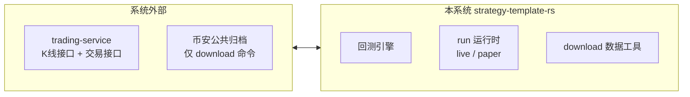

# 01 · 需求分析文档（strategy-template-rs）

> ## ⚠️ 状态：设计时快照（2026-11-25 收口加注，不再随代码更新）
>
> 本包是设计阶段的需求/架构/接口快照，仅用于理解设计意图。策略清单、行号与行数均已过期：
> 现行契约见 `docs/strategy/`，策略实现以 `crates/strategies/src/`（template_trend / template_xsec_ls）为准。

<!-- refcheck:coords=off -->

> 版本：v1.5（2026-11-13 **重构后全量重读**：运行时模块 `engine::xsec`→`engine::strategy`（commit `9aaf19e`，类型 `Xsec*`→`Strategy*`）；新增策略基类 `StrategyBase`/`StrategyLogic`；新增总仓/子仓仓位模型与资金上限（`CloseMaster`、`MasterContext`、`max_total_notional`、`sizing.max_position_pct`）；FR-1 全表、FR-4.4/4.7、FR-7.5、FR-8.1 与全部锚点按实况重锚；测试数 626→695（另 95 个 `#[tokio::test]`）。v1.4（2026-11-12 **统一策略接口复核**：旧 `Strategy` trait/Ctx/Legacy 分派已删除（commit `8115b92`），全仓统一为 `CrossSectionalStrategyPort` + 注册表工厂制；策略动作枚举、冷却判定、桥接分流等引用逐处重锚；测试数 460→626。v1.3（2026-11-09 订正：D1b/D2 后 `data/src/feed.rs` 与硬编码 CTP 时段表模块已删除，本文对已删实现的引用改为 engine SPI 实锚点；同轮再订正 v1.0 存量引用失真——歧义裸名 / 越界区间 / 错位行号，逐处重测落点；**v1.3 断：§配置契约的「缺失 fail-fast」按实测拆成两层——整块缺失确实 fail-fast，子块缺失静默降级，live 下为"永不下单且零信号"，缺陷登记 retirement §7 风险 8**）  
> 产出方式：**通读仓库源码后的逆向需求还原**（正文中的 `文件:行` 均为本次核对过的真实落点）。  
> 配套文档：[02-架构设计](02-架构设计.md)、[03-详细设计](03-详细设计.md)、[04-trading-service接口设计](04-trading-service接口设计.md)、[05-策略架构设计](05-策略架构设计.md)。

---

## 1. 项目背景与定位

### 1.1 一句话定位

**Rust 版 CTA 策略开发脚手架（模板仓库）**：clone 本仓库后 10 分钟内跑通一次回测，  
照着内置 example 复制即可写出第一个 CTA 策略；同一套策略代码可平滑切换  
回测（backtest）/ 纸上模拟（paper_trading）/ 实盘（live）三种运行模式。

### 1.2 业务目标（北极星）

| #  | 目标      | 可度量验收                                                                                           |
| -- | ------- | ----------------------------------------------------------------------------------------------- |
| G1 | 10 分钟上手 | `cargo test --workspace` 通过；`cargo run -p strategy-app -- backtest …` 直接出报告                     |
| G2 | 新增策略零侵入 | 复制 example 文件 + 改逻辑 + `register_strategy!` 自注册，**不修改任何其他文件**（`crates/strategies/build.rs` 自动发现） |
| G3 | 回测 ≡ 实盘 | 同一策略端口（`CrossSectionalStrategyPort`）、同一信号状态机、同一信号/仓位同步内核；`crates/app/tests/backtest_paper_parity.rs` 自动验收          |
| G4 | 不直连交易所  | 交易与行情链路只经 **trading-service**（含 K线接口；配置 `services:` 节，缺失 fail-fast）                             |
| G5 | 过程可审计   | 信号 8 态全留痕（含 Rejected/Failed），崩溃可从日快照恢复并完成对账                                                     |

### 1.3 系统边界



> kline-service 已退役并入 trading-service：K线历史/实时成为其一个接口（04 §6）。

- **在边界内**：策略执行、信号生命周期、仓位管理、统一持久化、回测撮合（paper/回测）、报表。
- **在边界外**：行情生产、订单路由到交易所、真实成交撮合、资金/账户体系、换月拼接（主连由上游产出）。
- 明确排除：`download` 子命令的公共归档下载**不在交易链路**（`crates/data/src/archive_download.rs`）。

---

## 2. 干系人与使用场景

| 角色      | 核心诉求            | 对应能力                                                          |
| ------- | --------------- | ------------------------------------------------------------- |
| 策略研究员   | 快速写策略、跑回测、看报表   | 统一策略端口、example 教学、backtest、result.json/PNG            |
| 交易运维    | 安全上实盘、可恢复、可观测   | mode=live/paper 分流、submit 双保险、Store 恢复+对账、inspect 工具          |
| 框架贡献者   | 边界清晰、可测试、可扩展交易所 | 10 crate 分层、engine SPI（新增交易所只实现 Exchange 规则）、695 个 #[test] 单测（另 95 个 tokio 异步测试） |
| 下游数据消费者 | 稳定的 CSV 契约      | 列序锁定的 signal.csv / exchange_orders.csv / history_positions    |


---

## 3. 功能需求（FR）

### FR-1 策略开发框架

| 编号     | 需求                                                                                     | 代码落点                                                      |
| ------ | -------------------------------------------------------------------------------------- | --------------------------------------------------------- |
| FR-1.1 | 策略实现统一端口 `CrossSectionalStrategyPort`（通用别名 `StrategyPort`）：`strategy_type()` / `timeframes()` / `on_cross_section_bars()`；运行在 `engine::strategy` 层 | `crates/engine/src/strategy/port.rs:155-170`（别名 `:173`） |
| FR-1.2 | 决策输入只暴露**已闭合** K 线序列（`InstrumentSnapshot.closed`）与快照，类型层面杜绝未来函数                             | `engine/src/strategy/port.rs:39-58`（`:56-57` 红线）      |
| FR-1.3 | 端口无时钟、不提供 `now()`；信号时间戳一律取 K 线时间                                                            | `engine/src/strategy/port.rs:56`（红线）                  |
| FR-1.4 | 持仓状态由引擎注入：`InstrumentSnapshot.position`（止损价/峰值/exit_active）+ `PortfolioContext`（子仓 `sub_positions`、总仓 `master`、`max_total_notional`） | `engine/src/strategy/port.rs:39-58,62-78`（总仓 `:31`）    |
| FR-1.5 | 策略动作枚举 `InstrumentAction`：Open / Close / Reverse / Adjust / **CloseMaster** / UpdateStop / UpdateExit / Hold（派发前按 `namespaced_key` 升序，`CloseMaster` 优先处理） | `engine/src/strategy/port.rs:82-131`（排序 `:138-148`）    |
| FR-1.6 | 策略文件级自注册（`register_strategy!`），build.rs 扫描 `src/*.rs` 自动装配注册表                          | `crates/strategies/build.rs`、`strategies/src/registry.rs` |
| FR-1.7 | 策略基类：`StrategyLogic` 三钩子（`score` 打分 / `entry_allowed` 入场过滤 / `stop` 止损定义）+ `StrategyBase` 骨架，单标与横截面两条路径由基类按快照数自动分派 | `strategies/src/common/mod.rs:20-43,104-293`              |
| FR-1.8 | 教学与示例策略：example_dual_ma、example_mtf_trend（教学）；xsec_template（双路径模板）、xsec_momentum、btc_xsec_trend、eth_xsec_reversion、futures_energy_chem（清单见 05 §10） | `strategies/src/*.rs`                                    |
| FR-1.9 | 仓位模型：策略账本 `StrategyPortfolio` → 总仓 `MasterPosition`（3 态）→ 标的子仓 `SubPosition`（5 态），全部落 Store 可恢复；策略不自持仓位状态 | `engine/src/strategy/model.rs:168-279`、`runner.rs:388-530`、`docs/strategy/POSITION_MODEL.md` |
| FR-1.10 | 通用指标库：SuperTrend、SAR 兼容层、效率比、talib 封装                                                  | `crates/indicators/`                                      |

### FR-2 行情接入（trading-service K线接口；原 kline-service 已并入）

| 编号     | 需求                                                                                                                                                                                           | 代码落点                                                                                                                                                                     |
| ------ | -------------------------------------------------------------------------------------------------------------------------------------------------------------------------------------------- | ------------------------------------------------------------------------------------------------------------------------------------------------------------------------ |
| FR-2.1 | 只消费 **1m** K 线；大周期由 engine 聚合器增量聚合（仅已闭合桶进入 `closed` 序列，残缺首桶丢弃）                                                                                                                               | `engine/src/core/aggregation.rs:195`（`AggregationState`）、`:234`（`on_closed_1m`）、`:223`（`closed`）；策略端口 `:35`（`BarAggregationPolicy`）                                      |
| FR-2.2 | 历史回填（`get_klines` 帧）+ 实时订阅（`subscribe_kline`）统一端口 `KlineClient`：`backfill` / `attach`（端口不变，仅适配层换对端）                                                                                          | `data/src/client.rs:45-58`、04 §6                                                                                                                                         |
| FR-2.3 | WS 断线指数退避重连（1→2→4…≤`reconnect_backoff_max_secs`），重连后发 `Reconnected` 事件并触发 `get_klines` 补缺                                                                                                    | 04 §6.5                                                                                                                                                                  |
| FR-2.4 | 闭合 K 线驱动策略且不可丢（broadcast 落后 `Lagged(n)` 自愈回补）；`KlineEvent::Tick` 为端口保留形——live 推送只含定稿 bar（线协议无 `is_final` 字段，未闭合快照不存在于此路径）                                                                    | `data/src/client.rs:18-27`、`app/src/ts_kline.rs`                                                                                                                         |
| FR-2.5 | 聚合口径为 **per-exchange 策略对象**（不再有 `fixed`/`ctp` 二值枚举）：`UtcGridPolicy`（7×24 UTC 网格）/ `SessionWindowPolicy`（时段窗口内切分钟网格，绝不跨午休与隔夜）；窗口来自 `config/contracts.yaml` 的 `session_opens`/`session_closes` | `engine/src/core/aggregation.rs:73`、`:113`；选择点 `engine/src/exchanges/binance/mod.rs:102-103`、`engine/src/exchanges/ctp/mod.rs:219-220`；时段源 `config/contracts.yaml:44,46` |
| FR-2.6 | 期货形态：交易日窗口/节假日、休市缺口不算断点、合约码/主连消费                                                                                                                                                             | `engine/src/core/session.rs`（时段/节假日窗口）、`engine/src/core/contract.rs`（`ctp_trading_day`）、04 §6.6                                                                          |
| FR-2.7 | 本地 CSV 数据存储（10 列命名空间布局），live 预热 warmup                                                                                                                                                       | `data/src/csv_store.rs:1-10`、`data/src/warmup.rs`                                                                                                                        |
| FR-2.8 | `download` 命令：币安公共归档离线导入 1m CSV（不在交易链路）                                                                                                                                                      | `data/src/archive_download.rs`                                                                                                                                           |

### FR-3 回测引擎

| 编号     | 需求                                                                                                                                                  | 代码落点                                                                                                                                                                                                        |
| ------ | --------------------------------------------------------------------------------------------------------------------------------------------------- | ----------------------------------------------------------------------------------------------------------------------------------------------------------------------------------------------------------- |
| FR-3.1 | 1m CSV 逐根回放，与实盘**共用同一段主循环**：`ExchangeRunner::on_event(MarketEvent::Bar)`；回测差异只在 `BarEventSource`（喂 `VecEventSource`/CSV）与 `ExecutionPort`（本地撮合）两个端口 | `engine/src/core/runtime.rs:131`（`on_event`）、`:30`（`ExchangeRunner`）、`core/bar.rs:185`（`MarketEvent`）、`:203`（`BarEventSource`）；回测装配 `app/src/spi_backtest.rs:313`（`run_from_spec`）、`:37`（`candles_to_bars`） |
| FR-3.2 | 确定性：同参数重跑逐字节复现；Store 时钟注入 `CandleClock`（K 线 open_time）                                                                                              | `store/src/lib.rs:31-33` 红线                                                                                                                                                                                 |
| FR-3.3 | 国内期货撮合：整数手、保证金约束、名义敞口约束、开/平/平今手续费、乘数盈亏                                                                                                              | `core/src/contract.rs`、`broker/src/backtest.rs`                                                                                                                                                             |
| FR-3.4 | 交易时段约束：开盘后/收盘前 N 分钟禁开平反手，动作挂起到下一可交易 1m（止损价更新即时生效）                                                                                                   | `config/contracts.yaml` 语义、`engine` session 规则                                                                                                                                                              |
| FR-3.5 | 账户初始权益 `initial_cash`（缺省 5000）、`leverage` 名义敞口上限                                                                                                    | `config` per-symbol、`app/src/bootstrap.rs:78-89`                                                                                                                                                            |
| FR-3.6 | 报告产出：`backtest_result.json`、`backtest_report.txt`、`backtest_analysis_report.md`、`charts/*.png`                                                      | `app/src/report.rs`、`report_charts.rs`                                                                                                                                                                      |

### FR-4 运行时（run：live / paper）

| 编号     | 需求                                                                                                                                                                                                               | 代码落点                                                                                                                                                                                                 |
| ------ | ---------------------------------------------------------------------------------------------------------------------------------------------------------------------------------------------------------------- | ---------------------------------------------------------------------------------------------------------------------------------------------------------------------------------------------------- |
| FR-4.1 | per-symbol 运行模式 `mode: live / paper_trading`，启动时打印 mode 一览表肉眼核对                                                                                                                                                  | `app/src/bootstrap.rs:50-58`                                                                                                                                                                         |
| FR-4.2 | live → `TradingGateway`（trading-service WS 真单通道）；paper → `BacktestOrderClient`（本地撮合，不经交易 WS）                                                                                                                     | `app/src/bootstrap.rs:60-76`                                                                                                                                                                         |
| FR-4.3 | 运行实例命名 `{strategy}_{TF}_3_{venue_key}_{MODE}`（信号/仓位共享表的过滤键口径）                                                                                                                                                    | `app/src/bootstrap.rs:33-47`                                                                                                                                                                         |
| FR-4.4 | 每根闭合 1m 固定顺序（`ExchangeRunner::on_bar`）：撮合侧 `execution.on_bar` → 交易日切换/极值更新 `pos_sync.on_price` → 聚合出 newly + 决策门控 → 统一回调 `on_cross_section_bars`（单标经 `PortStrategyBridge` 包成恰一元素快照）→ InstrumentAction 分流（策略静默时风控兜底 `check_fallback`）→ 成交入账与账本镜像；统一端口策略另由 `CrossSectionalRunnerGroup::flush_round` 跑同构六步（L3→L2→策略→两阶段调仓→L1，见 05 §7） | `engine/src/core/runtime.rs:186`（`on_bar`）、`:213`（日界）、`:222`（`on_price`）、`:226`（`aggregate_and_gate`）、`:266`（`dispatch_actions`）、`:279`（兜底）、`:319`（`sync_fills_and_book`）；桥接 `bridge.rs:117-260`；横截面 `strategy/runner.rs:1084` |
| FR-4.5 | 外部服务不可达时连接 task 内退避重连；`services` 未配置 fail-fast                                                                                                                                                                   | `app/src/bootstrap.rs:18-19`                                                                                                                                                                         |
| FR-4.6 | Ctrl-C 优雅关停：排空 → Store flush → 退出                                                                                                                                                                                | `app/src/bootstrap.rs:10-11`                                                                                                                                                                         |
| FR-4.7 | 策略 panic 监督重建（整代重来：重新装配内核 + 重新订阅 + 启动对账），不拖垮其他实例；每实例一条专用 OS 线程 + 线程内 current-thread runtime（统一端口组 panic 则整组 `Paused`，不自动重开）                                                                                                                      | `app/src/strategy_live_actor.rs:96`（`spawn_strategy_live`）、线程模型见该文件头 `:3-6`；横截面 `strategy/runner.rs:1295-1303` |

### FR-5 信号管理（SignalManager 同步内核）

| 编号     | 需求                                                                                                                                                     | 代码落点                                                           |
| ------ | ------------------------------------------------------------------------------------------------------------------------------------------------------ | -------------------------------------------------------------- |
| FR-5.1 | 确定性 signal_id：`sig_ + sha256({策略类型}_{venue_key}_{1m时间戳ms}_{信号类型})[..16hex]`；子仓位另有 `sub_` 命名空间（见 05 §信号 ID）                    | `core/src/signal.rs:92-109`                                    |
| FR-5.2 | 信号 8 态生命周期：Created→Validated→Submitted→Accepted→Filled；Rejected / Failed（可重试）/ Cancelled                                                               | `core/src/lifecycle.rs`                                        |
| FR-5.3 | 信号即事实：Created 即入 Store 落盘，Rejected/Failed 同样可审计，不删除                                                                                                    | `signals/src/manager.rs:1-11`                                  |
| FR-5.4 | 参数校验（`SignalValidator`，可替换）+ 在途去重（Open 全局、Close 按 position_id）                                                                                         | `signals/src/manager.rs:73-105`、`receive_intent_prepare:336`   |
| FR-5.5 | 提交失败分类 `Rejected`（永久）/ `Retryable`（可重试）；重试指数退避（**最多提交 3 次含首发**，即最多重试 2 次；base 1s 翻倍，上限 60s；仅 live，回测不重试）                                               | `signals/src/manager.rs:52-88`（RetryPolicy）、`gateway.rs:33-44` |
| FR-5.6 | 订单回报落账：`status/exchange_order_id/filled_price/filled_quantity`（成交量保留原始字面量）                                                                             | `signals/src/manager.rs:403+`                                  |
| FR-5.7 | 仅 FILLED 生成仓位；PARTIAL 只累积不入仓；撤单带累计成交产出残仓 FillEvent                                                                                                     | 订单状态机 §1.2 口径                                                  |
| FR-5.8 | 重启恢复：`recover()` 产出 Resubmit / Query 两种对账动作（Created/Validated 且 price>0 → 重提；Submitted/Accepted 且有 order_id → 先查后发；Failed 仅 Close 且非拒单可重提），幂等重提 + 先查后发 | `signals/src/manager.rs:707-770`、`RecoveryAction:179`          |
| FR-5.9 | 对外报表 `signals/{name}/signal.csv`（14 列，列序锁定）                                                                                                            | `signals/src/writer.rs:10-26`                                  |

### FR-6 订单通道与路由

| 编号     | 需求                                                                     | 代码落点                            |
| ------ | ---------------------------------------------------------------------- | ------------------------------- |
| FR-6.1 | 订单 7 态状态机：created/sent/ack/partially_filled/filled/canceled/rejected   | `core/src/order.rs:12-47`       |
| FR-6.2 | 双端口：同步 `OrderGateway`（回测 inline 成交）与异步 `AsyncOrderGateway`（live await） | `signals/src/gateway.rs:126+`   |
| FR-6.3 | 部分成交累积器 `OrderProgress`（加权均价、容差 1e-9 判满）                               | `core/src/order.rs:52-83`       |
| FR-6.4 | T7 订单转发器：`OrderRouter` 按 order_id 精确路由到 owner Actor；未知单按策略身份限定广播       | `app/src/order_router.rs`       |
| FR-6.5 | 订单回执旁路 `exchange_orders.csv`（12 列，列序锁定）                                | `broker/src/order_log.rs:74-87` |

### FR-7 仓位管理（PositionManager，仓位唯一写者）

| 编号     | 需求                                                                                                                                      | 代码落点                                                 |
| ------ | --------------------------------------------------------------------------------------------------------------------------------------- | ---------------------------------------------------- |
| FR-7.1 | 开/加/减/平四类成交入账（`apply_open_fill` / `apply_add_fill` / `apply_close_fill`）                                                                | `positions/src/manager.rs:279/355/447`               |
| FR-7.2 | 持仓行跟踪：入场价、峰值、max/min 盈亏%、总仓/剩余可平量（`remaining_size_raw` 精确字面量递减）                                                                         | `positions/src/state.rs:45-95`、`subtract_qty_raw:34` |
| FR-7.3 | 止损价更新持久化（方向约束"只朝有利"由**策略层**保证，PositionManager 不校验）与 SAR 触及制离场状态（`exit_active/exit_price`，重启后继续保护）                                       | `positions/src/manager.rs:545/586`                   |
| FR-7.4 | 平仓流程：写 history_position（部分平仓先写 partial_close 进度行，最终平仓**整行替换**为最终记录）+ 旁路 24 列历史 CSV（仅最终平仓写）；软删 position、stop 置 cancelled；止损平仓 upsert 冷却日 | `positions/src/manager.rs:447` 起                     |
| FR-7.5 | 止损冷却：当日止损后策略当日不再开仓（`InstrumentSnapshot::in_stop_loss_cooldown` 按 bar_end 日历日判定）                                                                                                  | `engine/src/strategy/port.rs:177-186`                |
| FR-7.6 | 远程对账：每分钟 `get_positions`，远程无匹配仓 → 本地 `external_close`（fail-open）                                                                        | `positions/src/manager.rs:702`                       |
| FR-7.7 | 国内期货：加减仓纯函数（加权均价/已实现盈亏）按乘数结算                                                                                                            | `core/src/position_math.rs`                          |

### FR-8 统一持久化（Store）

| 编号     | 需求                                                                                                                   | 代码落点                                 |
| ------ | -------------------------------------------------------------------------------------------------------------------- | ------------------------------------ |
| FR-8.1 | 10 类 model 统一门面：7 类业务（signal / position / stop / cooldown / history_position / trade / equity）+ 3 类策略账本（sub_position / master_position / strategy_portfolio）                               | 见 03 §2.3 数据字典                       |
| FR-8.2 | 内存总表（RwLock 索引 + 每行子锁）+ scope 二级索引；锁不跨 await                                                                         | `store/src/lib.rs:107-120`           |
| FR-8.3 | 日快照 `{base}/{YYYYMMDD}/{model}.csv`：5 列通用格式，同日整文件原子覆盖（tmp+fsync+rename）                                              | `store/src/persist.rs:172-202`       |
| FR-8.4 | 恢复双模（`state_prune_terminal` 默认 true）：prune 模式 recover 只读最新日文件、终态/软删行跨日物理裁剪防复活；兼容模式升序读全部日文件按 updated_at_ms 去重、软删行不入活表 | `store/src/lib.rs:289-420`、`596-640` |
| FR-8.5 | flush 一致性补偿：`.flush_marker`（行数 + id CRC32），恢复时检测跨表不一致告警                                                              | `persist.rs:260-268`                 |
| FR-8.6 | 时钟注入：回测 CandleClock / live EpochClock（毫秒）                                                                            | `store/src/lib.rs:31-42`             |
| FR-8.7 | `inspect` 子命令展开机器格式快照（只读，不改快照语义）                                                                                     | `app/src/inspect.rs`                 |


### FR-9 风控

| 编号 | 需求 | 代码落点 |
|------|------|---------|
| FR-9.1 | 统一风控兜底规则（回测与 live 同源配置 `risk` 节） | `core/src/risk.rs` |
| FR-9.2 | 保证金/名义敞口双上限、只开整数手（期货） | `core/src/contract.rs`、回测撮合 |
| FR-9.3 | 时段禁交易窗口（开后/闭前 N 分钟） | contracts.yaml session 字段 |

### FR-10 安全

| 编号 | 需求 | 代码落点 |
|------|------|---------|
| FR-10.1 | 默认不发真单：`submit_enabled=false`；paper 模式装配层强制 false（双保险） | `trading_service.rs:183-192`、`TradingGateway.allow_submit` |
| FR-10.2 | 平仓 quantity 必须逐字等于开仓 FILLED 回报量（`size_raw`），无仓位/无精确量 fail-closed 不发帧 | `wire.rs:34-38` |
| FR-10.3 | WS 握手鉴权：HMAC-SHA256(SECRET_KEY, strategy_name+nonce)，密钥不上线、不入日志 | `broker/src/auth.rs` |
| FR-10.4 | 密钥不入库：`strategy_secret` 占位 + 环境变量 `STRATEGY_SECRET` 覆盖 | `config/_global.example.yaml:14-16` |
| FR-10.5 | `default_quantity<=0` 且信号未带数量时本地拒绝，防误下零数量真单 | 契约 §6 |

---

## 4. 非功能需求（NFR）

| 编号 | 类别 | 需求 | 落点/度量 |
|------|------|------|----------|
| NFR-1 | 确定性 | signal_id、信号时间、回测产物只取 K 线时间；同输入同输出 | 红线表（design.md §0）；backtest 复现测试 |
| NFR-2 | 可靠性 | WS 断线自动重连（指数退避）、重连先查后发对账、重发幂等（同 signal_id） | `connection_loop:471`、`RecoveryAction` |
| NFR-3 | 可恢复性 | 进程崩溃后从日快照恢复到最近 flush 点并完成对账；坏行 fail-open 跳过不毒死全表 | `persist.rs:214-235` |
| NFR-4 | 性能 | 单实例单 task 串行决策（单写者无锁竞争）；Store 行级子锁不跨 await；K 线广播扇出慢消费者不拖垮他人 | `manager.rs` 锁纪律注释 |
| NFR-5 | 可观测 | tracing 结构化日志；信号/订单全生命周期留痕；mode 一览表；inspect 展开工具 | 全仓 tracing |
| NFR-6 | 可扩展 | 新增交易所只实现 engine 的 Exchange 规则对象；新增策略只加文件 | `engine/src/lib.rs:30-38` |
| NFR-7 | 兼容性 | 帧/CSV 契约前向兼容（旧帧逐字节不变、CSV 列序锁定、JSON payload 只追加字段） | `wire.rs:211-218` 测试钉死 |
| NFR-8 | 门禁 | `cargo test --workspace` + `cargo clippy --all-targets -- -D warnings` 全绿 | CI/交付标准 |

---

## 5. 数据与外部接口需求（摘要）

| 外部系统 | 方向 | 协议 | 详细设计 |
|---------|------|------|---------|
| trading-service（交易接口） | 出入 | WebSocket JSON（下单/查询/回报） | **[04-trading-service接口设计](04-trading-service接口设计.md)** |
| trading-service（**K线接口**） | 入 | WebSocket JSON（订阅/回填/推送，同端点同鉴权） | 04 §6（原 kline-service 已并入） |
| 币安公共归档 | 入 | HTTPS zip（仅 download） | 不在交易链路 |
| 本地文件系统 | 出入 | CSV/JSON/PNG | [03-详细设计 §持久化](03-详细设计.md) |

配置契约（分两层，2026-11-09 实测裁定；原写「缺失 fail-fast」过于笼统，已按行为拆开）：

> **层一：`services:` 整块缺失 ⇒ 确实 fail-fast。** `run` 启动即退出，
> `exit=1`，文案「run 需要配置文件中的 services.trading 端点（K 线与交易共用同一连接；
> klines-service 已退役，services.kline 节须删除）」
> （`app/src/main.rs:516`）。实测命令：
> `strategy-rs run --config <无 services 的文件>`。
> ⚠️ 复现陷阱：加载器的全局回落按 **cwd** 找 `config/_global.yaml`——在仓库根内跑
> 会被真实全局配置静默合并，测不出这一层（我第一轮就测错了这个）。
>
> **层二：`services:` 在、子块（`trading:`）缺 ⇒ 不 fail-fast，且静默降级。**
> `TradingServiceCfg` 带 `#[serde(default)]` 与占位 `Default` impl
> （`app/src/config.rs:188-200`：`ws_url = ws://127.0.0.1:9100/ws`、
> `submit_enabled = false`），缺失时静默取占位值；`KlineServiceCfg` 同理
> （`:159-170` 占位端点，注释自陈"连接失败暴露未配置状态"）。
> **实测后果（live 模式）**：`run --mode live` + 无 `trading:` 子块 ⇒ 进程正常启动、
> 打印「运行实例 mode 一览：… → live」与「订单网关已启动」，**全程无任何缺配置
> 告警或错误**，而 `submit_enabled` 已被静默置 `false` 并原样传给网关
> （`bootstrap.rs:124`）⇒ **一个永不下单的 live 实例，零信号**。
> **已处置（同日，用户选方案 1+2）**：live 命中占位交易端点 ⇒ **拒绝启动**，文案点名
> `services.trading` 并指路熔断的正确写法；paper/smoking 命中 ⇒ 启动 `warn!` 明示
> 「不会产生任何真实下单」。判据 `TradingServiceCfg::is_unconfigured` **只看端点、
> 不看 `submit_enabled`**，故 RUNBOOK §2.1 的紧急熔断（真实端点 + `false`）不被误杀。
> 行为由 8 个专档钉死：`tests/run_config_guards.rs` 4 个 CLI 级 + `config.rs` 内
> 4 个单元级（占位常量与 `Default` 同源、真实端点≠未配置、熔断≠未配置、
> 占位+`false` 仍算未配置）。

```yaml
services:
  trading: { ws_url, request_timeout_ms, submit_enabled, reconnect_backoff_max_secs, strategy_secret, exchange, account }
```

> kline 并入迁移（04 §11）：`services.kline`（`backfill_url` / `ws_url` / `market` / `source`）**已整节退役**（tombstone：解析放行、`run` 检测到即拒启给迁移指引，`app/src/config.rs:176-188` `check_kline_retired`）——
> 订阅走 `subscribe_kline`、回填走 `get_klines` 帧；**无 `market` 配置**（旧回填窗口口径随 `trading_calendar.rs` 删除，warmup=本地 CSV+最近 N 根）；
> fail-fast 文案为「run 需要配置文件中的 services.trading 端点（K 线与交易共用同一连接；klines-service 已退役，services.kline 节须删除）」（`main.rs:516`）。

per-symbol 覆盖（`SymbolEntry`，`app/src/config.rs:223-246`）：strategy / timeframe / cash / initial_cash / leverage / exchange / account / mode / params / warmup_days。
（`bar_merge` 为**已废弃字段**：键仍被解析以兼容存量 yaml，写了不生效且加载时告警一次——`app/src/config.rs:53` `warn_bar_merge_deprecated`。）

---

## 6. 验收标准（整体）

1. **功能**：FR-1～FR-10 各表的"代码落点"存在且对应测试通过（695 个用例 + 95 个 tokio 异步用例，覆盖状态机穷举、Store 裁剪/恢复、WS 三通道 mock 集成、Actor panic 重建、回测确定性、总仓/子仓不变量）。
2. **一致性**：`crates/app/tests/backtest_paper_parity.rs` 通过（回测与 paper 信号/仓位同步内核一致）。
3. **门禁**：`cargo test --workspace` 与 `cargo clippy --workspace --all-targets -- -D warnings` 零告警。
4. **安全**：默认配置下任何路径都发不出真实订单（submit_enabled=false + paper 双保险）。
5. **文档**：状态机改动或 CSV 列序改动必须同步修订 design.md 与本文档集（模板填写规则 §5.3）。

---

## 7. 已知限制与非目标

| 项 | 说明 |
|----|------|
| 本地模拟器（xili-exchange）不支持金额单 | 开仓 order_cash 换算无行情 → REJECTED；quantity 路径不受影响（契约 §5.1） |
| 无 order_event 重放 | 冷启动/重连错过的推送靠 `get_order` 主动对账兜底 |
| live 止损冷却写入触发 | `is_stop_loss` 透传在 live 路径的历史遗留（回测已生效），文档口径不宣称 live 已生效 |
| 主连换月 | 不在模板内拼接，由上游产出或 `roll_build` 工具生成 |
| 横截面空头侧未实现 | `rebalance.bottom_k` 必须为 0、`weight_scheme` 仅 `equal`；`StrategyBase` 只开多 |
| `MultiInstance` 模式未实现 | `StrategyMode::MultiInstance` 加载期明确拒绝（一实例一组合、资金共享） |
| 组合回撤层（L4）推迟 | `risk.max_drawdown` 配置被接受但加载期告警、不生效；L3 用 `portfolio_exit` |
| 非目标 | 不做 UI、不做多账户资金管理、不做高频 tick 策略、不构成投资建议 |
