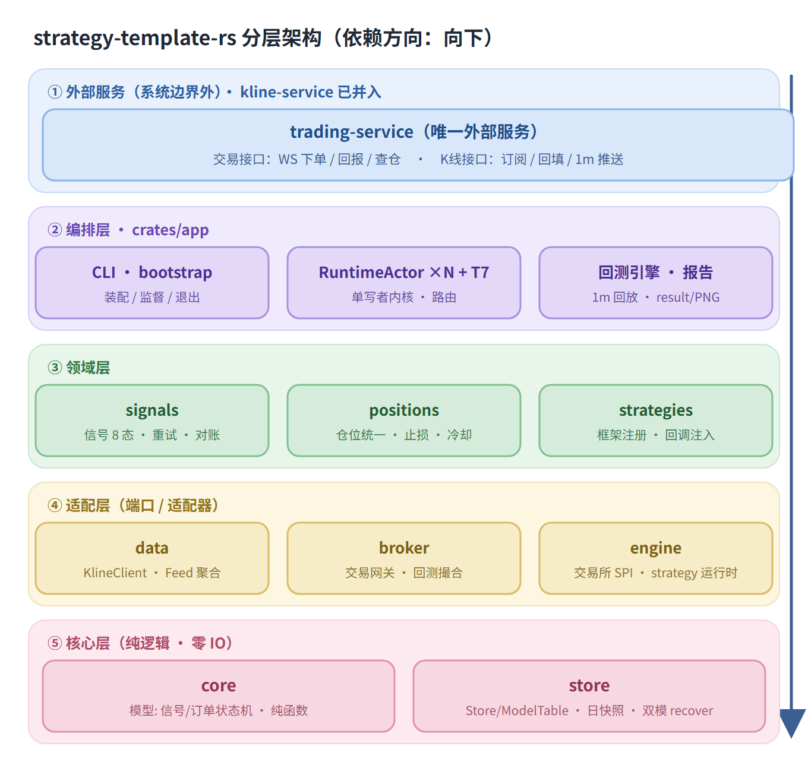
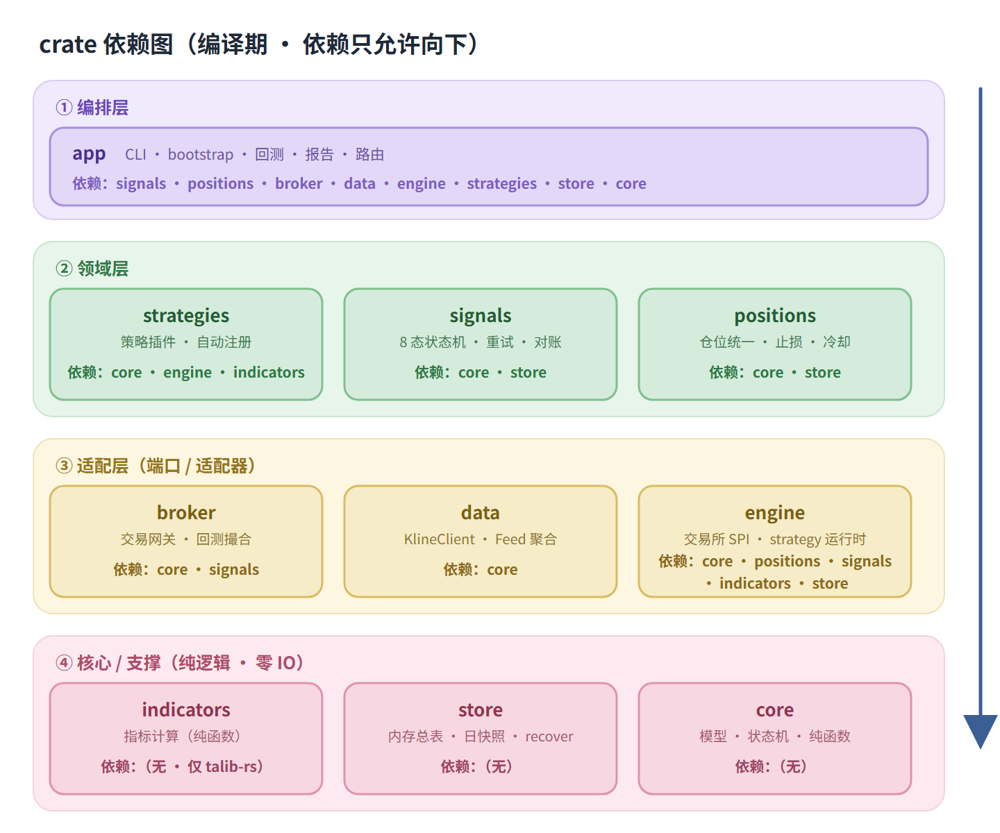
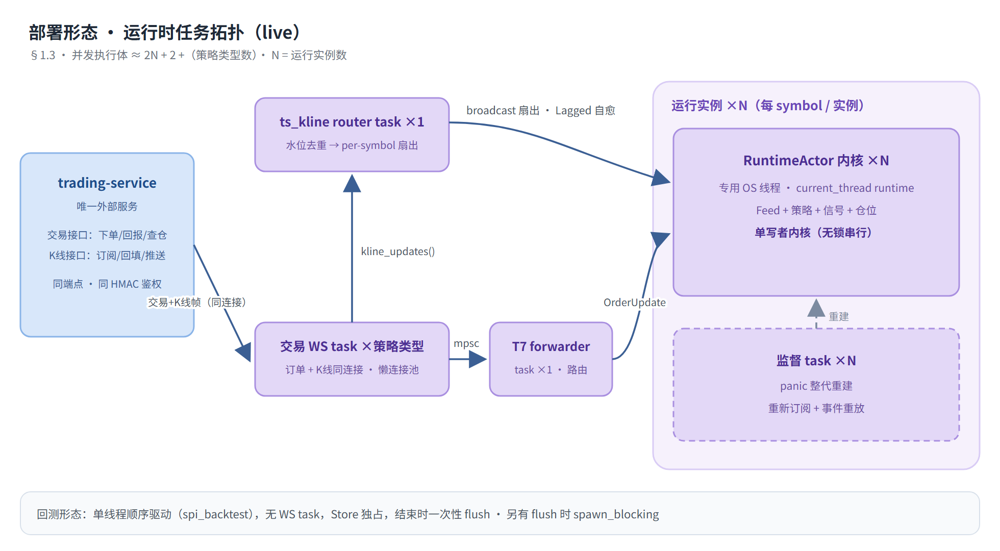
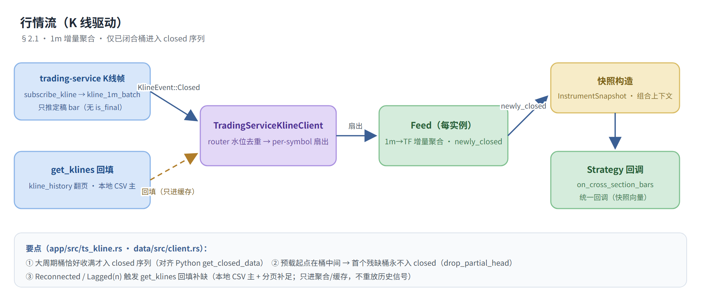
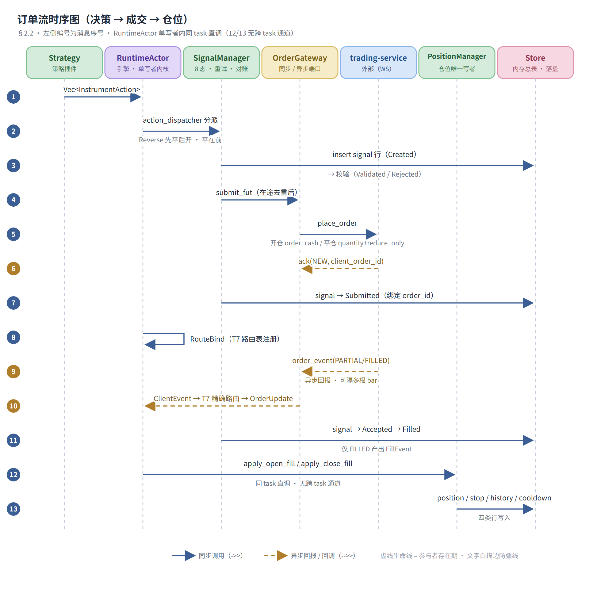
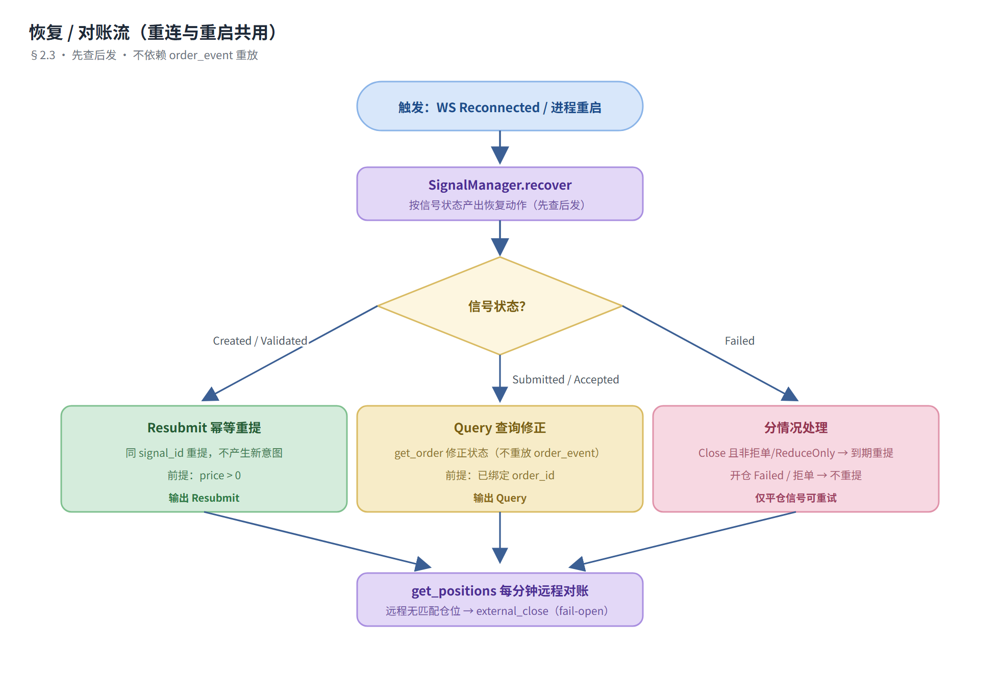
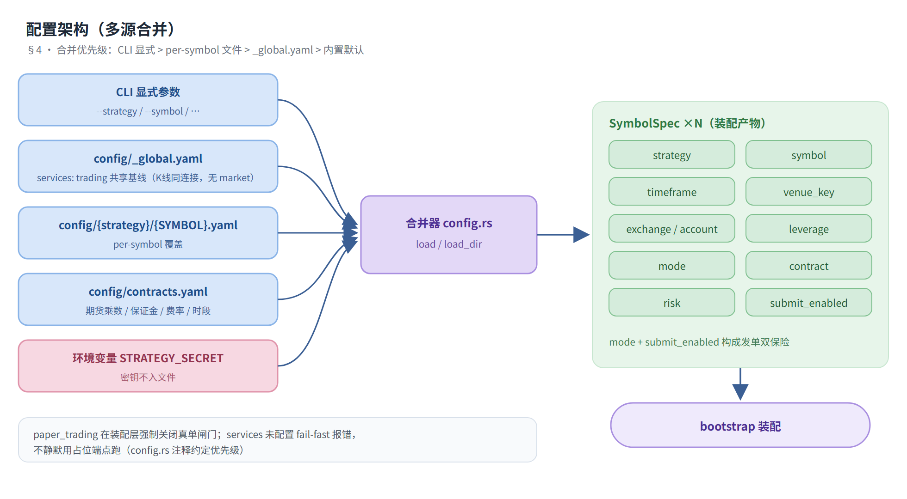

# 02 · 项目架构设计文档（strategy-template-rs）

> 版本：v2.0（2026-11-13 **重构后全量重读**：运行时模块 `engine::xsec`→`engine::strategy`（commit `9aaf19e`，`Xsec*`→`Strategy*`，`app` 的 `xsec_config/xsec_live_actor`→`strategy_config/strategy_live_actor`）；新增 `StrategyBase`/`StrategyLogic` 基类（`33ce6d8`/`8acec0d`）与总仓/子仓仓位模型、资金上限（`9948c65`）；层间调用表、部署形态、ADR（新增 A13/A14）按实况重锚。v1.9（2026-11-12 统一策略接口复核：旧 `Strategy` trait/Ctx/`LegacyStrategyBridge` 已删除（commit `8115b92`），策略侧统一为 `CrossSectionalStrategyPort`（经 `PortStrategyBridge` 适配 engine SPI 单标端口）；层间调用表、依赖铁律（store/indicators 零业务依赖实况）、runtime/bridge 行号重锚；新增 A12。前序 v1.8（2026-11-10 晚：**代码落地复核**——kline 并入已实现（commit `539a7d5`），按实况订正：K线帧与订单**同 per 策略类型连接**收发（无独立 K线 WS task，另设 ts_kline router task）、帧名为 `kline_1m(_batch)`/`kline_history`、无 HTTP 兼容路径、无 `market` 配置（`trading_calendar` 已删）；v1.7：kline-service 并入设计与四图重绘；v1.6：§4 目录模式身份归属规则；更早：§8 配置 fail-fast 两层口径）· 基于源码逆向核对（`文件:行` 为真实落点）  
> 前置阅读：[01-需求分析](01-需求分析.md)；后续：[03-详细设计](03-详细设计.md)、[04-trading-service接口设计](04-trading-service接口设计.md)、[05-策略架构设计](05-策略架构设计.md)

---

## 1. 架构总览（架构图）

### 1.1 分层架构图（Component / Layered View）

五层结构：外部服务 → 编排层（app）→ 领域层（signals/positions/strategies）→ 适配层（data/broker/engine）→ 核心层（core/store）。  
箭头 = 依赖/调用方向（向下）；`core`/`store` 只被依赖，不依赖任何业务 crate。

> 图源：`assets/architecture-layers.svg`（矢量，可编辑）· `assets/architecture-layers.png`（2x 位图）。  
> 图中只表达分层与依赖方向（向下）；实际存在的跨层调用（如编排层直调适配层）统一列在下表，避免连线交叉影响可读性。

**层间调用与数据流一览**：

| 端点                                                             | 接口 / 消息                                                                                 | 时机                                                           |
| -------------------------------------------------------------- | --------------------------------------------------------------------------------------- | ------------------------------------------------------------ |
| `data` ↔ trading-service（**K线帧**，经 per 策略类型交易连接）               | `subscribe_kline` 订阅 / `kline_1m(_batch)` 定稿推送 / `get_klines`→`kline_history` 回填（04 §6） | 启动 warmup / 实时推送                                             |
| `broker` ↔ trading-service（交易接口）                               | `place_order` / `ack` / `order_event`                                                   | 下单生命周期                                                       |
| `T7 OrderRouter` ↔ `broker`                                    | `ClientEvent` / `Reconcile`                                                             | order_id 路由与对账                                               |
| `spi_live_actor` → `engine`                                    | 1m 经 `ChannelBarSource` 灌成 `MarketEvent::Bar`                                           | 行情驱动（`live.rs:658`、`runtime.rs:131`）                         |
| `spi_live_actor` / `strategy_live_actor` → `strategies`        | `CrossSectionalStrategyPort` / `InstrumentAction`（单标经 `PortStrategyBridge` 适配）          | 策略回调（`bridge.rs:117-260`；统一端口直连 `strategy/runner.rs:1286`）   |
| `spi_live_actor` → `signals` / `positions`                     | 同线程直调（单写者，无锁）                                                                           | 每根 K 线 / 每笔成交（`runtime.rs:266,319`）                          |
| `spi_live_actor` → `broker`                                    | `submit_fut` / `query_fut` / `positions_fut`（`LiveExecution` 桥）                         | 提交 / 查询（`gateway.rs:148,150,153`、`live.rs:105`）              |
| 回测引擎 → `signals` / `positions` / `report`                      | 回放事件驱动                                                                                  | backtest                                                     |
| `bootstrap` → `spi_live_actor`/`strategy_live_actor` ×N / `T7` | 装配 / 监督 / 优雅退出                                                                          | 进程生命周期（`strategy_live_actor.rs:96`、`strategy_live_actor.rs:96`） |
| 领域层 / 适配层 → `core`；`signals`/`positions` → `store`             | 编译期依赖（虚线）                                                                               | 见 §1.2                                                       |
| `engine` 的订阅集 / `ContinuousSeriesBuilder`                      | 订阅集**已接入主路**（v1.4，单合约）；连续合约拼接**仍无生产消费者**；`BarDecoder` 已退役删除                             | 现状与缺口逐条见 03 §3.10                                            |

### 1.2 crate 依赖图（编译期视角）

工作区 10 个成员 crate（`Cargo.toml:3-14`），依赖只允许**向下**：

> 图源：`assets/crate-deps.svg`（矢量）· `assets/crate-deps.png`（2x 位图）。  
> 依赖关系以「分层 + 每卡依赖清单」完整表达（与 `Cargo.toml` 逐条对应），不画交叉连线避免缠绕；完整依赖边见每卡"依赖："行。

**依赖铁律**（`engine/src/lib.rs:13` 同型约束推广到全仓，2026-11-12 按 `Cargo.toml` 实况校准）：

- `core` 不依赖任何业务 crate（零 IO、零 now()）；
- `store` **零业务依赖**（连 `core` 也不依赖：通用行存 + payload_json，不理解业务语义）；`indicators` 同样零业务依赖（仅 `talib-rs`）；
- `signals` / `positions` 感知 Store 与 core，**不感知 WS/协议**；
- `broker` / `data` 是唯二接触外部协议的 crate（`broker` 依赖 core+signals，`data` 仅依赖 core）；
- `strategies` 依赖 core/engine/indicators——策略作者只面对策略端口与指标库；
- `app` 是唯一编排层，业务规则不落在此层。

### 1.3 部署形态（运行时进程拓扑）

> 图源：`assets/deployment-topology.svg` / `assets/deployment-topology.png`。

- 回测形态：单线程顺序驱动（`spi_backtest`），无 WS task，Store 独占；结束时一次性 flush。
- live 形态（`bootstrap.rs:253-322`、`strategy_live_actor.rs:3-6`（线程模型说明）与 `:128`（`catch_unwind` 整代重建））：每实例 = **1 个监督 tokio task + 1 条专用 OS 线程**（线程内嵌 current_thread runtime 跑内核，panic 整代重建）；  
  统一端口实例由 `strategy_live_actor` 承载（同监督代形态，内核为 `CrossSectionalRunnerGroup` 单线程事件泵，`strategy_live_actor.rs:96` `spawn_strategy_live`、`:232` 内核结构）。  
  全局另有 T7 forwarder task ×1、交易 WS task（per 策略类型懒连接池，1 类型 1 连接；**K线订阅/推送/回填与订单同连接收发**）与 ts_kline router task ×1（broadcast 水位去重 → per-symbol 扇出）。  
  合计约 **2N+2+（策略类型数）** 个并发执行体（N = 运行实例数），外加 flush 时的 spawn_blocking。

---

## 2. 关键数据流

### 2.1 行情流（K 线驱动）

> 图源：`assets/market-data-flow.svg` / `assets/market-data-flow.png`。

要点（`engine/src/core/aggregation.rs:195-249`、`data/src/client.rs:18-35`）：

- 大周期只在桶**恰好收满**时进入 closed 序列（对齐 Python `get_closed_data`）——  
  判定权在 `BarAggregationPolicy`（`:46`）+ `AggregationState`（`:206`）；
- 预载起点在桶中间 → 首个残缺桶永不入 closed（钉于 `aggregation.rs:430`  
  `aligned_first_bucket_kept_mid_start_dropped`、`:698`  
  `d1_head_bucket_dropped_when_ingested_mid_trading_day`）；
- 切桶口径由交易所提供，**无 fixed/ctp 二值枚举**：`UtcGridPolicy`（`:84`）/  
  `SessionWindowPolicy`（`:124`），后者窗口来自 `config/contracts.yaml`；
- `Reconnected` / `Lagged(n)` 事件触发 `get_klines` 回填补缺（本地 1m CSV 为主 + 分页补足；只进聚合/缓存，不重放历史信号）。

### 2.2 订单流（决策 → 成交 → 仓位）

> 图源：`assets/order-flow-sequence.svg` / `assets/order-flow-sequence.png`。  
> 13 条消息与原 autonumber 一一对应；实线 = 同步调用（`->>`），虚线 = 异步回报（`-->>`）。

### 2.3 恢复/对账流（重连与重启共用）

> 图源：`assets/recovery-reconcile-flow.svg` / `assets/recovery-reconcile-flow.png`。  
> 注意 Failed 分支：仅 Close 信号（非拒单/非 ReduceOnly）退避到期重提；开仓 Failed 不重提（`signals/src/manager.rs:707-770`）。

---

## 3. 并发与单写者模型

| 要素      | 设计                                                                           | 落点                                                                |
| ------- | ---------------------------------------------------------------------------- | ----------------------------------------------------------------- |
| 单写者     | 信号、仓位由同一 `spi_live_actor` 线程串行写（内核 `ExchangeRunner::on_event`）；回测由同一段主循环顺序直调 | `app/src/strategy_live_actor.rs:96`、`engine/src/core/runtime.rs:131` |
| 跨线程入口收敛 | 仅三类消息：`OrderUpdate`、`Reconcile`、`Shutdown`                                   | `app/src/runtime_types.rs:112-118`                                |
| 锁纪律     | ModelTable 行子锁只在同步闭包期持有，**严禁跨 await**；flush 走 spawn_blocking                 | `store/src/lib.rs:109`、`signals/src/manager.rs:24-25`             |
| 路由      | T7 持 order_id→Actor 路由表（单 task 读写无锁）；未知单按 strategy_name 限定广播                 | `order_router.rs`                                                 |
| 监督      | 策略 panic → 监督 task 整代重建（重新订阅+事件重放）                                           | bootstrap 监督结构                                                    |
| 背压      | 闭合 K 线 broadcast：慢消费者 Lagged 自愈；命令通道 mpsc(256)                               | `client.rs:20-22`、`trading_service.rs:158`                        |
| 心跳      | 交易 WS：应用层 Ping 15s / 读空闲看门狗 30s 判半开死连强制重连                                    | `trading_service.rs:516-519`                                      |

---

## 4. 配置架构

> 图源：`assets/config-merge.svg` / `assets/config-merge.png`。

合并优先级（`app/src/config.rs:31` 注释）：**CLI 显式 > per-symbol 文件 > `_global.yaml` > 内置默认**。  
`mode` 与 `submit_enabled` 构成发单双保险；`paper_trading` 在装配层强制关闭真单闸门。

**目录模式（`--config <dir>`）的身份归属（v1.6 新增，2026-11-10 根治）**：上表的  
"per-symbol 文件 > `_global.yaml`" 只在**声明该标的的那个文件**内部成立——

- 标的身份类字段（`strategy/timeframe/cash/initial_cash/leverage/exchange/account`）  
  只来自 ① 本文件顶层/`symbols:` 条目、② `_global.yaml`、③ 内置默认；  
  **同目录兄弟 symbol 文件的顶层字段一律不参与**（旧实现按"字母序首个非空者胜"提升为  
  目录级默认，于是 `--symbol BTCUSDT` 会继承 `CU.yaml` 的 `exchange: SHFE`，  
  行键错位成 `SHFE/crypto_perpetual/BTCUSDT` ⇒ 报"区间无 1m 数据"）。
- 跨文件共享只保留**基础设施类**字段：`services` / `contracts` / `exchanges` /  
  `instruments` / `risk`（本就是"整个目录共用一套"），以及已废弃的 `bar_merge`  
  （仅喂告警，不参与决策）。
- 目录模式**要求名实相符**：`--symbol X` 在目录内找不到自己的条目 ⇒ 直接报错并列出  
  可用标的（单文件模式不受此限——没有兄弟文件就不存在污染，模板复用照旧）。
- flat 文件的标的身份取**文件名 stem**（`{strategy}/{SYMBOL}.yaml` 约定）；文件名不便  
  表达时可写顶层 `symbol:` 显式声明，两者不一致会 `warn`。`_global.yaml` /  
  `contracts.yaml` 里写 `symbol:` 一律硬错（共享文件不属于单个标的）。
- 回测找不到数据时的报错现在**带出行键与期望 CSV 路径**，身份错位不再伪装成数据缺失。

---

## 5. 错误处理与重试策略（架构级）

| 场景                      | 分类                           | 处理                                                                            |
| ----------------------- | ---------------------------- | ----------------------------------------------------------------------------- |
| 服务端 REJECTED / EXPIRED  | 永久失败 `FailureKind::Rejected` | 信号 Failed 不重试，审计留痕                                                            |
| WS 超时 / 断连 / UNKNOWN 状态 | `FailureKind::Retryable`     | Failed → 退避重发（同 signal_id 幂等）；`max_attempts=3` 为总提交次数（含首发，最多重试 2 次），仅 live 生效 |
| 快照单行损坏                  | 本地 IO                        | warn 跳过该行，不毒死全表恢复（fail-open）                                                  |
| 历史 CSV 写失败              | 本地 IO                        | 只告警，不阻断 Store 平仓主流程                                                           |
| 策略 panic                | 运行时                          | 监督整代重建，不影响其他实例                                                                |
| services 未配置            | 启动期                          | fail-fast 报错（不静默用占位端点跑）                                                       |
| 时钟                      | —                            | 毫秒时钟注入（回测 K 线钟/live 墙钟），ID 与报表永不取 now()                                       |

---

## 6. 技术选型与理由

| 选型                          | 用途      | 理由                                       |
| --------------------------- | ------- | ---------------------------------------- |
| tokio（full）                 | 异步运行时   | WS/HTTP 并发、mpsc/broadcast、spawn_blocking |
| tokio-tungstenite (rustls)  | WS 客户端  | 支持 wss（MaybeTlsStream），无 OpenSSL 依赖      |
| serde/serde_json/serde_yaml | 序列化     | payload_json 向后兼容追加字段；YAML 配置            |
| csv + rust_decimal          | 数据与精度   | CSV 列序契约；数量精确递减无 f64 往返                  |
| parking_lot                 | Store 锁 | 总表 RwLock + 行 Mutex，低开销                  |
| hmac/sha2/subtle            | 鉴权      | 握手签名与恒定时间比对                              |
| plotters                    | 回测图表    | 纯 Rust 出 PNG                             |
| thiserror/anyhow            | 错误      | 库内 typed error + 应用层 anyhow              |
| clap                        | CLI     | derive 子命令                               |
| dashmap                     | 连接池     | 策略类型 → WS 命令通道懒连接                        |

---

## 7. 架构决策记录（ADR 摘要）

| # | 决策 | 取舍 |
|---|------|------|
| A1 | 信号与订单**两个独立状态机** | 信号=意图档案（可重试多次提交），订单=交易所侧执行；避免重试污染订单生命周期 |
| A2 | 统一 Store（内存表 + 日快照），废弃 append 事件日志 | 读路径简单、恢复确定；放弃逐事件溯源（审计靠状态行 version/last_error） |
| A3 | actor 单 task 融合 聚合/策略/信号/仓位，内核为 `ExchangeRunner::on_event` | 消灭 FillEvent 跨 task 通道丢失与跨 task 查仓竞态（B4/B9 根治）；聚合/决策/入账同线程零消息（`runtime.rs:131,186,319`） |
| A4 | 双 OrderGateway 端口（同步/异步） | 回测 inline 成交确定性；live await 不允许 block_on（B2） |
| A5 | 开仓单用金额（order_cash）而非数量 | 服务端掌握市价换算与整数手/保证金；模板侧不重复实现交易所换算 |
| A6 | 平仓量用**原始字面量**（size_raw，Decimal 递减） | f64 往返会改写精确成交量导致 REJECTED |
| A7 | engine SPI：交易所规则只实现一次 | 新增交易所只写 exchanges/ 文件夹，回测/实盘同规则 |
| A8 | 5 列通用快照 + payload_json | 新增 model/字段零迁移成本；inspect 工具展开可读 |
| A9 | 订阅面以 `Exchange` 的 `SubscriptionPlan` 解析结果为**单一真源**（v1.4 已接线） | 收益：逻辑品种配置可落到实际订阅与历史回补；代价与边界：①非 1m 在**装配期 fail-fast**（`run_generation` 无错误通道，运行期只能静默或跑错）；②多合约只消费首条 + 告警；③换月**重**订阅仍需 `MarketEvent::Roll` 生产端，其输入的合约快照宇宙（`SourceRequest.universe`）在生产侧恒空——**"自动换月"至今不生效**，不是回归而是缺口（详见 03 §3.10） |
| A10 | `BarDecoder` 端口**退役删除**（commit `ab92793`），不留永不执行的实现充当架构完整性 | 实测 `parts.decoder` 读取点 0、`resolve_finality` 调用者 0；帧解码继续由 `data` 承担、闭合帧经 `ChannelBarSource` 入主循环。代价：`#[test]` −1（`infer_finality_boundary_semantics`，钉的是被删代码），非 Final 不驱动策略的不变量仍由 `cross_exchange.rs:313` 承重；同时移除公开类型 `RawFrame`/`JsonBarDecoder`（库 crate 破坏性 API 变更，仓内无外部消费者） |
| A11 | **kline-service 并入 trading-service**（已落地，commit `539a7d5`）：K线成为其一个帧族（同端点、同 HMAC、同 per 策略类型连接，04 §6） | 收益：单一外部服务/鉴权/运维面，行情与交易同门。实现要点与边界：①`KlineClient` 端口不变，live 实现改 `app/src/ts_kline.rs::TradingServiceKlineClient`（复用交易连接池，router 按 (venue,symbol) 水位去重后扇出）；②`services.kline` tombstone（run 拒启给迁移指引），**无 `market` 配置**（旧口径随 `trading_calendar.rs` 删除，warmup=本地 CSV+`get_klines` 最近 N 根）；③**无独立 K线连接**——订阅按 (策略类型, exchange) 分组登记、重连逐组重发，推送 `kline_1m_batch` 只含定稿 bar（无 `is_final`）；④契约已升 v0.3（§8 K线章：`kline_history` 对象数组应答、`get_klines` 要求 exchange、无 HTTP 兼容路径） |
| A12 | **统一策略接口**（2026-11-12，commits `7dcc441`→`8115b92`）：删除旧 `Strategy` trait/`Ctx`/`LegacyStrategyBridge`，全仓策略只实现 `CrossSectionalStrategyPort`；单标路径经 `PortStrategyBridge` 适配 engine SPI 的 `StrategyPort`；策略注册表工厂制（`register_strategy!` + `build.rs` 自动装配） | 收益：一套接口横跨单标/横截面，动作全集 `InstrumentAction` 统一（`Adjust` 在单标桥显式降级 `Hold`，禁止误映射开/平）；策略作者零 engine SPI 负担。代价：单标策略也以横截面回调形态书写（快照向量恰一元素）；旧接口全删为破坏性变更（仓内无外部消费者）。详见 [05-策略架构设计](05-策略架构设计.md) |
| A13 | **运行时候选模块去历史化**（commit `9aaf19e`）：`engine::xsec` → `engine::strategy`，移除过渡别名；`XsecConfig/Slot/Mode` 等类型统一为 `Strategy*`；`app` 的 `xsec_config.rs`/`xsec_live_actor.rs` → `strategy_config.rs`/`strategy_live_actor.rs` | 收益：模块路径与"唯一策略接口"语义一致，新人不再误以为 `xsec` 是独立子系统；策略**注册名**（`btc_xsec_trend` 等）与配置目录保持不变 ⇒ 存量配置零迁移。代价：破坏性路径变更（仓内全部调用点同轮改完）；`xsec_` 仅作为文件名前缀历史保留，规则写入 `docs/strategy/XSEC_GUIDE.md` §9 |
| A14 | **总仓/子仓仓位模型 + 资金上限**（commit `9948c65`，契约侧 `518fe09`/`8299d57` 收口）：`StrategyPortfolio`（策略账本）→ `MasterPosition`（总仓，3 态）→ `SubPosition`（标的子仓，5 态）；新增 `InstrumentAction::CloseMaster`、`PortfolioContext.master`/`max_total_notional`、`sizing.max_position_pct` | 收益：组合级风控（L3）与调仓有明确作用对象；容量闸门与策略目标权重同口径（等权目标按 `max_total_notional*nav` 而非全额 NAV），消灭"每轮调仓必然拒单"；拒单与静默跳过分离（在途 `Adjust` 延后、live 低于单笔名义视为达标），指标不被噪声污染。代价：账本行从 1 类（`sub_position`）增到 3 类，重启恢复需按序迁移（`master_id` 空串 → `master_legacy`）。详见 [05](05-策略架构设计.md) §6-§7 与 [`docs/strategy/POSITION_MODEL.md`](../strategy/POSITION_MODEL.md) |

---

## 8. 架构验收清单

| 检查项 | 验收方式 |
|--------|---------|
| 依赖方向不越层 | crate 依赖图与 `Cargo.toml` 一致；core 无 IO |
| 单写者成立 | 跨 task 入口只有 OrderUpdate/Reconcile/Shutdown 三类 |
| 双端口语义 | backtest 用同步网关、live 用异步网关，测试各自覆盖 |
| 确定性 | backtest_paper_parity + 同参数重跑复现断言 |
| 失败分类 | SubmitError::Rejected/Retryable 分支测试 |
| 配置 fail-fast | 两层均已钉死：整块 `services:` 缺失 ⇒ 退出码 1 + 明确文案；`trading:` 子块缺失（占位端点）⇒ **live 拒绝启动**、非 live 出声告警（`tests/run_config_guards.rs` 4 案 + `config.rs` 单元 4 案）。紧急熔断（真实端点 + `submit_enabled: false`）有专档保证不被误杀。验收须在**仓库目录之外**执行——全局回落按 cwd 找 `config/_global.yaml`，在仓内测会被真实配置静默掩盖 |
| **端口接线现状**（新增） | 订阅集已接入主路（单合约，非 1m 装配期报错）；`ContinuousSeriesBuilder` **不计入已交付**；`BarDecoder` 已退役删除。逐条按 03 §3.10 的证据表核对，不接受"有实现即算交付" |
