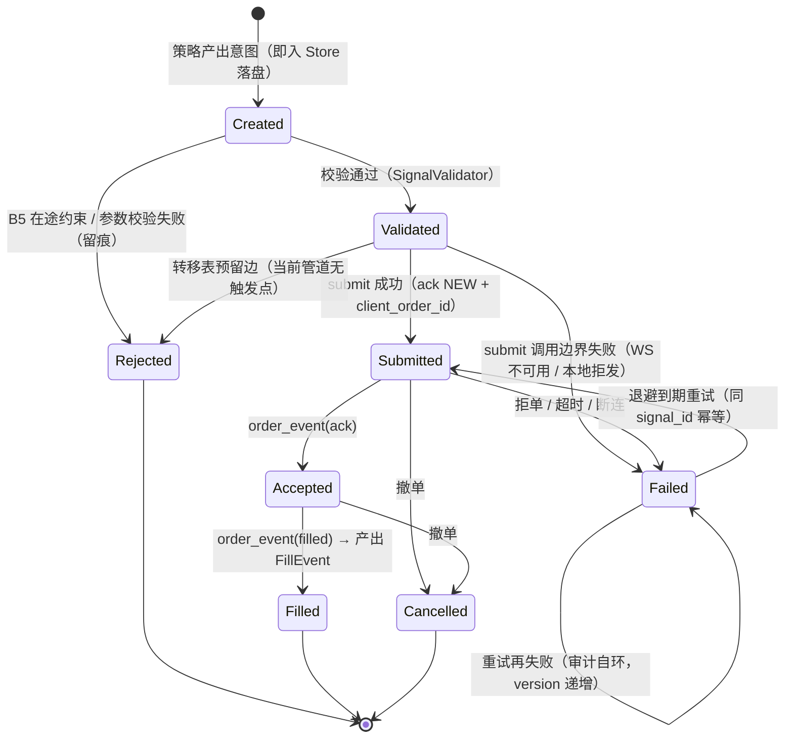
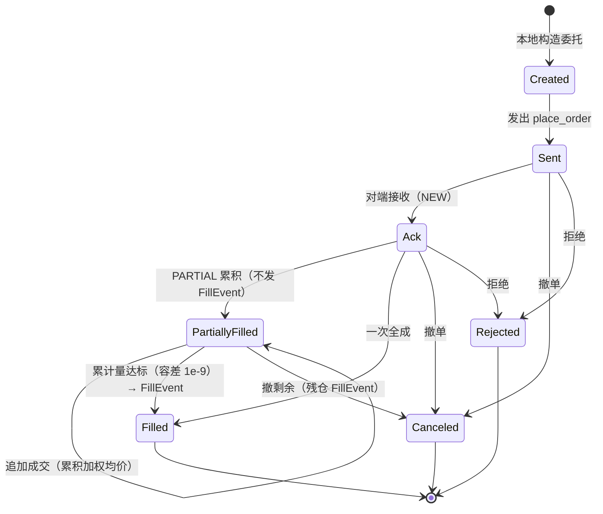
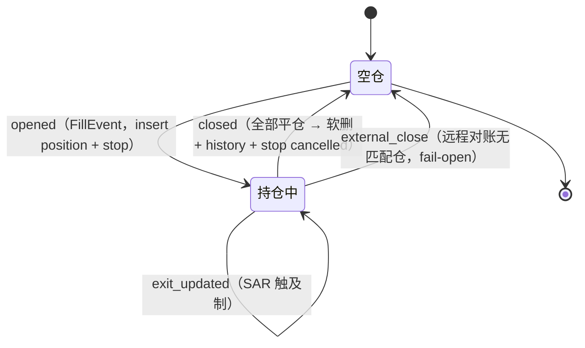
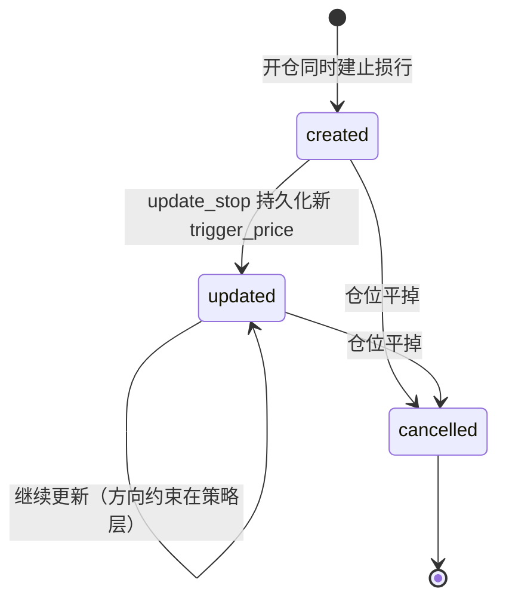
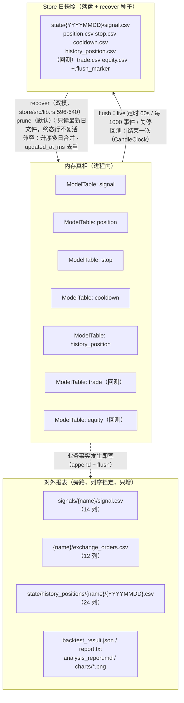
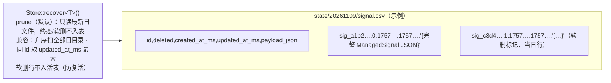

# 03 · 项目详细设计文档（strategy-template-rs）

> ## ⚠️ 状态：设计时快照（2026-11-25 收口加注，不再随代码更新）
>
> 本包是设计阶段的需求/架构/接口快照，仅用于理解设计意图。策略清单、行号与行数均已过期：
> 现行契约见 `docs/strategy/`，策略实现以 `crates/strategies/src/`（template_trend / template_xsec_ls）为准。

<!-- refcheck:coords=off -->

> 版本：v1.6（2026-11-13 **重构后全量重读**：运行时模块 `engine::xsec`→`engine::strategy`（commit `9aaf19e`），全文路径重锚；§2.3 数据字典 9→**10** model（补 `master_position`，`strategy_portfolio` 补 `active_master_id`/`master_seq`）；§3.1/§3.4/§3.8/§4 锚点按实况重测；§3 新增 §3.11「strategy — 统一策略运行时层」。v1.5（2026-11-12 统一策略接口复核：旧 `Strategy` trait/Ctx/`intents_from_action`/`LegacyStrategyBridge` 已删除（commit `8115b92`），§3.1/§3.4/§3.8/§4 引用改锚至 `CrossSectionalStrategyPort`/`InstrumentAction`/`action_dispatcher`；§2.3 数据字典 7→9 model（补 `sub_position`/`strategy_portfolio`）；signal_id/Model 结构体行号重锚。前序 v1.4（2026-11-09：**§3.10 订阅面接入主路**——topic 驱动 `attach` 与 `load_warmup`、非 1m 装配期 fail-fast、多合约取首条并告警；仍缺 Roll 生产端（universe 恒空）与解码/连续合约面的接线。更早：D1b/D2 已删实现的引用重锚、v1.0 存量坐标失真订正、§3.10 端口接线现状登记）· 基于源码逆向核对（`文件:行` 为真实落点）
> 前置：[01-需求分析](01-需求分析.md)、[02-架构设计](02-架构设计.md)；接口：[04-trading-service接口设计](04-trading-service接口设计.md)；策略架构：[05-策略架构设计](05-策略架构设计.md)

---

## 目录

1. [状态图设计（State Diagram）](#1-状态图设计)
2. [持久化存储设计（Storage Diagram）](#2-持久化存储设计)
3. [模块详细设计](#3-模块详细设计)
4. [关键算法与纯函数](#4-关键算法与纯函数)
5. [错误恢复设计](#5-错误恢复设计)

---

# 1. 状态图设计

> 口诀：框里写名词（状态），箭头上写动词（事件）。每张图配转移表作为开发/测试共同验收依据。
> 本系统有 **4 个独立状态机**：信号（8 态）、订单（7 态）、仓位（生命周期动作）、止损单（3 态字符串）。
>
> **管道顺序**（`receive_intent_prepare:334-392`）：同 signal_id 去重（重复**直接丢弃、不建行、不留痕**，仅 warn）
> → insert Created → B5 在途约束（冲突 → Rejected 留痕）→ 参数校验（失败 → Rejected 留痕）→ Validated。

## 1.1 信号生命周期状态机（8 态）

定义：`crates/core/src/lifecycle.rs:21-89`（`SignalStatus` + 严格转移表 `can_transit`）。
信号是**策略意图的档案**：一旦产生即落盘，下单结果只改变其状态；终态 Rejected/Filled/Cancelled 不可再转移、不删除（审计红线）。



### 1.1.1 转移表（验收 Checklist，对齐 `lifecycle.rs` 单测）

| 当前状态 | 事件 | 目标 | 允许 | 备注 |
|----------|------|------|------|------|
| Created | 校验通过 | Validated | ✅ | — |
| Created | 校验失败 | Rejected | ✅ | 终态，不下单 |
| Created | 直接提交 | Submitted | ❌ | 不可跳级 |
| Validated | ack NEW | Submitted | ✅ | 拿到 client_order_id 才落 submitted |
| Validated | submit 抛错 | Failed | ✅ | 无 order_id 的边界失败（补充边） |
| Validated | 风控拦截 | Rejected | ✅ | — |
| Submitted | order_event(ack) | Accepted | ✅ | 推送可省略，filled 时自动补 accepted 边 |
| Submitted | 超时/断连/UNKNOWN | Failed | ✅ | `FailureKind::Retryable` |
| Submitted | REJECTED 拒单 | Failed | ✅ | `FailureKind::Rejected`，不重试 |
| Submitted | 直接成交 | Filled | ❌ | 必须先 Accepted |
| Submitted | 撤单 | Cancelled | ✅ | 终态 |
| Accepted | order_event(filled) | Filled | ✅ | 产出 FillEvent |
| Accepted | 撤单 | Cancelled | ✅ | 终态 |
| Accepted | 回退 | Submitted | ❌ | 不可回退 |
| Failed | 退避到期 | Submitted | ✅ | 仅 Retryable；`RetryPolicy` 默认 3 次 |
| Failed | 重试再失败 | Failed | ✅ | 自环留痕 |
| Failed | 直接接受 | Accepted | ❌ | 重试必须重新提交 |
| Rejected/Filled/Cancelled | 任意 | 任意 | ❌ | 终态不可出 |

**恢复口径**：`is_pending()` = {Created, Validated, Submitted, Accepted}（`lifecycle.rs:64-72`）。
重启 `recover()` 产出 `RecoveryAction`（`signals/src/manager.rs:707-770`，仅两个变体）：
- Created/Validated **且 `intent.price > 0`** → `Resubmit`（幂等重提；price≤0 的防御行不提）；
- Submitted/Accepted **且已持有 order_id** → `Query`（get_order 先查后发修正状态，不靠 order_event 重放；无 order_id 不产生动作）；
- Failed → **仅平仓（Close）信号**且非 `FailureKind::Rejected`、错误不含 `ReduceOnly` 时 `Resubmit`（交易所状态未知、仓位可能仍敞着）；**开仓信号 Failed 不在 recover 重提**（是否重开由策略信号面决定）。注意这是 recover 的对账重提，与运行期 `due_retries`（`next_retry_at` 退避到期）是两条路径。
- `RecoveryAction` 只有 `Resubmit` / `Query` 两变体（`signals/src/manager.rs:179-184`），无第三种。

## 1.2 订单状态机（7 态）

定义：`crates/core/src/order.rs:12-47`。追踪 trading-service/交易所侧订单；
部分成交在 `OrderProgress` 内累积，**仅完全成交**打包 FillEvent。



### 1.2.1 转移表

| 当前 | 事件 | 目标 | 允许 | 备注 |
|------|------|------|------|------|
| Created | 发送 | Sent | ✅ | — |
| Created | 收到 ack | Ack | ❌ | 不可跳过 Sent |
| Sent | ack | Ack | ✅ | — |
| Sent | 撤单/拒绝 | Canceled/Rejected | ✅ | — |
| Ack | 部分成交 | PartiallyFilled | ✅ | `OrderProgress.accumulate` |
| Ack | 全成 | Filled | ✅ | — |
| PartiallyFilled | 再次部分成交 | PartiallyFilled | ✅ | 自环 |
| PartiallyFilled | 完全成交 | Filled | ✅ | 仅此刻产出 FillEvent |
| PartiallyFilled | 拒绝 | Rejected | ❌ | 已有成交只能撤不能拒 |
| PartiallyFilled | 撤单 | Canceled | ✅ | filled_size>0 时产出残仓 FillEvent |
| 任意终态 | 任意 | 任意 | ❌ | Filled/Canceled/Rejected |

### 1.2.3 服务端状态 → OrderState 映射（`broker/src/wire.rs:148-158`）

| 服务端 status | OrderState | 语义 |
|---|---|---|
| `NEW` | Ack | submit 成功，返回 client_order_id |
| `PLACING` | Sent | 跳过（不产生状态转移） |
| `PARTIAL` | PartiallyFilled | 推进累计成交量，不入仓位 |
| `FILLED` | Filled | 产出 FillEvent 入仓位管理 |
| `CANCELED` | Canceled | 终态 |
| `REJECTED` / `EXPIRED` | Rejected | 永久失败，不重试 |
| `UNKNOWN`/缺失/未识别 | — | submit 判可重试；order_event 跳过该帧 |

## 1.3 仓位生命周期（动作驱动）

仓位无枚举状态机，用生命周期动作推进；当前态常驻 Store `position` 行（平仓软删除）。
定义：`positions/src/manager.rs`（open/apply_*/close/external_close/restore）。



| 生命周期动作 | 入口（`positions/src/manager.rs`） | Store 写入 | 副作用 |
|------|------|------|------|
| opened | `open:244` / `apply_open_fill:279` | insert `position`（id=position_id）+ insert `stop`(created) | position_id = 开仓信号 signal_id |
| fill_added | `apply_add_fill:355` | with 闭包更新 total/remaining_size | — |
| fill_reduced | `apply_close_fill:447`（部分） | remaining_size(_raw) 精确递减；写 history 进度行（partial_close） | 已实现盈亏累加；对外 CSV 不写（留待最终平仓） |
| price_updated | `on_price:522` | peak_price / max_pnl_pct / min_pnl_pct | close 不参与 |
| stop_updated | `update_stop:545` | stop 行 trigger_price 无条件持久化（只朝有利方向是**策略层**的约束，manager 不校验方向） | 行缺失时防御补建 |
| exit_updated | `update_exit:586` | exit_active / exit_price | 重启后继续保护 |
| closed | `close:610` / `apply_close_fill:447` | 软删 position（deleted=1）；stop→cancelled；insert history_position（已存在则整行替换） | 旁路 24 列历史 CSV（仅此时写）；止损时 upsert `cooldown` |
| external_close | `external_close:702` | 同 closed | 对账路径，exit_price=last_price 或入场价 |
| restore | `restore:728` | recover 后重建内存视图 | — |

## 1.4 止损单状态机（3 态字符串）

Store `stop` model（`ManagedStop`，id=`stop_{position_id}_sl`，`positions/src/manager.rs:34`）。
触价判定由**引擎**完成，不在策略内：L1 单标兜底 `RiskGuard::check_fallback`（固定止损/回落止盈/固定止盈，
`core/risk_guard.rs:48`、`runner.rs:1977`）、L2 配置 `exit` 规则纯函数求值（`strategy/evaluator.rs:42`）、
L3 组合级 `portfolio_exit`（`runner.rs:1119-1217`）。止损单无独立 Triggered 态，成交后随仓位平掉而 cancelled。
注意：`update_stop:545` 对 trigger_price 是**无条件持久化**（含原值直接覆盖），
"只朝有利方向"是策略层调用约定，PositionManager 不做方向校验。



---

# 2. 持久化存储设计

## 2.1 持久化存储图（总览）

进程内唯一真相 = `strategy-store::Store` 内存表；**日快照 CSV 是 Store 的落盘形态兼恢复种子**；
对外固定列报表是**旁路输出**，两条链路完全不同。



| 维度 | Store 日快照 | 对外报表 |
|------|------------|---------|
| 读者 | 程序自己（启动 recover 种子） | 人 / 下游工具（决策路径不读回） |
| 写法 | 同日整文件**覆盖**（tmp+fsync+rename） | **追加**一行，永不重写 |
| 保留 | 每 id 一行最新状态（软删行当日以 deleted=1 同行落盘） | 每条事实一行 |
| 形态 | 通用 5 列 + payload_json（完整 model JSON） | 展开业务字段，列序锁定 |
| 删掉后果 | 丢最近一个快照周期状态 | 数据永久丢失不可重建 |

## 2.2 日快照物理格式（`store/src/persist.rs:162`）

```
{base}/{YYYYMMDD}/{model}.csv
表头：id,deleted,created_at_ms,updated_at_ms,payload_json
```

| 列 | 语义 |
|----|------|
| `id` | 业务主键（signal_id / position_id / stop_order_id / …） |
| `deleted` | 0/1 软删标记；软删行当日仍落盘。跨日行为分双模：**prune 模式（默认）**跨日 flush 物理丢弃终态/软删行（不设墓碑区，防复活由「recover 只读最新日文件」结构保证）；**兼容模式**软删行留旧日文件、recover 合并后不入活表 |
| `created_at_ms` / `updated_at_ms` | epoch 毫秒（UTC）；upsert 保留 created、刷新 updated |
| `payload_json` | model 完整 serde JSON（snake_case 稳定契约，字段只追加） |

写入原子性：`.{file}.{pid}.tmp` → fsync → rename（`persist.rs:173-202`）；
读取逐行容错：坏行 warn 跳过（`persist.rs:214-235`）。
跨表一致性：`.flush_marker`（各表行数 + id 排序 CRC32），恢复时检测不一致仅告警（`persist.rs:260-268`）。



> 另有 `SignalManager::load_filled_open_from_disk`（`signals/src/manager.rs:644`）：绕过 is_terminal 过滤，
> 跨日扫描**全部**日文件补载 Filled Open 信号行——供「信号 Filled Open、仓位缺失」交叉对账补成交。

## 2.3 数据字典（10 个注册 model）

`Store::table::<T>()` 按 `Model::NAME` 返回同一张表；多策略实例共享同一 Store
（`strategy_name`/`scope` 为过滤键，`Model::scope()` 二级索引 `store/src/lib.rs:55-61`）。

前 7 行为业务 model，后 3 行为统一端口策略账本（`engine::strategy::model`，详见 05 §6）。

| model（NAME） | Rust 类型 | 行 id | 生命周期 | 关键 payload 字段 |
|---|---|---|---|---|
| `signal` | `signals::manager::ManagedSignal`（`signals/src/manager.rs:110`） | `intent.id`=signal_id | 8 态全留（含终态；`is_terminal` 对终态及不可重提 Failed 返回 true，prune 模式跨日物理裁剪） | strategy_name, intent(全量), version, status, order_id, attempts, next_retry_at, last_error, last_failure_kind, exchange_order_id, filled_price/quantity(_raw), order_type/price/quantity |
| `position` | `positions::manager::ManagedPosition`（`positions/src/manager.rs:91`） | `state.position_id` | 开仓 insert；平仓软删 | strategy_name, version, state(PositionState 全字段) |
| `stop` | `positions::manager::ManagedStop`（`positions/src/manager.rs:115`） | `stop_order_id` | created/updated/cancelled（终态留审计） | position_id, version, lifecycle, trigger_price, size |
| `cooldown` | `positions::manager::Cooldown`（`positions/src/manager.rs:142`） | `strategy_name` | 止损平仓 upsert 当日冷却日 | date: `YYYY-MM-DD` |
| `history_position` | `positions::history::HistoryPosition`（`history.rs:54`） | `position_id` | 部分平仓写累计进度行（exit_reason=partial_close）；**最终平仓整行替换**为最终记录（幂等，AlreadyExists 走 with 替换）；对外 CSV 仅最终平仓写一次。is_terminal=true（每行即已完成成交） | 24 个业务字段（见 §2.5） |
| `trade` | `app::report::TradeRow`（`report.rs:49`） | `trade_{signal_id}` | 每笔成交一行只增；回测注册 | trade_id(T%08), side, quantity, price, commission, slippage, pnl, timestamp |
| `equity` | `app::report::EquityPoint`（`report.rs:122`） | `eqd_/eqt_` 前缀桶 id | daily/tf 同表 upsert；回测注册 | kind, label, bucket_secs, equity, cash |
| `sub_position` | `engine::strategy::model::SubPosition`（`strategy/model.rs:127`） | 开仓 `sub_` signal_id（1:1） | 5 态生命周期（PendingOpen→OpenRequested→Active→CloseRequested→Closed），`is_terminal`=Closed | strategy_id, master_id, instrument, side, qty(正幅值), entry_price, stop_price, target_weight, rebalance_epoch, state, opened_at/closed_at, realized_pnl |
| `master_position` | `engine::strategy::model::MasterPosition`（`strategy/model.rs:206`） | `master_{seq:06}` | 3 态（Open→Closing→Closed）；`Closed` 当且仅当关联子仓全 Closed | strategy_id, state, opened_at, closed_at（**只存生命周期**，指标由子仓派生） |
| `strategy_portfolio` | `engine::strategy::model::StrategyPortfolio`（`strategy/model.rs:248`） | `strategy_id` | 每策略一行常驻（phase: Running/Paused/Liquidating） | phase, active_master_id, master_seq, nav, high_watermark, drawdown, peak_unrealized_pnl, trail_armed, target_holdings, max_total_notional, last_rebalance_at, rebalance_epoch |

### 2.3.1 PositionState 字段（`positions/src/state.rs:45-95`）

`position_id, symbol, side, entry_price, entry_time, entry_timestamp, peak_price, stop_price,
max_pnl_pct, min_pnl_pct, atr_at_entry, total_size, remaining_size, realized_pnl,
trail_activated, trail_trigger_pct, entry_size_raw, remaining_size_raw, exit_active, exit_price`

红线：禁止缓存字段进持久化；`remaining_size_raw` 是平仓帧 quantity 的真正来源（Decimal 精确递减，`state.rs:34`）。

## 2.4 时间格式约定（4 种，勿混用）

| 场景 | 格式 | 示例 |
|------|------|------|
| Store 元数据 created/updated_at_ms | epoch 毫秒整数 | `1783689600000` |
| K 线 CSV timestamp | pandas 风格 `%Y-%m-%d %H:%M:%S%:z` | `2026-09-11 00:00:00+00:00` |
| 快照目录 / 历史仓位文件名 | `YYYYMMDD` | `20260911/` |
| 止损冷却日 | `YYYY-MM-DD` | `2026-09-07` |

（trade 行 payload 内 timestamp 为 `%Y-%m-%dT%H:%M:%S` K 线时间，第 5 种内部格式。）

## 2.5 对外旁路报表列序（锁定契约）

| 文件 | 列数 | 表头 | 定义处 |
|------|------|------|--------|
| `signals/{name}/signal.csv` | 14 | strategy_name, signal_id, timestamp, user_id, signal_action, symbol, pos_type, cash, leverage, side, exchange, trigger_price, order_type, quantity | `signals/src/writer.rs:10` |
| `{name}/exchange_orders.csv` | 12 | signal_id, symbol, exchange, leverage, pos_type, price, side, exchange_order_id, exchange_order_status, exchange_order_price, exchange_order_quantity, exchange_update_time | `broker/src/order_log.rs:74` |
| `state/history_positions/{name}/{YYYYMMDD}.csv` | 24 | position_id, strategy_name, symbol, position_type, entry_price, exit_price, entry_time, exit_time, entry_timestamp, exit_timestamp, peak_price, stop_price, max_pnl_pct, min_pnl_pct, exit_reason, is_stop_loss, price_diff, pnl_pct, duration_seconds, atr_at_entry, trail_activated, trading_mode, entry_size, exit_size | `positions/src/history.rs:23` |

三张表均为 header-on-create + append。改动列序必须同步修订文档（模板红线）。

## 2.6 行情数据存储（`data/src/csv_store.rs:1-10`）

```
{base}/{tf}/{exchange}/{market}/{SYMBOL}_{tf}.csv
列（10）：timestamp,open,high,low,close,volume,quote_volume,trade_num,active_buy_volume,active_buy_quote_volume
```
- 路径键 = venue_key（`{exchange}/{market}/{symbol}`）；裸 symbol 回落旧布局并一次 rename 迁移；
- 桶时间语义 = open_time（左闭起点）；兼容旧 6 列（扩展列缺省 0）。

## 2.7 回测报告产物（非 Store 快照）

| 产物 | 内容来源 | 写时机 |
|------|---------|--------|
| `backtest_result.json`、config 快照 | Store trade/equity 表 | 回测结束 |
| `backtest_report.txt`、`backtest_analysis_report.md` | 同上 | 回测结束 |
| `charts/*.png`（3 张） | plotters | 回测结束 |

---

# 3. 模块详细设计

## 3.1 core — 核心类型与纯逻辑（零 IO）

| 模块 | 职责 | 关键 API |
|------|------|---------|
| `candle.rs` | Candle / Timeframe | 10 字段 Candle（含 quote/trade_num 等） |
| `signal.rs` | Signal / SignalType / SignalIntent / IntentKind | `generate_signal_id:92`；撮合动作枚举 `Action` 已迁 `broker/src/action.rs`，`intents_from_action` 已删（Reverse 由 `action_dispatcher` 直接先平后开分派） |
| `lifecycle.rs` | 信号 8 态 | `can_transit` 严格转移表 |
| `order.rs` | 订单 7 态 + OrderProgress | `accumulate` / `weighted_price` / `is_fully_filled` |
| `fill.rs` | FillEvent | 含 `is_stop_loss / exit_reason / initial_stop / fee`（serde default） |
| `position_math.rs` | 加仓均价 / 减仓已实现盈亏 | 期货按乘数结算 |
| `contract.rs` | ContractSpec/CommissionSpec | 乘数/保证金率/开平平今费率/时段 |
| `strategy.rs` | Cooldown / PositionView | 止损冷却与持仓视图值对象（策略端口本体在 `engine/src/strategy/port.rs`，运行时层见 §3.11） |
| `risk.rs` | 统一风控兜底 | 回测与 live 同源 |

**确定性 signal_id**（`signal.rs:92-109`）：
```
key = {strategy_type.lower()}_{venue_key.upper()}_{1m时间戳ms}_{signal_type.lower()}
id  = "sig_" + hex(sha256(key))[..16]
```
venue_key = `{exchange}/{market}/{symbol}`（跨交易所同名标的不共享行键）。
子仓位信号另有 `sub_` 命名空间（`engine/src/strategy/signal_id.rs:42-69`，与 `sig_` 互不竞争，详见 05 §8）。

## 3.2 store — 统一 model 门面

| 类型 | 职责 |
|------|------|
| `Clock` / `EpochClock` | 毫秒时钟注入（回测 CandleClock / live 墙钟） |
| `Model` trait | `NAME`、`id()`、`is_terminal()`（跨日物理裁剪）、`scope()`（二级索引） |
| `ModelTable<T>` | 总表 `RwLock<HashMap<id, Arc<Mutex<行>>>>` + scope 索引；insert/upsert/get/with |
| `Store` | model 注册表、定时/阈值/关停 flush、跨日 rollover（prune 模式 purge_terminal）、`recover`（双模：prune 只读最新日 / 兼容多日合并去重） |
| `StorageBackend` / `CsvStorage` | 端口/适配器：write_table/read_table/list_days/marker（未来可换 sled） |

锁纪律（`store/src/lib.rs:109`）：子锁只在同步闭包期持有，**严禁跨 await**；外部读到的永远是克隆值。

## 3.3 signals — SignalManager 同步内核

职责链（`signals/src/manager.rs:12-20`）：

```text
receive_intent       → insert Created → validate（Rejected 可审计）
                     → 在途去重（B5：Open 全局 / Close 按 position_id）
submit_request       → 外壳（回测 inline / live await 网关）→ apply_submit_outcome
handle_order_update  → Accepted / Filled（产出 FillEvent）/ Cancelled（残仓）
tick(now)            → 到期重试（Failed → Submitted，指数退避）
recover              → 重建 order_index → RecoveryAction（Resubmit/Query）
```

| 组件 | 说明 |
|------|------|
| `ManagedSignal` | Store `signal` 行：intent + status + order_id + attempts + next_retry_at + last_error |
| `SignalValidator` | trait，`BasicValidator` 查 symbol/price/size 合法性 |
| `RetryPolicy` | **最多提交 3 次（含首发，即最多重试 2 次）**；base=1s 翻倍，上限 60s；仅 live，回测不重试 |
| `OrderGateway` / `AsyncOrderGateway` | 同步（回测）/ 异步 boxed future（live）双端口 |
| `SubmitError` | `FailureKind::{Rejected, Retryable}` 决定是否重试 |
| `SignalWriter` | 旁路 signal.csv 14 列 |

## 3.4 positions — PositionManager（仓位唯一写者）

| 组件 | 说明 |
|------|------|
| 4 个 Store model | position / stop / cooldown / history_position |
| 成交入账 | apply_open_fill（初始止损=intent.stop_price）/ apply_add_fill / apply_close_fill |
| 行情跟踪 | on_price(high,low)：峰值 + max/min 盈亏% |
| 止损 | update_stop（持久化新 trigger_price，方向约束由策略层保证）；update_exit（SAR 触及制） |
| 平仓三件事 | ①history_position 行（部分平仓先写进度行，最终平仓整行替换）+ 旁路 24 列 CSV（仅最终平仓）②软删 position + stop cancelled ③止损时 upsert cooldown |
| 对账 | external_close（远程无匹配仓 fail-open） |
| 冷却 | `InstrumentSnapshot::in_stop_loss_cooldown()`（`engine/src/strategy/port.rs:177-186`，按 bar_end 日历日判定）注入，当日不再开仓 |

## 3.5 data — 行情端口与聚合

| 组件 | 说明 |
|------|------|
| `KlineClient` | `backfill(symbol, tf, bars)` + `attach(symbol, tf) → KlineStream` |
| `KlineEvent` | Closed（不可丢）/ Tick（可丢）/ Reconnected（触发补缺） |
| `AggregationState` | 1m→TF 增量聚合：已闭合桶序列（`closed(tf)`）+ 形成中桶；`on_closed_1m` 返回 newly_closed 周期（`engine/src/core/aggregation.rs:195,234,223`）；切桶口径由策略对象决定，**无 fixed/ctp 二值枚举**——`BarAggregationPolicy:35` 的两个实现 `UtcGridPolicy:73`（UTC 网格）/ `SessionWindowPolicy:113`（时段窗口内分钟网格，窗口来自 `config/contracts.yaml:44,46`） |
| `TradingServiceKlineClient`（`crates/app/src/ts_kline.rs`） | `KlineClient` 端口的 live 实现：复用 `TradingServiceClient` 连接池（订阅按 (策略类型,exchange) 分组登记、`get_klines` 回填），`kline_updates()` broadcast → router 按 (venue,symbol) 水位去重 → per-symbol 扇出（`FANOUT_CAP=100`）；回填=本地 CSV 主 + `get_klines` 分页 |
| `csv_store` / `warmup` / `archive_download` | CSV 存取、live 预热、归档下载；期货时段/交易日历口径在 `engine/src/core/session.rs` 与 `engine/src/core/contract.rs` |

## 3.6 broker — 交易适配

| 组件 | 说明 |
|------|------|
| `TradingServiceClient` | per 策略类型懒连接池（DashMap）；submit_order/get_order/get_positions/**get_klines/subscribe_klines/kline_updates**；帧形判定（offset 显式 → 开/平仓帧；None → position_id 隐式判定） |
| `TradingGateway` | `AsyncOrderGateway` 实现；`allow_submit` 实例闸门 |
| `BacktestOrderClient` | 同步网关 + `drain_ready_fills`（回测/paper 本地撮合） |
| `BacktestBroker`/`BacktestConfig` | 现金/持仓/整数手/保证金/手续费撮合内核 |
| `wire` | PlaceOrderOpen/PlaceOrderClose/InEvent/WirePosition/**WireKline** + `map_status`（订单与 K线帧统一宽松解析） |
| `auth` | nonce + HMAC-SHA256 握手 + percent_encode |
| `mock` | 脚本化 mock：鉴权+成交+cancel_order+**K线回放（kline_1m_batch/get_klines）**+get_order 快照/get_positions 净持仓镜像（测试/联调） |
| `order_log` | exchange_orders.csv 12 列旁路 |

## 3.7 app — 编排

| 组件 | 说明 |
|------|------|
| `main.rs` | CLI：backtest / run / download / inspect |
| `config.rs` | FileConfig/ServicesConfig/SymbolSpec 三级合并（CLI > per-symbol > _global > 默认） |
| `bootstrap` | run_live 装配：trading 客户端（`start_arc`）→ `ts_kline::TradingServiceKlineClient`（复用该客户端）→ 每实例 gateway 分流（live/paper）→ `spawn_strategy_live`（`strategy_live_actor.rs:96`，panic 整代重建 `:128`）→ T7 → Ctrl-C |
| `runtime_types` | 命令面/看门狗/对账原语宿主：`RuntimeSpec:20`、`RuntimeCommand:114`（OrderUpdate/Reconcile/Shutdown）、`RuntimeHandle:123`、`PollWatch:213`；单写者内核 = `ExchangeRunner::on_event`（`engine/src/core/runtime.rs:131`），旧 `drive_bar` 已随旧链删除（§3.8） |
| `order_router` | T7 路由表：bind / dispatch_update / Reconcile |
| `spi_backtest` / `spi_live_actor` | engine SPI 的回测/实盘装配 |
| `report` / `report_charts` | TradeRow/EquityPoint 模型 + 报告/PNG 生成 |
| `inspect` | 日快照展开（--json / --out / --limit），只读 |

## 3.8 每根闭合 1m 的固定处理顺序（`ExchangeRunner::on_bar`）

> 旧 `drive_bar` 随旧链退役删除；以下为现网 engine 主循环的等价顺序，逐锚点核对。

1. `execution.on_bar(bar)` 推进撮合侧（挂单/成交时钟）——`runtime.rs:193`；
2. 交易日切换（跨日先 `on_day_boundary` 收线 + `position.rollover`）、会话开盘价登记、
   `pos_sync.on_price(high, low)` 更新峰值极值——`runtime.rs:206-223`、
   `engine/src/core/position_sync.rs:61` → `positions/src/manager.rs:522`；
3. `aggregate_and_gate`：`AggregationState::on_closed_1m` 得出 newly 周期并组装
   `DecisionContext`（含禁交易门控），无新闭合直接返回——`runtime.rs:226`；
4. `dispatch_actions` → `strategy.on_closed_bars(newly, state, ctx)`（engine SPI 单标端口）；
   策略侧统一端口经 `PortStrategyBridge` 适配：包成恰一元素 `InstrumentSnapshot` +
   中性 `PortfolioContext` 后回调 `on_cross_section_bars`（`engine/src/bridge.rs:117-260`）；
   策略静默且持仓 → `risk_guard.check_fallback` 兜底（固定止损 > 回落止盈 > 固定止盈，
   `runtime.rs:279`、`engine/src/core/risk_guard.rs:48`）；
5. InstrumentAction 分流：`UpdateStop`→回写止损位、`UpdateExit`→回写离场价
   （`engine/src/core/action_dispatcher.rs:82,91`）；Open/Close/Reverse →
   `action_dispatcher::dispatch` 直接分派（Reverse 先 `submit_close`、成功才 `submit_open`，
   平仓永远在前，`:151-186`）→ 信号内核 prepare
   （在途去重）→ `submit_fut()`（live 为 await，`signals/src/gateway.rs:148`）；
   `InstrumentAction::Adjust` 在单标桥**显式降级为 `Hold`**（禁止误映射开/平）；
6. `sync_fills_and_book`：成交入账 + 仓位账本镜像同步——`runtime.rs:319`。

## 3.9 engine — 统一主循环 SPI（扩展点）

目标（`engine/src/lib.rs:3-6`）：新增一个交易所只实现 `Exchange` 及规则对象，实盘与回测自动跑通同一套主循环。
分层：core（trait+主循环）→ exchanges（binance/ctp 各一文件夹）→ registry（按 ExchangeId 分派）。
公理：规则只实现一次；实盘/回测差异只允许出现在 `BarEventSource` 与 `ExecutionPort` 两个端口。

## 3.10 端口接线现状：订阅面已接入主路，解码面已退役，连续合约面仍是装饰

> 口径钉死：**"有 trait、有实现、有单测"不等于"已交付能力"**。
> v1.4 两项变化：① `SubscriptionPlan` 已由 `app` 主路消费（单合约订阅 + 同 topic
> 历史回补），改判"部分接线"并写明剩余缺口；② `BarDecoder` 依决策**退役删除**
> （commit `ab92793`），不再作为端口存在。`ContinuousSeriesBuilder` 仍无生产消费者。
> 证据均实测于 2026-11-09，坐标由 CI 第四步校验；**第四步只验坐标存在性，不验语义**
> ——本节三条曾被边界检查放过、语义却已失效，靠人读源码逐行核对才抓到。

| 端口 | 实现在哪 | 装配在哪 | **生产消费点** | 判定 |
|---|---|---|---|---|
| `BarDecoder` | 已删除（原 `engine/src/core/bar.rs` 的 trait + `JsonBarDecoder` + `RawFrame`，commit `ab92793`） | 原装配行 `engine/src/core/exchange.rs:153`（该行现内容已是 `subscriptions`，坐标存在但语义随删除而变——第四步抓不到这类漂移） | 删除判据（删前删后各测）：`parts.decoder` 读取点 **0**；`resolve_finality` 调用者 **0**（含测试）；`decode()` 唯一调用点在 `resolve_finality` 体内 ⇒ 整条不可达。删后代码侧 `BarDecoder/JsonBarDecoder/RawFrame/resolve_finality/infer_finality/finality_of` **非注释命中 0** | **已退役**。断言影响：`#[test]` 50→49，消失的唯一一条是 `core::bar::tests::infer_finality_boundary_semantics`（钉的正是被删的 `infer_finality` 三分支，代码不存在后无对象可钉）；相邻不变量仍承重——`engine/tests/cross_exchange.rs:313`（`provisional_bar_never_drives_strategy`，非 Final 绝不驱动策略）与 `engine/src/core/replay.rs:93`（断开/日界注入）。保留项经核仍在用：`BarExtensions`（bridge/aggregation/replay 依赖，不属解码端口）、`require_final`、`Bar::is_final` |
| `SubscriptionPlan`（订阅集） | `engine/src/core/subscription.rs:120`（`DirectSubscriptionPlan`）、`:203`（`MainContractPlan`） | `engine/src/core/exchange.rs:145` 调 `resolve()` 生成 `parts.subscriptions` | **v1.4 起已接入主路**：`app/src/strategy_live_actor.rs` 的 `run_generation` 以 `runner.subscriptions()` 解析出的 **topic** 驱动 `kline.attach` 与 `warmup::load_warmup`（此前两处都硬编码裸 `symbol` + `M1`，计划结果只在测试出口可读） | **部分接线**：单合约订阅已真生效（`DirectSubscriptionPlan` 解析为 `(logical.symbol, M1)`，逐字等价 ⇒ 零回归；`MainContractPlan` 解析为主力合约码，逻辑品种配置由此落到订阅/回补动作）。**未接线的剩余**：①多合约（次主力 `SecondMain`）目前只取首条并 `warn!`，不静默吞；②换月**重**订阅仍需 `MarketEvent::Roll` 生产端，而 `SourceRequest.universe` 恒空（app/src/strategy_live_actor.rs:390）——合约快照宇宙无来源，`detect_roll` 无输入 |
| `ContinuousSeriesBuilder`（连续合约拼接/换月） | `engine/src/core/subscription.rs:271`（`NoAdjustContinuousSeries`，`:320` 明写"不做复权，换月处保留断档"） | 由 `SubscriptionPlan::continuous_series()` 钩子暴露（`engine/src/core/subscription.rs:89`），缺省 `roll_policy()` 在 `:93` | `continuous_series()` / `roll_policy()` / `NoAdjustContinuousSeries::detect_roll`（`engine/src/core/subscription.rs:272-278`）的调用者**全部为 0**；`MarketEvent::Roll` 只有消费端（`engine/src/core/runtime.rs:148-156`）无生产端——`engine/src/core/replay.rs:110` 直接把它归为 `"other"` | 在线主力换月与复权整条链**未接线**；当前换月只由离线 `data/src/bin/roll_build.rs` 产出主连 CSV + 配置里写死合约码 |

**由此得到的实际约束**（不是待办，是今天的既有行为）：

1. **CTP 逻辑品种 → 主力合约的订阅已接通一次，但"自动换月"仍不生效**。装配期解析
   出的主力合约码现在会真正驱动订阅与历史回补；而**盘中/次日切换到新主力**需要
   `MarketEvent::Roll` 有生产端，其输入是合约快照宇宙（OI/成交量），本仓生产侧
   `universe` 恒空 ⇒ 切换仍需人工改配置里的合约码。
2. **订阅周期非 1m 在装配期直接报错退出**（`spi_live_actor.rs` 的 assemble 校验
   `runner.subscriptions()` 的 timeframe）。设计原因：`run_generation` **没有错误通道**
   （签名为 unit），运行期遇到冲突只能"静默不订阅"或"跑错周期"——两者都比装配期
   fail-fast 更糟，正是本轮要消灭的那类哑失败。
3. **多合约解析结果目前只消费首条**（次主力用于换月配对，尚无消费方），超出部分
   `warn!` 打印 `topic/role` 明细，不静默丢弃。

**剩余缺口与代价**（供排期）：订阅面已接单次解析，**换月重订阅**仍需 1–2 人日——
先决条件是合约快照宇宙（OI/成交量）的来源，本仓生产侧 `universe` 恒空
（`app/src/strategy_live_actor.rs:390`），`ContractSnapshot` 的构造者目前全在测试里；
没有真宇宙就不造假的，这条缺口保持可见。`BarDecoder` 已按零残留口径退役删除，
不再有"待决"状态；`ContinuousSeriesBuilder` 与 `MarketEvent::Roll` 随换月一并处置。

---

## 3.11 strategy — 统一策略运行时层（`engine/src/strategy/`）

统一端口的策略运行时（单标、横截面、组合策略共用），共 10 模块约 10.0k 行；
端口契约、仓位模型与决策轮编排的完整口径见 05，此处只列模块边界：

| 模块 | 职责 | 关键 API |
|------|------|---------|
| `port.rs` | 端口 + 快照/上下文/动作全集 | `CrossSectionalStrategyPort:155`（别名 `StrategyPort:173`）、`InstrumentAction:82`、`MasterContext:31`、`in_stop_loss_cooldown:177` |
| `model.rs` | 仓位模型：总仓 3 态、子仓 5 态、组合账本、聚合视图 | `advance_sub_state:79`、`advance_master_state:186`、`StrategyPortfolio:248`、`master_position_view:310` |
| `runner.rs` | 单标切片 + 多标的对齐轮次 + 决策轮六步（L3→L2→策略→两阶段调仓→L1） | `StrategySlot:58`、`CrossSectionalRunnerGroup:180`、`flush_round:1084`、`recover_from_store:655`、`reconcile_remote:876` |
| `dispatch.rs` | 子仓位开/平/调仓下单（1:1 约束、规整、平仓腿 `_leg{i}`） | `open_position:45`、`close_position:180`、`adjust_position:246` |
| `config.rs` | `StrategyConfig` + 装配期校验（错误聚合） | `validate_config:267`、`resolved_rule_summary:452` |
| `features.rs` / `evaluator.rs` | 指标流水线 / entry-exit 规则求值 | `FeaturePlan::compute:100`、`entry_eligible:29`、`exit_triggered:42` |
| `align.rs` | 多源事件对齐（确定性有序流） | `AlignedEventSource:53`、`next_aligned:88` |
| `signal_id.rs` | `sub_` 确定性 ID | `generate_sub_signal_id:42` |

单标 SPI 主循环（`ExchangeRunner`）**不经过** `runner.rs`，只经 `PortStrategyBridge` 使用端口；
两条宿主路径共用同一端口与同一信号内核（05 §12）。

---

# 4. 关键算法与纯函数

| 算法 | 位置 | 说明 |
|------|------|------|
| 确定性 ID | `core/src/signal.rs:92` | SHA256 前 16 hex；同数据同 ID |
| 子仓位确定性 ID | `engine/src/strategy/signal_id.rs:42` | `sub_` + SHA256 前 8 字节 hex（总长 20，含 `rebalance_epoch`），与 `sig_` 互不竞争 |
| Reverse 拆单 | `engine/src/core/action_dispatcher.rs:151-186` | 1 动作 → 先平后开两次提交，平仓成功才开仓 |
| 部分成交累积 | `core/src/order.rs:52` | 加权均价 = Σ(价×量)/Σ量；满单容差 1e-9 |
| 精确数量递减 | `positions/src/state.rs:34` | Decimal `remaining_raw - closed_raw`，唯一实现 |
| 加仓均价/已实现盈亏 | `core/src/position_math.rs` | 期货 ×乘数 |
| 1m→TF 聚合 | `engine/src/core/aggregation.rs:195`（`AggregationState`）/`:234`（`on_closed_1m`） | O(1) 摊销；残缺首桶丢弃（`:430`）；切桶口径由 `BarAggregationPolicy:35` 决定（`:73` UTC 网格 / `:113` 时段窗口） |
| flush CRC32 | `store/src/persist.rs:272` | id 排序拼接的 IEEE CRC32 |
| HMAC 握手 | `broker/src/auth.rs` | nonce 32B hex + HMAC-SHA256；恒定时间验签 |
| 指数退避 | 信号重试 / WS 重连 | 1→2→4…≤max（60s / 120s） |

---

# 5. 错误恢复设计

| 层级 | 故障 | 恢复机制 |
|------|------|---------|
| 帧级 | 坏 JSON / 未知帧类型 | 跳过不报错（InEvent 宽松解析） |
| 行级 | 快照坏行 | warn 跳过，不毒死全表（fail-open） |
| 表级 | 跨表 flush 不一致 | .flush_marker CRC 检测 → 告警 |
| 信号级 | 提交失败 | Rejected 终态 / Retryable 退避重试（同 id 幂等） |
| 订单级 | 推送丢失 | get_order 主动对账（先查后发） |
| 连接级 | WS 断连/半开 | 指数退避重连 + Ping 15s/读空闲 30s 看门狗 + Reconnected 对账 |
| 仓位级 | 本地/远程不一致 | get_positions 每分钟对账 → external_close（fail-open） |
| 进程级 | 崩溃/重启 | Store recover（prune 只读最新日 / 兼容多日合并）→ RecoveryAction → 对账 |
| 实例级 | 策略 panic | 监督 task 整代重建 |
| 一致性红线 | 双端状态 | `backtest_paper_parity.rs` 自动验收 |
