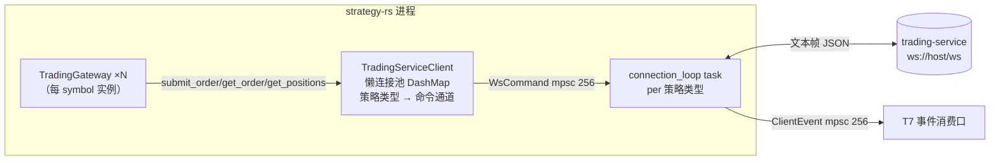
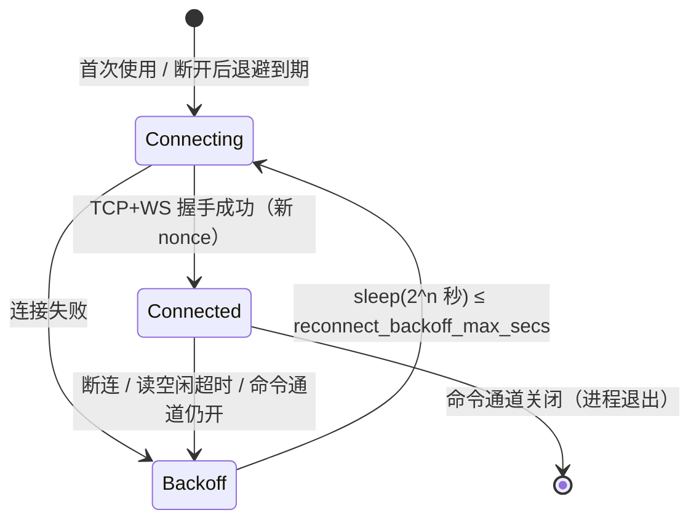
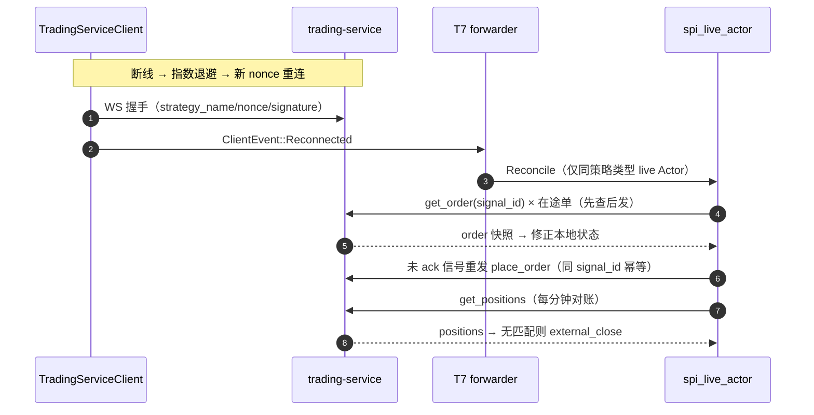

# 04 · trading-service 连接接口设计文档

> 版本：v1.4（2026-11-10 晚：**代码落地后全篇复核**——kline 并入已在代码侧完成（commit `539a7d5`+`1766c58`），§2.1/§3/§6 按契约 v0.3 与源码实况订正：帧名实为 `kline_1m(_batch)`/`kline_history`（非 `kline`/`klines`/`subscribed`）、bar 为命名字段对象（只推定稿、无 `is_final`）、K线帧与订单同走 per 策略类型交易连接（无独立共享 K线连接）、`get_klines` 要求 `exchange`、HTTP 兼容路径代码已不存在、`services.trading` 无 `market` 字段；行号随代码增长重锚。前序 v1.3：kline-service 并入设计；v1.2：D1b/D2 后已删实现引用重锚 + v1.0 坐标失真订正）· 基于源码逆向核对（`文件:行` 为真实落点）
> 视角：**strategy-template-rs（客户端）与 trading-service（服务端）的连接接口设计**。
> 消息契约原始件：`contracts/trading-service.md`（**v0.3**，含 §8 K线章）；客户端可执行规格：
> `crates/broker/src/trading_service.rs`（连接/提交/查询/订阅）、`crates/broker/src/wire.rs`（帧结构）、
> `crates/broker/src/auth.rs`（握手）、`crates/broker/mock.rs`（鉴权+成交+K线回放 mock）、
> `crates/app/src/ts_kline.rs`（K线 → `KlineClient` 端口适配）、
> `crates/broker/tests/async_gateway_e2e.rs`（端到端用例）。

---

## 1. 接口定位与设计原则

| 原则 | 含义 |
|------|------|
| 不直连交易所 | 模板只产信号与仓位视图；真实下单/换算/平今判定归 trading-service |
| 一条连接一个策略身份 | WS 握手绑定 `strategy_name`，服务端按此注册回调路由 |
| 帧内不重复身份 | `strategy_name` 不入业务帧；帧内只带交易要素 + `signal_id` |
| 幂等优先 | 重发/重连一律同 `signal_id`；服务端去重依赖 signal_id 回显 |
| 先查后发 | 重连/重启对账用 `get_order` 主动修正，不依赖 order_event 重放 |
| fail-closed 发单 | 无仓位/无精确成交量/本地闸门关闭 → 不发帧 |
| 前向兼容 | 新字段（`offset`/`fee`）不出现时旧帧逐字节不变 |
| 行情交易同门 | K线是 trading-service 的一个接口：同端点、同 HMAC 鉴权、同帧族（§6）；kline-service 退役 |

---

## 2. 连接模型

### 2.1 连接拓扑



- 拓扑事实（`trading_service.rs:1-8`）：一个客户端实例持有「策略类型名 → 一条认证 WS」的懒连接池；
  **同策略类型的多符号 `spi_live_actor` 实例复用一条连接**（真实服务 1 连接绑定 1 策略名）。
- 连接按需懒建（`conn_for`，`trading_service.rs:245`），首次下单/查询时才 spawn 连接任务。
- 事件唯一消费口：`start_arc` 返回 `mpsc::Receiver<ClientEvent>`（订单更新流 + 重连通知）。
- **K线与订单同连接收发**（kline 并入后，`trading_service.rs:1-8`、契约 §8）：K线帧不在独立连接上——`TradingServiceClient::subscribe_klines` 把订阅按 **(策略类型, exchange)** 分组登记到同一批 per 策略类型连接（重连逐组重发），推送经各连接回流后汇入 `kline_updates()` broadcast；`app/src/ts_kline.rs` 的 router 按 (venue, symbol) 单调水位去重（多策略类型订阅同 symbol 各推一份）后按 symbol 扇出给策略管线，`get_klines` 回填命令走同一客户端连接池。

### 2.2 端点与传输

| 项 | 值 | 出处 |
|----|----|------|
| 基础 URL | 配置 `services.trading.ws_url`（默认 `ws://127.0.0.1:9100/ws`；生产 `wss://trading.zkware.cn/ws`） | `config/_global.example.yaml:34` |
| 路径 | `/` 与 `/ws` 等价 | 契约 §1 |
| 帧格式 | 文本帧、JSON、UTF-8 | 契约 §1 |
| TLS | 客户端经 MaybeTlsStream 天然支持 `wss://` | 契约 §5.1 |

### 2.3 握手鉴权（`broker/src/auth.rs`）

```
ws://<host>/ws?strategy_name=<urlenc>&nonce=<64hex>&signature=<64hex>
```

| 参数 | 生成规则 |
|------|---------|
| `strategy_name` | 策略类型名（RFC 3986 percent-encode，`auth.rs:33-45`） |
| `nonce` | 每次（重）连接生成的 32 字节随机数 hex（`new_nonce`） |
| `signature` | `hex(HMAC_SHA256(SECRET_KEY, strategy_name + nonce))`（`sign`） |

- 密钥来自配置 `services.trading.strategy_secret`（或环境变量 `STRATEGY_SECRET`），**不上线传输、不入日志**。
- 验签恒定时间比较（`verify` + subtle::ConstantTimeEq）。
- 服务端当前只读 `strategy_name`（额外参数被忽略），客户端已前向实现；服务端开启强校验后无需改动。
- 连接建立后服务端可能先推 `welcome` 等非业务帧 → 客户端忽略。

### 2.4 连接生命周期与重连（`trading_service.rs:663` 起 `connection_loop`）



| 机制 | 参数 | 行为 |
|------|------|------|
| 指数退避 | 1→2→4…≤ `reconnect_backoff_max_secs`（默认 120s） | 无限重连（`connection_loop`） |
| 重连成功 | — | 事件流先发 `ClientEvent::Reconnected{strategy_name}` → T7 下发对账 |
| 应用层 Ping | 15s（`PING_INTERVAL`） | 服务端 south.rs 回 Pong，市场静默期保活 |
| 读空闲看门狗 | 30s（`READ_IDLE_TIMEOUT`） | 未收到任何帧（含 Pong）判半开死连，强制断开走退避 |
| 超时 | `request_timeout_ms`（默认 5000） | 在途请求判 Retryable，oneshot 随连接销毁失败 |

---

## 3. 逻辑通道总表

以帧内 `option`（出站请求）/ `type`（入站回调）区分：

| 方向 | 帧 | 用途 | 应答 |
|------|----|------|------|
| 出站 | `option:"place_order"`（开仓帧） | 开仓（order_cash+leverage） | `ack` / `error` |
| 出站 | `option:"place_order"`（平仓帧） | 平仓（quantity+reduce_only） | `ack` / `error` |
| 出站 | `option:"cancel_order"` | 撤单（client_order_id）**协议预留**：mock 服务端支持，但当前 `TradingServiceClient` 命令集仅 Submit/GetOrder/GetPositions，**客户端不发此帧**（撤单走 order_event 被动感知） | `ack(CANCELED)` / `error` |
| 出站 | `option:"get_order"` | 订单快照（按 signal_id） | `order` / `error` |
| 出站 | `option:"get_positions"` | 持仓查询（instrument+side 精确筛选） | `positions` / `error` |
| 出站 | `option:"subscribe_kline"` | 订阅 1m K线（symbols 批量，`exchange` 必填）**§6** | **无请求-应答**（Notify 类；订阅失败由 `error` 帧点名） |
| 出站 | `option:"unsubscribe_kline"` | 取消 K线订阅**§6** | **无请求-应答**（Notify 类） |
| 出站 | `option:"get_klines"` | K线历史回填（exchange+symbol+时间窗/根数）**§6** | `kline_history` / `error` |
| 入站 | `type:"ack"` | place_order 受理应答（status=NEW） | — |
| 入站 | `type:"order_event"` | 主动订单状态推送（PARTIAL/FILLED/…） | — |
| 入站 | `type:"order"` | get_order 应答 | — |
| 入站 | `type:"positions"` | get_positions 应答 | — |
| 入站 | `type:"kline_1m"` | 单根定稿推送（协议兼容形态，客户端双解析保留）**§6** | — |
| 入站 | `type:"kline_1m_batch"` | 同所批量定稿推送（**统一下发形态**，单根亦 batch）**§6** | — |
| 入站 | `type:"kline_history"` | get_klines 应答（`klines[]` 对象数组 + `has_more` 翻页）**§6** | — |
| 入站 | `type:"error"` | 拒绝/错误（status=REJECTED） | — |
| 入站 | 其他（welcome 等） | 忽略，不报错 | — |

---

## 4. 出站帧契约

### 4.1 开仓帧（`wire.rs:13-32` `PlaceOrderOpen`）

```json
{
  "option": "place_order",
  "exchange": "binance",
  "account": "test_binance",
  "instrument": "BTCUSDT",
  "instrument_type": "futures",
  "side": "long",
  "order_type": "market",
  "order_cash": "100",
  "leverage": 3,
  "signal_id": "sig_xxx"
}
```

| 字段 | 类型 | 说明 |
|------|------|------|
| `exchange` | string | 目标交易所实例名（服务端 registry 键）；取自 `{SYMBOL}.yaml`，缺省回落 `services.trading.exchange` |
| `account` | string | 账户名；同上回落 |
| `instrument` | string | 交易所原生标的（合约码/交易对） |
| `instrument_type` | `futures` | 恒 futures（金额单仅支持合约） |
| `side` | `long`/`short` | 开仓方向（服务端兼容 buy/sell，客户端发规范值） |
| `order_type` | `market` | 固定市价单 |
| `order_cash` | **string** | 每单名义金额（quote 币）；服务端按 `order_cash / 市价` 换算数量 |
| `leverage` | number | 杠杆倍数（>1 时服务端先幂等 set_leverage） |
| `signal_id` | string | 策略信号 ID；服务端在 ack/order_event 中原样带回 |
| `offset` | string? | 可选 `open`；**None 时字段整体不出现**（前向兼容钉死，`wire.rs:215-293` 测试） |

- 服务端换算参考价：优先共享 QuoteTable（binance mark，mark>mid>last），缺失走 REST ticker 兜底，均无 → REJECTED；数量按市价步长向下对齐。
- 数值一律**字符串形态**出帧（服务端 decimal 兼容）。

### 4.2 平仓帧（`wire.rs:39-56` `PlaceOrderClose`）

```json
{
  "option": "place_order",
  "exchange": "binance",
  "account": "test_binance",
  "instrument": "BTCUSDT",
  "instrument_type": "futures",
  "side": "short",
  "order_type": "market",
  "quantity": "0.01",
  "reduce_only": true,
  "signal_id": "sig_xxx"
}
```

| 字段 | 类型 | 说明 |
|------|------|------|
| `side` | `long`/`short` | 与持仓方向相反（持 long 发 short） |
| `quantity` | **string** | **必须逐字等于开仓 FILLED 回报的 filled_quantity 原始字面量**（`size_raw`，Decimal 递减口径），不得修改 |
| `reduce_only` | `true` | 恒 true |
| `offset` | string? | 可选 `close` / `close_today` / `close_yesterday`（平今/平昨显式化）；None ⇒ 服务端隐式判定 |

**发帧前置校验（fail-closed，`trading_service.rs:335-375`）**：
- 平仓前必须存在仓位；无仓位/quantity≤0/无精确成交量 → 本地拒发（Rejected）；
- `submit_enabled=false` 或实例闸门 `allow_submit=false` → 本地拒发，**绝不发真实下单请求**。

### 4.3 帧形判定规则（`trading_service.rs:329-371`）

| intent.offset | 帧形 |
|---------------|------|
| `Some("open")` | 开仓帧 |
| `Some("close"\|"close_today"\|"close_yesterday")` | 平仓帧 |
| `None`（旧链路） | 按 `position_id` 隐式判定（有=平仓）；帧内不出现 offset 字段 |
| 其他值 | warn + 回落隐式判定 |

### 4.4 撤单（cancel_order）——协议预留，客户端未实现

```json
{ "option": "cancel_order", "strategy_name": "sar_snt3", "client_order_id": "0x9f2c…" }
```
成功回 `type:"ack", status:"CANCELED"`；订单不存在/已终结回 `error`。

> 现状（`trading_service.rs` CmdKind 枚举）：客户端命令集只有 Submit / GetOrder / GetPositions，
> **不发送 cancel_order**；mock 服务端（`mock.rs:565/1251`）实现了该命令供协议联调。策略侧撤单感知
> 依赖 `order_event` 的 CANCELED 状态推送。若未来启用撤单，需在 CmdKind 增加 Cancel 并接 `ack`。

### 4.5 订单查询（get_order）

```json
{ "option": "get_order", "exchange": "binance", "account": "test_account", "signal_id": "sig_xxx" }
```
- 应答 `type:"order"`（订单快照）；服务端自动限定在握手策略名下（跨策略查询回 `error`）。
- 服务端三级查询（活动 / 当日终态 / 跨日历史）对客户端透明。
- 用途：重连/重启对账（先查后发）、在途单卡单轮询。

### 4.6 持仓查询（get_positions）

```json
{ "option": "get_positions", "exchange": "binance", "account": "test_account",
  "instrument_type": "futures", "instrument": "BTCUSDT", "side": "long" }
```
- 应答 `type:"positions", status:"OK", positions:[…]`；`instrument`+`side` 精确筛选，无仓返回**空数组**（不是错误）。
- 用途：每分钟远程仓位对账（远程无匹配仓位 → 本地 `external_close`，fail-open）。

---

## 5. 入站帧契约

### 5.1 统一事件体（`wire.rs:61-99` `InEvent`，宽松解析）

| 字段 | 类型 | 说明 |
|------|------|------|
| `type` | string | `ack` / `order_event` / `order` / `positions` / `error` |
| `status` | string? | 服务端状态（大写），映射见 §5.5 |
| `client_order_id` | string? | 服务端生成（0x+32hex）；ack 绑定后作为本地 order_id |
| `exchange_order_id` | string? | 交易所原生单号 |
| `signal_id` | string? | 回显；回报早于本地绑定时按它找回信号（不丢弃） |
| `filled_price` / `filled_quantity` | number\|string? | 数字或数字字符串双口径（`f64_or_zero`/`number_raw`） |
| `fee` | number\|string? | 本笔手续费（服务端升级后回传；缺失容忍 → 0 兜底） |
| `order_type`/`order_price`/`order_quantity` | ? | 实际委托要素（金额单换算结果，审计核对） |
| `reduce_only` | bool? | — |
| `positions` | WirePosition[]? | get_positions 应答数组 |
| `message` | string? | 拒单原文（REJECTED 时） |

### 5.2 受理应答（ack）

```json
{
  "signal_id": "sig_xxx", "type": "ack", "status": "NEW",
  "client_order_id": "0x9f2c…", "exchange_order_id": "XILI-1",
  "exchange": "binance", "strategy_name": "sar_supertrend",
  "instrument": "BTCUSDT", "side": "BUY", "order_type": "market",
  "order_price": 0, "order_quantity": 0.01, "reduce_only": false,
  "filled_price": 0, "filled_quantity": 0, "message": null, "positions": null
}
```

### 5.3 订单状态推送（order_event）

```json
{ "signal_id": "sig_xxx", "type": "order_event", "status": "FILLED",
  "client_order_id": "0x9f2c…", "exchange_order_id": "XILI-1",
  "reduce_only": false, "filled_price": 80000.5, "filled_quantity": 0.01 }
```

- 可多次 PARTIAL（只累积不入仓），最终 FILLED（入仓）；
- 客户端按 `signal_id` 关联本地信号，落账 `status/exchange_order_id/filled_price/filled_quantity`；
- **成交量同时保存原始字面量**（`filled_quantity_raw`，`trading_service.rs:82-98`），平仓帧 quantity 逐字取用。

### 5.4 拒绝（error）

```json
{ "type": "error", "status": "REJECTED", "client_order_id": null,
  "strategy_name": "sar_snt3", "message": "quantity 必须为正数" }
```

### 5.5 状态映射（`wire.rs:198` `map_status`，幂等前缀兼容大小写）

| 服务端 status | 客户端 OrderState | submit/处理语义 |
|---|---|---|
| `NEW` | Ack | submit 成功，返回 client_order_id |
| `PLACING` | Sent | 跳过（不产生状态转移） |
| `PARTIAL` | PartiallyFilled | 累积累计成交量，不入仓位 |
| `FILLED` | Filled | 产出 FillEvent 入仓位管理 |
| `CANCELED` | Canceled | 终态 |
| `REJECTED` / `EXPIRED` | Rejected | 永久失败（不重试） |
| `UNKNOWN` / 缺失 / 未识别 | — | submit 判**可重试**（ack fail-closed）；order_event 跳过该帧 |

---

## 6. K线接口（自 kline-service 并入）

> kline-service 已退役（归档 `docs/archive/kline-service.md`）：**K 线订阅/推送/回填是
> trading-service 交易连接上的一个帧族**（协议 §10，权威源 `contracts/trading-service.md` §8）。
> 与订单**同一批 per 策略类型连接**收发（§2.1），同握手鉴权；语义基线：只推**定稿** 1m bar
> （无未闭合快照）、断开期间不补推历史（补缺走 `get_klines` 或本地 CSV）。
> 预热/补缺口径 = 本地 1m CSV 为主 + `get_klines` 分页补足（`ts_kline.rs`、`warmup.rs`）。

### 6.1 帧总表

| 方向 | 帧 | 用途 | 应答 |
|------|----|------|------|
| 出站 | `option:"subscribe_kline"`（别名 `subscribe_klines`） | 订阅 1m K线（`exchange` 必填 + symbols 批量） | **无请求-应答关联**（Notify 类；失败由 `error` 帧点名） |
| 出站 | `option:"unsubscribe_kline"`（别名 `unsubscribe_klines`） | 取消订阅（`symbols` 缺省=全停） | **无请求-应答关联** |
| 出站 | `option:"get_klines"` | 历史查询（exchange+symbol+时间窗/根数） | `kline_history` / `error` |
| 入站 | `type:"kline_1m_batch"` | **统一下发形态**：同所同分钟定稿 bar 聚为一帧数组（单根亦 batch） | — |
| 入站 | `type:"kline_1m"` | 单根定稿推送（协议兼容形态，客户端双解析保留） | — |
| 入站 | `type:"kline_history"` | get_klines 应答（`klines[]` 同形对象 + `has_more` 翻页） | — |

- 帧形与载荷定义镜像 trading_service_rust `trading-core/src/protocol.rs`（`WireKline`，`wire.rs:113-145`）；
- `subscribe_kline`/`unsubscribe_kline` **不入在途表**（`CmdKind::Notify`，`trading_service.rs:126-128`）；
  `get_klines` 入在途表（`CmdKind::GetKlines`，关联键=帧顶层 `symbol` 回声，`trading_service.rs:122-123`）。

### 6.2 订阅（subscribe_kline / unsubscribe_kline，契约 §8.1）

```json
{ "option": "subscribe_kline", "exchange": "binance", "instrument_type": "futures",
  "symbols": ["BTCUSDT"], "interval": "1m" }
```

- `exchange` **必填**（精确名）；`symbols` 为具体合约/标的（CTP 如 `cu2512`），
  亦支持 **CTP 品种前缀**（`cu`）——服务端展开为该品种在交易合约并只推当前主力，
  换月随帧内 `symbol` 变化；单标的可写 `symbol`/`instrument`；
- 策略身份由握手绑定，**不入帧**（与交易帧纪律一致）；
- `interval` 仅支持 `1m`（缺省/空 = 1m，其余周期拒绝）；大周期由 engine 聚合器本地聚合；
- **无请求-应答关联**：不回 `subscribed` 之类确认帧；订阅失败/拒订阅由 `error` 帧点名；
- 同连接重复订阅幂等；多连接同标的服务端只向交易所订一份（引用计数）；
- 订阅是**连接级**的：断线即失效（服务端自动清退），重连必须重发——客户端按
  **(策略类型, exchange)** 分组登记，重连逐组重发（同策略跨交易所订阅互不覆盖，
  `trading_service.rs:264` `subscribe_klines`、重发 `:685/:744`）；
- `unsubscribe_kline` 同形（`symbols` 缺省 = 全停）。

### 6.3 实时推送（type:"kline_1m_batch" / "kline_1m"，契约 §8.2）

**统一只下发 `kline_1m_batch`**（同交易所、同分钟定稿的多根 bar 聚为一帧数组，
组内按 `(symbol, start_time)` 升序；该分钟仅一根时数组长度也为 1）；单根
`{"type":"kline_1m","kline":{…}}` 为协议兼容形态（客户端双解析保留）：

```json
{ "type": "kline_1m_batch", "klines": [
  { "venue": "binance", "symbol": "BTCUSDT", "interval": "1m", "trading_day": 20261110,
    "start_time": 1789636860000, "end_time": 1789636920000,
    "open": "76700.00", "high": "76705.50", "low": "76677.00", "close": "76685.80",
    "volume": 74, "quote_volume": "5695878.37", "trade_num": 1449,
    "active_buy_volume": "39.003", "active_buy_quote_volume": "2991311.07" }
] }
```

bar 载荷 = **12 个公共命名字段 + 各所 extras 平铺**（`wire.rs:113-145` `WireKline`，
宽松解析，**勿开 deny_unknown_fields**）：

| 字段 | 类型 | 说明 |
|------|------|------|
| `venue` | string | binance / ctp / … |
| `symbol` | string | 标的；CTP 如实为具体合约（品种前缀订阅时帧内变主力合约，换月会变） |
| `interval` | string | 恒 `1m` |
| `trading_day` | u32 | YYYYMMDD（CTP 夜盘归次日；mock 简化按 UTC 日） |
| `start_time` / `end_time` | i64 | 桶起止（UTC 毫秒，左闭右开） |
| `open/high/low/close` | decimal（JSON 字符串） | OHLC |
| `volume` | i64 | 周期成交量（增量） |
| `quote_volume` | decimal | 周期成交额（增量） |
| `trade_num` / `active_buy_volume` / `active_buy_quote_volume` | binance extras | 其余所可缺省 |
| `exchange_id` / `open_interest` | ctp extras | 币圈所无 |

- **只推定稿 bar，无 `is_final` 字段**（未闭合快照不存在于此路径；旧 kline-service 的
  `is_final`/`data` 包装口径已随退役作废）；断开期间定稿的 bar **不补发**（历史走 §8.5）；
- K线帧不携带策略身份（广播给订阅连接）；多策略类型订阅同 symbol 时各连接各推一份——
  `ts_kline` router 按 **(venue, symbol) 单调水位去重**，下游每根只投一次（Actor
  `last_handed` 二道闸）；
- 定稿 bar 走**独立 broadcast 通道**（`kline_updates()`，`trading_service.rs:323`），
  不占订单事件 mpsc；消费落后 `Lagged` 由策略侧 backfill 自愈。

### 6.4 历史查询（get_klines → kline_history，契约 §8.5）

```json
{ "option": "get_klines", "exchange": "binance", "symbol": "BTCUSDT",
  "start_time": 1761696000000, "end_time": 1761699600000, "limit": 300 }
```

应答 `type:"kline_history"`：

```json
{ "type": "kline_history", "exchange": "binance", "symbol": "BTCUSDT",
  "has_more": true, "start_time": 1761696000000, "end_time": 1761699600000,
  "klines": [ { "venue": "binance", "symbol": "BTCUSDT", "interval": "1m",
    "trading_day": 20261110, "start_time": 1761696000000, "end_time": 1761696060000,
    "open": "76700.00", "high": "76705.50", "low": "76677.00", "close": "76685.80",
    "volume": 74, "quote_volume": "5695878.37", "trade_num": 1449,
    "active_buy_volume": "39.003", "active_buy_quote_volume": "2991311.07" } ] }
```

- 请求：`exchange`/`symbol` **必填**；`start_time`（含）/`end_time`（不含）UTC 毫秒，均可省；
  `limit` 缺省 300、超 1500 服务端截断。缺 `start_time` = 取窗口内**最近** `limit` 根（升序返回）；
  给了 `start_time` = 窗口内最早 `limit` 根（正向翻页）。
- 应答：`klines[]` 元素与 §6.3 bar **完全同形**（命名字段对象，非裸数组）；顶层带
  `exchange`/`symbol`（客户端关联键）/`has_more`/实际生效的 `start_time`/`end_time`。
- 服务端只读**本地留存**（内存保留窗 + 归档 CSV），不调交易所；无数据回**空数组**（不是错误）；
  参数非法（缺 exchange/symbol、`start_time >= end_time`、非 1m）回 `error` 帧。
- 客户端实现（`trading_service.rs:528-571` `get_klines`）：oneshot 关联、`symbol` 回声精确
  匹配 → FIFO 兜底（`take_klines:920`）；超时/断线 Retryable。续翻步长 = 本页最早 bar 的
  `start_time` 作下页 `end_time`。
- 回填路径（`ts_kline.rs` `backfill`）= **本地 1m CSV 为主 + `get_klines` 分页补足**缺口，
  两路皆空才报错（`warmup.rs` 合并去重后截取 `warmup_bars` 根）。

### 6.5 重连与补缺

- 指数退避重连（1→2→4…≤`reconnect_backoff_max_secs`），无限重连（与交易连接同一机制）；
- 订阅是连接级的：重连后按 (策略类型, exchange) 分组登记**逐组重发** `subscribe_kline`；
- 每次（重）连成功：`ClientEvent::Reconnected` → 触发 `get_klines` 窗口补缺
  （**只进聚合/缓存，不重放历史信号**）；闭合 K线背压等待语义在消费端 broadcast
  （落后 `Lagged(n)` 自愈回补）。

### 6.6 期货形态（并自 kline-service §5，契约 §8.2）

- symbol 用**合约码**（`CU2601` / CTP 线协议 `cu2512` 形态，与 `config/contracts.yaml` 键一致）；
  品种前缀订阅（`cu`）由服务端展开只推**当前主力**（选举需连续 N 个有数据交易日胜出，
  月份只进不退），换月随帧内 `symbol` 变化；主连序列由上游产出（或 `roll_build` 工具），
  模板不拼接换月；
- `trading_day`：CTP 夜盘归次日（服务端按交易日历决定；mock 简化按 UTC 自然日）；
  午休/隔夜/节假日空档为**正常休市**——不触发补缺、不计入缺 bar、不打断指标连续性；
- 回填窗口：客户端 warmup 取**最近 N 根**（`warmup_bars`），本地 CSV + `get_klines` 分页，
  无「crypto 墙钟 / futures 交易日折算」的 `market` 配置开关（旧 `services.kline.market`
  随退役作废；`trading_calendar.rs` 已删除）。

---

## 7. 请求-应答关联语义

| 机制 | 设计 |
|------|------|
| 在途表 | 连接任务维护 `pending: VecDeque<PendingEntry>`（`trading_service.rs:140-148`）；`CmdKind` 五类：Submit / GetOrder / GetPositions / **GetKlines** / **Notify**（`trading_service.rs:115-128`） |
| 关联键 | `signal_id` 精确匹配（Submit/GetOrder）；GetPositions 按 `instrument`；**GetKlines 按 `symbol` 回声**（`take_klines:920`，FIFO 兜底）；Notify（订阅/退订）**无应答、不入在途表** |
| 退化 | 服务端未回显 signal_id → FIFO（同连接 submit 逐条 await，同时仅一个在途） |
| 超时 | `request_timeout_ms` 到期 → Retryable 失败，oneshot 释放 |
| 连接断开 | 在途全部随连接销毁 → 可重试失败，由信号状态机下次对账重发 |
| 事件分发 | 入站 push 走事件流 → T7 `OrderRouter` 按 order_id 精确路由；未知单按帧内 strategy_name 限定同策略类型广播，无身份全量兜底（`order_router.rs:36-56`） |

---

## 8. 断线重连与对账流程



**重连原则（契约 §2）**：从未收到 ack 的信号**重发**（幂等）；已 ack 在途单经 `get_order` **对账修正**状态，不靠 order_event 重放。

---

## 9. 期货语义（CTP 品种，契约 §7）

> 行情侧期货语义（合约码 / 交易日回填窗口 / 休市缺口）见 §6.6；本节只讲交易侧。

模板侧只负责**发信号**；整数手换算、保证金、平今/平昨归服务端：

| 项 | 口径 |
|----|------|
| 开仓帧 | 仍只发 `order_cash + leverage`；服务端按合约乘数/保证金率/手续费换算整数手 |
| 平仓帧 | `quantity` = 整数手字符串（取持仓行 `remaining_size_raw`），`reduce_only=true` |
| 平今/平昨 | 服务端按 CTP 交易日决定；模板不发 offset（显式化时发 `offset` 字段，服务端可选用） |
| 回测口径一致性 | `config/contracts.yaml` 同名字段仅用于回测/paper 撮合，**必须与服务端同一费率口径**（否则回测与实盘不可比） |
| 时段约束 | 模板侧自执行禁交易窗口；不得假设服务端替它执行 |
| 未声明合约 | `contracts.yaml` 未收录 → crypto 兼容口径（小数数量 + fee-rate），不得混用期货字段 |

---

## 10. 安全约定

| 控制 | 实现 |
|------|------|
| 双保险发单闸门 | `TradingConfig.submit_enabled`（默认 false）+ `TradingGateway.allow_submit`（mode=live 才 true）；paper 装配强制 false |
| 数量安全 | `default_quantity<=0` 且信号未带数量 → 本地拒绝；平仓 quantity 必须逐字等于成交回报量 |
| 密钥管理 | HMAC 密钥不入库（`_global.yaml` 占位）→ 环境变量 `STRATEGY_SECRET`；签名不入日志 |
| 握手失败 | 缺参数/nonce 重放/签名不符 → mock 直接 HTTP 401，不升级 WebSocket、不分配连接资源 |
| nonce 防重放 | 5 分钟窗口（mock 实现；真实服务上线后以其实现为准） |
| 传输 | 生产应使用 `wss://`（客户端天然支持） |

---

## 11. 客户端配置接口

```yaml
services:
  trading:
    ws_url: wss://trading.zkware.cn/ws   # 基础 URL（/ 与 /ws 等价）；K线接口同端点
    request_timeout_ms: 5000             # 在途请求超时（Retryable）
    submit_enabled: true                 # 全局发单开关（默认 false）
    reconnect_backoff_max_secs: 120      # 指数退避上限（交易/K线连接共用）
    strategy_secret: "REPLACE_WITH..."   # HMAC 密钥（env STRATEGY_SECRET 覆盖）
    exchange: binance                    # per-symbol 未配置时回落
    account: test_binance                # per-symbol 未配置时回落
```

per-symbol 覆盖（`app/src/config.rs:223-246` `SymbolEntry`）：`exchange` / `account` / `leverage` / `cash`（order_cash）/ `mode`（live|paper_trading）。

**kline 并入迁移**：`services.kline`（`backfill_url` / `ws_url` / `market` / `source`）**已整节退役**——回填走 `get_klines` 帧（§6.4），
订阅走 `subscribe_kline`（§6.2）；`market` 口径不再需要（回填窗口由客户端按 bar 时间分页决定，
交易日归属由帧内 `trading_day` 与引擎 session 规则承担）。无 HTTP 兼容路径；存量 yaml 的
`services.kline` 节保留即 `run` 拒启。

配置缺失 → `run` 命令 fail-fast（不静默用占位端点）。

---

## 12. 错误语义汇总

| 场景 | SubmitError 分类 | 信号状态机动作 |
|------|-----------------|---------------|
| 服务端 error/REJECTED/EXPIRED | Rejected | Failed 终态（不重试），last_error 留痕 |
| 超时 / 断连 / UNKNOWN / WS 不可用 | Retryable | Failed → 退避重发（`RetryPolicy`：max_attempts=3 为总提交次数**含首发**，即最多重试 2 次；退避 1s 翻倍上限 60s） |
| 本地闸门关闭 / 平仓量非法 | Rejected | Failed/Rejected（不发帧） |
| get_order 查无 / 越权 | error | 对账路径记录告警 |
| get_positions 空数组 | 正常 | 视为无仓（可触发 external_close） |
| get_klines 应答等待超时 | Retryable | 回填路径降级（本地 CSV 兜底/告警），不动订单状态机（`trading_service.rs:571`） |
| K线订阅被拒（error 帧） | — | Notify 类无在途；日志点名（CTP 品种前缀口径差由扇出 warn+计数兜底） |

---

## 13. 已知限制

1. **本地模拟器（xili-exchange）不支持金额单**：开仓 `order_cash` 换算无行情 → REJECTED；平仓 quantity 路径不受影响。
2. **无 order_event 重放**：冷启动/重连错过的推送无法追回，靠 `get_order` 主动对账兜底。
3. 市价单价格由交易所撮合（order_price=0）。
4. 真实服务当前不强制 TLS（生产应用 `wss://`）。
5. 服务端对 `signal_id` 的幂等去重与回显需联调验证（契约层已约定）。
6. **K线帧以服务端实现契约 §8 为前提**；`docs/archive/kline-service.md` 已归档，其语义基线由 `contracts/trading-service.md` v0.3 §8 接管（§15 纪律）。mock 与真实的口径差异：`trading_day` mock 按 UTC 自然日（真实 CTP 夜盘归次日）、品种前缀订阅 mock 不做主力选举（帧内 symbol 恒为订阅名）——以真服务验收覆盖。
7. **推送无未闭合快照**：live 路径只收定稿 bar（`kline_1m(_batch)`），`KlineEvent::Tick` 为端口保留形（本路径不产生）；断开期间定稿 bar 不补发，靠 `get_klines`/本地 CSV 补缺。

---

## 14. 验收用例（可执行规格）

| 用例 | 位置 | 断言要点 |
|------|------|---------|
| 帧形序列化逐字节兼容 | `wire.rs:215-293` | offset=None 时旧帧不变；offset 出现时落帧 |
| 宽松解析 | `wire.rs:296-325` | 缺字段/别名/数字字符串双口径 |
| 状态映射全覆盖 | `wire.rs:327` 起 | NEW/PLACING/PARTIAL/FILLED/CANCELED/REJECTED/EXPIRED/UNKNOWN |
| 握手 URL 与签名 | `auth.rs` 测试 | percent-encode、HMAC、恒定时间验签 |
| 端到端（mock 服务） | `broker/tests/async_gateway_e2e.rs` | 下单→ack→order_event→仓位；重连对账；重试；K线订阅/回放/get_klines；`get_order` 快照/`get_positions` 净持仓镜像对账（mock 已补齐，commit `1766c58`） |

---

## 15. 接口变更纪律

1. 改帧字段/状态映射必须同步修订 `contracts/trading-service.md` 与本文档，并更新 `wire.rs` 序列化测试（前向兼容钉死）。
2. 新增可选字段一律 `#[serde(default, skip_serializing_if = "Option::is_none")]`，保证旧帧逐字节不变。
3. 数量/价格出帧保持字符串形态；入站保持数字/字符串双宽容解析。
