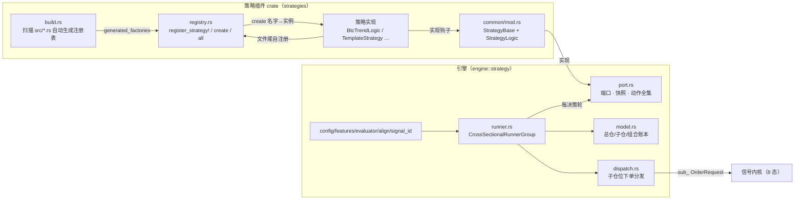
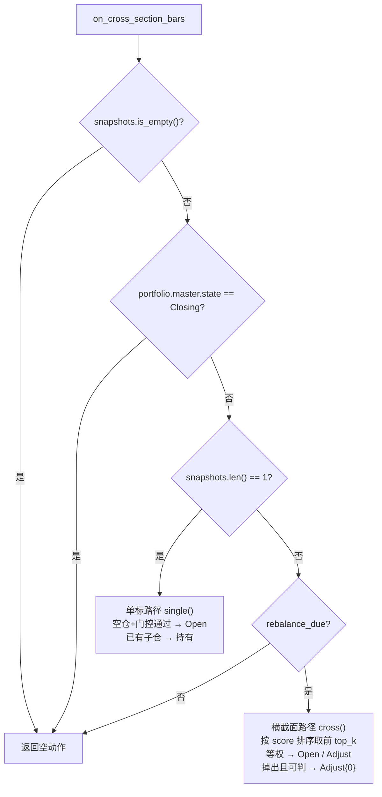
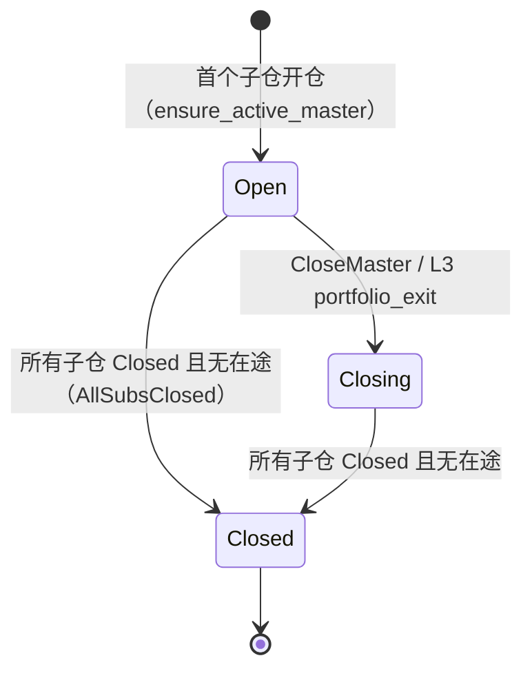
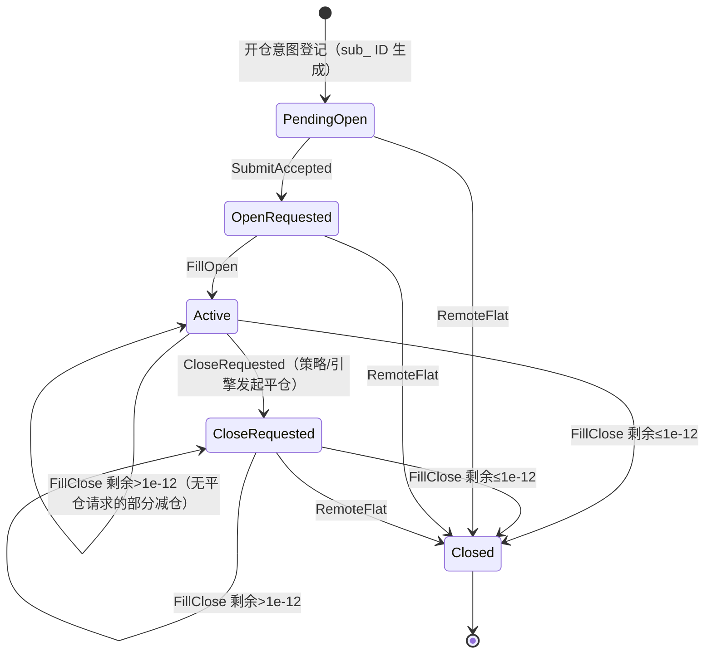
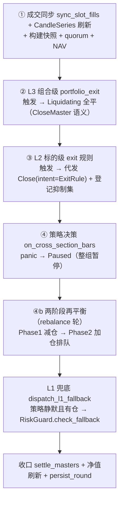

# 05 · 策略架构设计文档（strategy-template-rs）

> ## ⚠️ 状态：设计时快照（2026-11-25 收口加注，不再随代码更新）
>
> 本包是设计阶段的需求/架构/接口快照，仅用于理解设计意图。策略清单、行号与行数均已过期：
> 现行契约见 `docs/strategy/`，策略实现以 `crates/strategies/src/`（template_trend / template_xsec_ls）为准。

<!-- refcheck:coords=off -->

> 版本：v2.0（2026-11-13 **按重构后代码全量重读复核**：运行时模块 `engine::xsec` 已改名 `engine::strategy`（commit `9aaf19e`），类型 `Xsec*`→`Strategy*`；新增策略基类 `StrategyBase`+`StrategyLogic`（commits `33ce6d8`/`8acec0d`）；新增总仓/子仓仓位模型与资金上限（commit `9948c65`，`CloseMaster`/`MasterContext`/`max_total_notional`）；契约侧补 `sizing.max_position_pct`、live `order_cash` 影子数量与「拒单 vs 静默跳过」口径（commits `518fe09`/`8299d57`）；测试数 695（另 95 个 `#[tokio::test]`）。v1.0（2026-11-12 统一策略接口重构后的首版逆向还原）。· 基于源码逆向核对（`文件:行` 为真实落点）
> 前置阅读：[01-需求分析](01-需求分析.md)、[02-架构设计](02-架构设计.md)、[03-详细设计](03-详细设计.md)；开发者向教程见 [`docs/strategy/XSEC_GUIDE.md`](../strategy/XSEC_GUIDE.md)（怎么写策略）、[`docs/strategy/POSITION_MODEL.md`](../strategy/POSITION_MODEL.md)（仓位模型契约）。本文讲"架构为什么长这样"，教程讲"怎么用"。

---

## 1. 设计目标与总览

**一套策略接口横跨单标、横截面与组合策略**，策略作者只写 alpha，其余全部由引擎承担：

| 目标 | 落法 |
|---|---|
| G2 新增策略零侵入 | 复制一个 `.rs` 文件 + 文件尾 `register_strategy!`，`build.rs` 自动装配，不改任何其他文件 |
| G3 回测 ≡ 实盘 | 同一端口实现、同一 `CrossSectionalRunnerGroup` 轮次主循环（横截面）/ `ExchangeRunner` 主循环（单标），同一信号/仓位同步内核 |
| 单标 → 横截面平滑升级 | N=1 与 N>1 是同一份代码：`universe` 加一行即升级（`StrategyBase` 按快照数自动选路径） |
| 策略作者零引擎负担 | 策略只面对 `InstrumentSnapshot` / `PortfolioContext` / `InstrumentAction`；K 线接收、指标计算、配置规则、止损止盈、动作派发、仓位账本全在引擎 |
| 仓位模型可审计 | 策略账本 `StrategyPortfolio` → 总仓 `MasterPosition` → 标的子仓 `SubPosition`，全部落 Store、可重启恢复 |



**两种宿主形态**（02 §1.3）：
- 单标/教学策略：`spi_live_actor` 每实例一内核（`ExchangeRunner::on_event`，`core/runtime.rs:131`），策略经 `PortStrategyBridge` 挂入；
- 统一端口策略（含横截面）：`strategy_live_actor`（`app/src/strategy_live_actor.rs:96` `spawn_strategy_live`）承载 `CrossSectionalRunnerGroup` 单线程事件泵，与回测共用同一段轮次主循环（G3）。

---

## 2. 统一策略端口

### 2.1 trait 签名（`engine/src/strategy/port.rs:155-170`）

```rust
pub trait CrossSectionalStrategyPort: Send {
    fn strategy_type(&self) -> &str;                                // 与注册名、配置 strategy_type 一致
    fn timeframes(&self) -> Vec<Timeframe> { vec![Timeframe::M1] }   // 仅声明周期，默认只 1m
    fn on_cross_section_bars(
        &mut self,
        newly_closed: &[Timeframe],        // 本轮新闭合的周期（只会是声明过的值）
        snapshots: &[InstrumentSnapshot],  // 全 universe 的已闭合决策输入（单标时恰一元素）
        portfolio: &PortfolioContext,      // 组合级账户 / 总仓快照
    ) -> Vec<InstrumentAction>;            // 组合动作流（派发前由引擎按 key 排序）
}
```

**历史命名与通用别名**（`port.rs:173`）：`CrossSectionalStrategyPort` 是历史命名，`port.rs`
底部 `pub use self::CrossSectionalStrategyPort as StrategyPort;` 提供通用别名；新代码/文档
一律可称 `StrategyPort`，二者是**同一个 trait**（不是两个端口）。

生命周期：构造（注册表工厂）→ `timeframes()` 声明周期 → 每个 base TF 决策轮调用一次。
**红线**：输入只含已闭合数据——`InstrumentSnapshot.closed` 是只读视图，端口不提供 `now()`，
未闭合 K 线不可见（`port.rs:56`），未来函数无法编译。

### 2.2 输入类型

**`InstrumentSnapshot`**（`port.rs:39-58`）——单标的一根已闭合 bar 的全部决策输入：

| 字段 | 含义 |
|---|---|
| `instrument` / `bar` / `position` | 标的、当前已闭合 bar、该标的仓位视图（`Option<PositionView>`，含止损价/峰值/exit_active） |
| `stale` | 数据过期（流动性枯竭/上行中断）；`true` 时不得开仓或参与排名 |
| `features` | `FeatureMap`（`strategy/features.rs:30`，`number()`/`label()`）；缺失特征返回 `None`，不伪造 0/NaN |
| `entry_eligible` / `entry_reason` | 配置 `entry` 规则纯函数结果（`evaluator::entry_eligible:29`）；空 `entry` 视为合格 |
| `exit_triggered` | 配置 `exit` 规则已触发；引擎 L2 自动平仓并抑制该标的策略动作 |
| `closed: Option<CandleSeries>` | 已配置周期的已闭合序列视图（只读，`bridge.rs:58`） |
| `trading_day` / `no_trade` / `entry_confirm` / `signal_resume` / `cooldown` / `session_open_price` | 交易日与门控扩展字段；冷却判定封装为 `in_stop_loss_cooldown()`（`port.rs:177`，按 `bar.open_time+1m` 日历日） |

**`PortfolioContext`**（`port.rs:62-78`）——组合级账户与总仓快照：

| 字段 | 含义 |
|---|---|
| `strategy_id` / `nav` / `drawdown` / `portfolio_pnl_pct` | 组合身份与账户水位 |
| `sub_positions` | 子仓位账本（`state != Closed` 为活动子仓） |
| `master: Option<MasterContext>` | 活动总仓快照（`port.rs:31`：`master_id`/`state`/`view`）；无总仓为 `None` |
| `multipliers` | `instrument.namespaced_key()` → 合约乘数（`MasterPositionView` 计价口径，缺省 1.0） |
| `max_total_notional` | 组合总名义预算（NAV 比例，即 `risk.max_total_notional`）；**调仓目标必须与执行层容量闸门同口径** |
| `rebalance_due` / `no_trade` | 调仓门控（有在途减仓/加仓时为 false）/ 组合级禁交易 |

### 2.3 动作全集（`InstrumentAction`，`port.rs:82-131`）

| 动作 | 下游效果 |
|---|---|
| `Open{instrument,side,price,stop_price,atr,strength,reason}` | 开仓并登记初始止损 |
| `Close{instrument,price,reason,is_stop_loss,strength}` | 平单个子仓 |
| `Reverse{instrument,side,...,close_reason,is_stop_loss}` | **先平后开，平仓失败则放弃开仓**（dispatch 层保证） |
| `Adjust{instrument,target_qty,reason}` | 调整到带符号净数量（多头为正），**不产生信号 ID**；目标口径见 §7.3 |
| `CloseMaster{reason,is_stop_loss}` | **组合级平仓**：平掉本策略全部非 `Closed` 总仓及其子仓；无总仓 no-op；子仓全 `Closed` 后收口 |
| `UpdateStop{instrument,stop_price}` | 更新持仓止损价（"只朝有利"是策略层约束），不产单 |
| `UpdateExit{instrument,exit_active,exit_price}` | 更新 SAR 触及制离场状态，不产单 |
| `Hold` | 组合级 no-op（无标的） |

**派发排序口径**（`port.rs:138-148`）：动作流在派发前必须按 `instrument_key()`
（= `InstrumentId::namespaced_key()` 字典序）升序排序——f64 逐位确定、与策略构造顺序无关；
`Hold`/`CloseMaster` 无 instrument（排在最前）。`CloseMaster` 在 `dispatch_actions:1589`
被**优先处理**，随后总仓进入 `Closing`，本轮任何 `Open`/加仓都会被兜底拦截（平仓优先）。

**单标桥降级规则**（`bridge.rs:250-252`）：engine SPI 的 `StrategyAction` 无 `Adjust`/`CloseMaster`，
`PortStrategyBridge` 一律映射为 `StrategyAction::Hold`——**显式降级、禁止误映射成开/平仓**
（测试钉死 `bridge.rs:495-520`）。

---

## 3. 策略基类：`StrategyBase` + `StrategyLogic`

**定位**（`strategies/src/common/mod.rs:1-6`）：引擎已统一 K 线接收、指标计算、配置入场规则、
组合止损与动作派发，本模块只保留策略特有的三件事——**打分、入场过滤、止损定义**。

### 3.1 钩子接口（`crates/strategies/src/common/mod.rs:20-43`）

| 钩子 | 回答的问题 | 约束 |
|---|---|---|
| `name()` | 注册名 | 必须与 `register_strategy!` 名、配置 `strategy_type` 一致 |
| `top_k()` | 横截面保留数 | 单标路径忽略；横截面路径实际选股数 |
| `score(snapshot)` | 排名分数 | `None` = 特征缺失/无法判定，**不参与排名也不开仓**（不得按 0 参与） |
| `entry_allowed(snapshot)` | 策略私有入场门槛 | 在 `stale` / `entry_eligible` 之外叠加 |
| `stop(snapshot)` | 止损定义 `StopSpec` | `None` = 本轮不开仓（开仓动作必须携带止损价） |

**`StopSpec`**（`crates/strategies/src/common/mod.rs:47-93`）：`Percent(pct)`（占价格百分比）或
`Atr{mult, fallback_pct, min_distance_pct, max_distance_pct}`（ATR 缺失/非法时回退百分比，
并可夹上下限）；`percent_stop()`（`:96`）把百分比夹在 `[0.1%, 99%]`，防零/负止损价。

### 3.2 基类固定行为（`strategies/src/common/mod.rs:104-293`）



- **单标路径**（`single:144`）：`stale` / `!entry_eligible` / `!entry_allowed` / 已有活动子仓
  任一成立即空动作；否则按 `stop()` 计算止损价开多（`Open{ side: Long, price: close, atr: 0.0, strength: 1.0 }`）。
- **横截面路径**（`cross:170`）：过滤 `stale`，按 `score` 降序、同分按 `namespaced_key` 升序
  取前 `top_k`；命中者无仓则开仓、有仓则按目标数量 `Adjust`；掉出者若数据可判且 `qty>1e-12`
  则 `Adjust{target_qty: 0}`；`stale`/缺特征**保持仓位**，等下一个可判定的调仓轮（避免缺数据误平仓）。
- **目标数量口径**（`cross:227-243`）：`target = weight * max_total_notional * nav / (price * multiplier)`，
  `weight = 1/top_k`；容差 `1e-9 * max(current, 1.0)` 内视为已在目标，不发动作。
- **总仓门控**（`on_cross_section_bars:277-284`）：`master.state == Closing` 时直接返回空动作
  （开仓/加仓/调仓均无意义），等子仓全部收口后再决策。
- **退出交给引擎**：止损/止盈/组合回撤由配置 `exit` / `portfolio_exit` 处理，基类**不产生 `Close`**。

---

## 4. 策略注册表（工厂制，`strategies/src/registry.rs`）

### 4.1 三个角色

| 角色 | 落点 | 职责 |
|---|---|---|
| `StrategyEntry` | `crates/strategies/src/registry.rs:26-32` | 注册表条目：`name`（小写蛇形，进 signal_id 与报表行键）+ `factory: fn(&FactoryArgs) -> anyhow::Result<Box<dyn CrossSectionalStrategyPort>>` |
| `register_strategy!` | `crates/strategies/src/registry.rs:46-56` | 策略文件尾部自注册宏（**每个策略文件恰好调用一次**），生成 `pub(crate) fn __strategy_entry()` |
| `create` / `all` | `crates/strategies/src/registry.rs:59-78` | 运行时工厂查询（app 调用）；未知名字时错误信息**动态列出全部可用策略** |

**`FactoryArgs`**（`crates/strategies/src/registry.rs:15-23`）：`symbol`、`timeframe`（主周期字符串，各策略自行 parse）、
`cash`（每单名义金额）、`params`（`Option<&serde_json::Value>`，配置 `params` 原样透传，`None` = 全默认）。
工厂参数取配置首个 instrument；横截面策略忽略 `symbol/timeframe/cash`（`app/src/strategy_config.rs:504-519` `build_strategy`）。

**`params_or_default<T>`**（`strategies/src/registry.rs:84-92`）：策略私有参数统一解析入口——存在则反序列化、
否则 `T::default()`；参数结构体约定 `#[serde(default, deny_unknown_fields)]`（拼错字段名启动即报错）。

### 4.2 build.rs 自动装配（`strategies/build.rs`）

```text
src/*.rs（排除 lib.rs / registry.rs，按文件名排序保证确定性）
  → 生成 OUT_DIR/strategy_registry_gen.rs：
      #[path = ".../src/btc_xsec_trend.rs"] pub mod btc_xsec_trend;  …
      fn generated_factories() -> Vec<StrategyEntry> {
          vec![ btc_xsec_trend::__strategy_entry(), … ]
      }
  → lib.rs `include!` 汇合（lib.rs 头部为「模板冻结区」，新增策略不改它）
```

新增策略 = 往 `src/` 放一个 `.rs` 文件，下次 `cargo build` 自动编入注册表。
约束由测试钉住（`strategies/src/registry.rs:95-150`：小写蛇形、注册存在性、未知名字列出可用项）。

---

## 5. 运行时框架模块导览（`engine/src/strategy/`，10 模块约 10.0k 行）

| 模块 | 职责 | 关键落点 |
|---|---|---|
| `port.rs`（378） | 端口、快照、组合上下文、动作全集（本文 §2） | trait `:155-170`、别名 `:173`、`InstrumentAction:82`、`MasterContext:31` |
| `model.rs`（705） | 仓位模型：总仓 3 态 + 子仓 5 态 + 组合账本 + 聚合视图（本文 §6） | `SubPositionState:30`、`advance_sub_state:79`、`MasterPositionState:168`、`advance_master_state:186`、`StrategyPortfolio:248`、`master_position_view:310` |
| `runner.rs`（5471） | 单标的切片 `StrategySlot` + 多标的对齐轮次 `CrossSectionalRunnerGroup` + 决策轮编排（本文 §7） | `StrategySlot:58`、`CrossSectionalRunnerGroup:180`、`on_event:320`、`flush_round:1084`、`recover_from_store:655`、`resume_from_store:858`、`reconcile_remote:876` |
| `dispatch.rs`（1356） | 子仓位开/平/调仓下单分发（本文 §6.4） | `StrategyIds:27`、`DispatchOutcome:37`、`open_position:45`、`close_position:180`、`adjust_position:246`、`add_to_position:336` |
| `config.rs`（679） | `StrategyConfig` schema + 装配期结构校验（本文 §9） | `StrategyConfig:20`、`validate_config:267`、`resolved_rule_summary:452` |
| `signal_id.rs`（132） | `sub_` 确定性信号 ID（本文 §8） | `SubIntent:12`、`generate_sub_signal_id:42` |
| `features.rs`（443） | 配置指标 → 已闭合序列计算 → `FeatureMap` | `FeatureMap:30`、`FeaturePlan:59`、`compute:100`；NaN/历史不足**不写入** |
| `evaluator.rs`（316） | entry/exit 规则纯函数求值 | `effective_rules:18`（按标的解析、`overrides` 整组替换 `default`）、`entry_eligible:29`、`exit_triggered:42` |
| `align.rs`（558） | 多源对齐事件源：多路行情归一为确定性有序流 | `AlignedEvent:26`、`AlignedEventSource:53`、`next_aligned:88`；排序键 `(at, rank, slot)` |
| `mod.rs`（15） | 模块声明与层定位 | `port`/`model`/`runner`/`dispatch`/`config`/`features`/`evaluator`/`align`/`signal_id` |

**轮次编排口径**（`runner.rs:1-8`）：base TF（`config.timeframes[0]`）是决策节奏；1m bar 逐根驱动
聚合/成交/盯市；同一 `at` 时间戳的事件汇聚成一轮，下一时间戳到达（或 `finish`）时 `flush_round`——
一轮内全 universe 快照齐整后才调 `on_cross_section_bars`。

---

## 6. 仓位模型：总仓 / 子仓 / 组合账本

### 6.1 三层结构

```text
StrategyPortfolio（策略实例账本，1 个，id = strategy_id）
  └─ MasterPosition（策略总仓，至多 1 个非 Closed，id = master_{seq:06}）
       ├─ SubPosition（标的子仓，0..N，id = 开仓 sub_ signal_id）
       └─ ...
```

- **总仓只保存生命周期**（`MasterPosition:206`：`master_id`/`strategy_id`/`state`/`opened_at`/`closed_at`）；
  `gross_notional`/`net_notional`/`avg_entry_price`/`realized_pnl`/`unrealized_pnl`/`sub_position_count`
  全部由非 `Closed` 子仓**实时派生**（`MasterPositionView:293`，不落表）；
- 策略只读 `PortfolioContext.master` / `sub_positions`，**不得自己维护仓位状态**；
- 命名：总仓 `master_{seq:06}`（序号来自 `StrategyPortfolio.master_seq`）、子仓 `sub_<hash>`、
  平仓腿 `sub_<hash>_leg{i}`、旧数据迁移总仓 `master_legacy`。

### 6.2 总仓 3 态（`model.rs:168-200`）



事件只有两个：`StartClosing`、`AllSubsClosed`。`Closed` 是终态且**只有 `AllSubsClosed` 能进入**——
平总仓动作本身不能直接关总仓（`advance_master_state:186-200`）。

### 6.3 子仓 5 态（`model.rs:30-120`）



规则（`model.rs:66-78` 文档化，`:85-119` 实现）：
- `PendingOpen + SubmitAccepted → OpenRequested`；`PendingOpen/OpenRequested + Rejected → None`（行删除语义，不占状态位）；
- `OpenRequested + FillOpen → Active`；
- `FillClose{remaining_after > 1e-12}` 部分减仓保持原态；`≤ 1e-12` → `Closed`（全平即终态）；
- `RemoteFlat` 是远程账本最终事实：任一非终端态 `+ RemoteFlat → Closed`；
- `Closed` 为终态，任何事件返回 `None`；`Model::is_terminal` 只在 `Closed` 为真（跨日 prune 裁剪防复活）。

### 6.4 不变量与下单分发（`dispatch.rs:1-13`、`runner.rs:388-530`）

- **1:1 约束**：同一 `strategy_id + instrument` 至多一个非 `Closed` 子仓；`open_position:45` 违反直接拒，
  `close_position:180` 防重复平仓；
- **总仓归属**：开仓/加仓前 `ensure_active_master:388` 取总仓——只复用 `Open` 总仓，
  `Closing` 总仓不得接收新子仓；纯平仓轮次不得创建空总仓；成交归属走 `master_for_fill:428`
  （允许落 `Closing` 总仓，成交是既成事实，随后立即补平）；
- **收口**：`settle_masters:473` 在决策轮/对账/成交同步后运行——总仓非 `Closed` 且关联子仓全部
  `Closed` ⇒ `AllSubsClosed → Closed` 并清空 `active_master_id`；同一规则顺带收口「开仓被拒遗留的空总仓」；
- **TradingRules 规整**：数量/价格全部经规整后才提交；
- **平仓腿拆分**：`PositionRules::split_close` 按子仓账本拆腿，腿 ID = `{base}_leg{i}`（`reduce_only`）。

### 6.5 聚合口径（`model.rs:281-370`）

只聚合非 `Closed` 子仓；**先按 `namespaced_key()` 字典序排序再 f64 求和**（插入顺序无关、逐位一致）；
`gross_notional` = 成本名义 `Σ|qty*entry_price*multiplier|`（L3 百分比分母）；
`net_notional` 带方向；`avg_entry_price` 按 qty **幅值**加权（qty 恒为正，方向由 `side` 给出）；
`unrealized_pnl = Σ signed_qty*(mark-entry)*multiplier`，mark 缺失用 entry 兜底、不产生 NaN。

---

## 7. 决策轮编排（`CrossSectionalRunnerGroup::flush_round`）

### 7.1 六步顺序（`runner.rs:1084-1445`）



| 步骤 | 口径 | 落点 |
|---|---|---|
| quorum | `(4*n).div_ceil(5)`：80% 标的 base TF 本轮闭合才决策 | `runner.rs:1104` |
| ① 成交同步 | 每 slot 的成交写回子仓（`FillOpen`/`FillClose`），book 镜像同步 | `runner.rs:1090-1100` |
| ② L3 | 度量对象 = `MasterPosition`：`pnl% = unrealized / gross_notional × 100`；`trailing{arm_pnl_pct,giveback_pct}` 或 `stop_loss_pct` 触发 → `Liquidating`，放弃排队中的加仓，逐总仓 `close_master`；清零后 `Liquidating → Paused` | `runner.rs:1119-1217` |
| ③ L2 | 仅 `quorum_ok && !no_trade && !l3_block && can_trade`；本轮 base TF 闭合的 slot 求 `exit` 规则，命中即代发 `Close(ExitRule)` 并把该标的加入抑制集（本轮策略动作全部丢弃、计 rejected） | `runner.rs:1219-1326` |
| ④ 策略 | `catch_unwind` 包裹 `on_cross_section_bars`；panic → 该组 `Paused`（不拖垮其他实例，恢复须 `resume_from_store` 重建账本）；返回动作按 `instrument_key()` 排序 | `runner.rs:1279-1304` |
| ④b 调仓 | Phase 1 先派减仓并登记 `reduction_ids`；Phase 2 加仓进 `pending_adds`，等减仓腿全部成交确认后按 `epoch+1` 派发（`try_phase2`）；无减仓则同轮直派 | `runner.rs:1328-1413` |
| L1 | 策略本轮对该标的无动作且有仓 → `RiskGuard::check_fallback`（固定止损 > 回落止盈 > 固定止盈）；`no_trade` 时段不明发平仓 | `runner.rs:1945-1990`、`core/risk_guard.rs:48` |

**门控**：`can_trade()`（`runner.rs:633`）= 未 panic 暂停 且 `phase == Running` 且活动总仓不在 `Closing`；
`rebalance_due` = `bars_since_rebalance >= every_bars` 且无在途减仓/加仓（`build_portfolio_ctx:1566`）。
`entry` 硬门（`dispatch_actions:1637-1647`）：`Open` 与「增大持仓幅值的 `Adjust`」（`|target| > |current|`）
在 `entry_eligible == false` 时丢弃并计 rejected。

### 7.2 资金、容量与拒单口径

| 口径 | 公式 / 规则 |
|---|---|
| 策略总预算 | `max_total_notional * nav`（`risk.max_total_notional`，经 `PortfolioContext` 暴露） |
| 单仓目标比例 | `sizing.per_position_pct`，可被 `sizing.max_position_pct` 收紧 |
| 等权目标数量 | `weight * max_total_notional * nav / (price * multiplier)`；**不得用全额 NAV** |
| 总仓剩余容量 | `max_total_notional * nav - master.gross_notional` |
| 子仓硬上限 | `max_position_pct * nav`；已超限只禁止继续加仓，不强制减仓 |
| live 单笔名义 | `order_cash`；启动校验 `order_cash ≤ min(per_position_pct, max_position_pct) * initial_cash_total` |

**拒单与静默跳过必须分清**（`518fe09`/`8299d57` 收口）：
- `rejected`：被门控/容量/状态拒绝，计入 `rejected_actions`；
- live 加仓：目标差额小于单笔名义、或剩余容量/子仓预算不足 → 视为已达标**静默跳过**，不计 rejected；
- 在途子仓（`PendingOpen`/`OpenRequested`/`CloseRequested`）上的 `Adjust` → **静默延后**到下一轮，不拒单；
  平仓仍按状态拒。

**NAV 口径**：paper/live 每个 slot 以完整总资金虚拟起账时，`current_nav`/`current_cash` 会扣除
重复起账现金（`set_initial_cash_total:289`），`PortfolioContext.nav` 不虚高。

### 7.3 持久化与重启（`runner.rs:655-900`）

- Store 行：`strategy_portfolio`、`master_position`、`sub_position`，均按 `strategy_id` 分 scope；
- `recover_from_store` 顺序：盘载三类行 → 重建 slots 与执行层 `PositionState` → 旧数据迁移
  （`master_id` 为空串归入 `master_legacy`；`master_seq` 不得低于任何已落盘总仓序号）→ `Running`
  → 远程对账 → 持久化；
- **构造器不写初始账本**（`runner.rs:259-284`）：实盘装配期写空组合会让随后的 recover 跳过盘载状态；
- `max_total_notional` 取**当前配置**而非盘载旧值（改配置后容量缓冲不被旧值覆盖）；
- 对账期开仓订单在途时不得提前收口总仓，以远程账本为最终事实。

---

## 8. 确定性信号 ID（`sub_` 命名空间）

### 8.1 与 `sig_` 的关系

| 命名空间 | 生成器 | 用途 |
|---|---|---|
| `sig_` | `core/src/signal.rs:92-109`（`generate_signal_id`） | 单标信号链路（signal.csv 行键），key = `{strategy_type.lower()}_{venue_key.upper()}_{ts_ms}_{signal_type}` |
| `sub_` | `strategy/signal_id.rs:42-69`（`generate_sub_signal_id`） | 子仓位行键（开仓 1:1；平仓腿加 `_leg{i}`），key 含 `strategy_id`/`side`/`intent`/`rebalance_epoch` |

两者**互不竞争**：`sig_` 链路逐字节不动（测试钉黄金值 `sig_9c1b75861b10144f`），回测/实盘同输入同 ID。

### 8.2 哈希口径（`signal_id.rs:42-69`）

```
key = {strategy_type.lower()}|{strategy_id}|{venue_key.upper()}|{ts_ms}|{side}|{intent}|{rebalance_epoch}
id  = "sub_" + hex(sha256(key))[..8 字节]        // 总长 20
```

- `side` = `"long"|"short"`；`ts_ms` = 对齐决策时刻的毫秒（开仓用 `round.at`，平仓用 `slot.last_bar_at`）；
- `SubIntent`（`signal_id.rs:12-30`）：`Open` / `RebalanceReduce` / `RiskCloseAll` / `SubStop` / `ExitRule`；
- **黄金值**（`signal_id.rs:89` 测试钉死）：输入 `("xsec_momentum", "xsec_momentum:default",
  "binance/crypto_perpetual/BTCUSDT", 2026-06-10T00:00:00Z, Long, Open, 0)` ⇒ `sub_b526b953d8bc66f0`；
- `master_id`、`namespaced_key` 只用于本地账本与哈希，**不进入交易所帧**。

---

## 9. 配置 schema（`StrategyConfig`，`strategy/config.rs:20-37`）

| 字段 | 类型 | 语义 |
|---|---|---|
| `strategy_type` / `strategy_id` | String / Option | 策略类型名（= 注册名）；实例 id（缺省 `{type}:default`） |
| `mode` | `StrategyMode:43` | `CrossSectional`（默认，一实例一组合、资金共享）/ `MultiInstance`（本期未实现，**加载期明确拒绝**） |
| `universe` | `Vec<UniverseEntry>:54` | 标的列表：字符串简写或 `{symbol, exchange?}` |
| `timeframes` | Vec<String> | `[0]` = base TF（决策节奏），其余为上级 tf |
| `indicators` | `BTreeMap<String, IndicatorCfg>:64` | 指标名 → `{tf, …参数}`；`IndicatorKind:197` 白名单 adx/rsi/ema/sma/atr/macd |
| `entry` / `exit` | `RuleSet:74` | `default` + `overrides`（按标的整组替换，AND 语义） |
| `portfolio_exit` | `PortfolioExitCfg:143` | `trailing{arm_pnl_pct,giveback_pct}` / `stop_loss_pct`（组合级 L3 全平） |
| `rebalance` | `Option<RebalanceCfg>:157` | `every_bars` / `top_k` / `bottom_k`（本期必须 0）/ `weight_scheme`（仅 equal）；N=1 可省略 |
| `risk` | `RiskCfg:173` | `max_total_notional`（容量闸门）；`max_drawdown`（L4 本期推迟：加载告警、不生效） |
| `sizing` | `SizingCfg:181` | `per_position_pct` 单仓目标比例；`max_position_pct` 子仓硬上限（缺省不启用） |
| `params` | `Option<serde_json::Value>` | 策略私有参数，加载期不校验，工厂内 `params_or_default` 消费 |

**规则 DSL**（`Rule:81`/`RuleOp:89`/`RuleValue:136`）：`op ∈ > < >= <= == !=`，`value` 为数值或文本。
**校验**：`validate_config:267` 装配期一次做完（错误聚合、不早停）；`resolved_rule_summary:452`
输出确定性条件集摘要供审计与快照测试。

**示例**（`config/btc_xsec_trend/strategy.yaml` 摘录）：

```yaml
strategy_type: btc_xsec_trend
strategy_id: btc_xsec_trend:btc
universe: [BTCUSDT]          # 加一行即升级横截面
timeframes: [1h]             # [0] = base TF
indicators:
  ema: { tf: 1h, period: 21 }
  sma: { tf: 1h, period: 55 }
  adx: { tf: 1h, period: 14 }
entry:
  default: [ { ind: adx, op: ">", value: 20 } ]
portfolio_exit: { stop_loss_pct: 8 }
rebalance: { every_bars: 1, top_k: 1, bottom_k: 0, weight_scheme: equal }
risk: { max_total_notional: 0.80 }
sizing: { per_position_pct: 0.10, max_position_pct: 0.10 }
params: { top_k: 1, adx_min: 20.0, stop_loss_pct: 3.0 }
```

> `params.top_k` 必须与 `rebalance.top_k` 同值（校验期约束），`params.rank_indicator` 必须与
> `indicators` 的键一致，否则候选因特征缺失被全过滤、策略完全不交易。

---

## 10. 策略清单（`strategies/src/`，8 个策略文件）

| 文件 | 注册名 | 形态 | 逻辑简述 |
|---|---|---|---|
| `example_dual_ma.rs`（513） | `example_dual_ma` | 单标教学 | 双均线交叉入门（脚手架起点，含 8 个交叉事件判定测试） |
| `example_mtf_trend.rs`（546） | `example_mtf_trend` | 多周期教学 | 多周期趋势：多周期已闭合序列、ATR 初始止损、反转出场 |
| `xsec_template.rs`（522） | `xsec_template` | 双路径模板 | 直接实现 port 的参考：`snapshots.len()==1` 单标、多标排名轮换；`rank_indicator`/`higher_is_better`/`top_k` 参数 |
| `xsec_momentum.rs`（383） | `xsec_momentum` | 横截面示例 | alpha 在代码；`rebalance_due` 时按打分排名调仓 |
| `btc_xsec_trend.rs`（370） | `btc_xsec_trend` | 单标起步（基类） | BTCUSDT 趋势：`score=(ema−sma)/sma*100`、ADX 过滤、固定百分比止损 |
| `eth_xsec_reversion.rs`（400） | `eth_xsec_reversion` | 单标起步（基类） | ETHUSDT 均值回归：`score=−rsi`（越超卖排名越前） |
| `futures_energy_chem.rs`（353） | `futures_energy_chem` | 横截面（基类） | 上期所能化板块（FU/BU/RU/SP/BR）动量：`score=(ema−sma)/sma*100` |
| `common/mod.rs`（293） | — | 基类（非策略） | `StrategyLogic` 钩子 + `StrategyBase` 骨架 + `StopSpec` |

> `xsec_` 前缀只是命名历史，**不是模块路径也不是约定**；运行时模块路径统一为 `strategy_engine::strategy`。
> `registry.rs` / `lib.rs` / `build.rs` 为模板冻结文件，新增策略不改。

---

## 11. 新增策略与升级路径

### 11.1 三步走（推荐走基类）

1. **建文件**：`crates/strategies/src/my_strategy.rs`；
2. **写 alpha**：实现 `StrategyLogic` 五个钩子（`name`/`top_k`/`score`/`entry_allowed`/`stop`），
   `StrategyBase::new(logic)` 包装；参数结构体 `#[serde(default, deny_unknown_fields)]`，工厂内
   `registry::params_or_default(args.params)?`；
3. **自注册**：
   ```rust
   crate::register_strategy! {
       name: "my_strategy",                                  // 小写蛇形、全局唯一、与 name() 一致
       factory: |args| Ok(Box::new(StrategyBase::new(MyLogic::from_params(args.params)?)))
   }
   ```
   再加 `config/<group>/strategy.yaml`（文件名必须为 `strategy.yaml`），**不修改任何其他代码文件**。

需要更自由的语义（自定义空头、`Close`/`Reverse`/`CloseMaster`、组合级判断）时，直接实现
`CrossSectionalStrategyPort`，以 `xsec_template.rs` 为骨架。

### 11.2 单标 → 横截面升级

| 步骤 | 内容 |
|---|---|
| ① 配置 | `universe` 加标的；补 `rebalance`（`top_k ≤ universe 数`，与 `params.top_k` 同值） |
| ② 代码 | **零改动**：基类按快照数自动切路径（N=1 单标不看 `rebalance_due`，N>1 排名等权） |
| ③ 验证 | `cargo test --workspace`（含 `backtest_paper_parity.rs` 回测≡实盘门禁） |

### 11.3 测试与门禁

- 基类测试：`crates/strategies/tests/strategy_base.rs`（单标开仓/跳过、`rebalance_due` 门控、排名、
  等权调仓、掉出 `top_k`、`max_total_notional` 预算）；
- 注册集成：`crates/strategies/tests/registry.rs`（注册名 = `strategy_type()`、名字小写蛇形）；
- 端到端：`crates/app/tests/strategy_backtest_e2e.rs`、`strategy_live_mock_e2e.rs`；
- 提交前：`cargo fmt --check`、`cargo clippy --workspace --all-targets -- -D warnings`、`cargo test --workspace`。

---

## 12. 与单标 SPI 路径的关系

全仓策略只有一种接口，但 engine 内核仍保留单标 SPI 端口 `StrategyPort`
（`engine/src/core/types.rs:20`：`on_closed_bars`/`on_tick`）供主循环驱动——策略作者不再直接写它，由桥接层适配：

| 组件 | 落点 | 职责 |
|---|---|---|
| `CandleSeries` | `bridge.rs:65`（`refresh:65`/`from_closed:87`/`insert_closed:94`/`closed:102`/`last_price:107`） | Bar→Candle 已闭合序列视图（增量刷新），喂 `InstrumentSnapshot.closed` |
| `PortStrategyBridge` | `bridge.rs:117-260`（`impl StrategyPort:145`） | 统一端口 → 单标 SPI：`DecisionContext` 包成**恰一个** `InstrumentSnapshot` + 中性 `PortfolioContext`；`Adjust`/`CloseMaster` 显式降级 `Hold`（`:250-252`） |
| `bar_to_candle` / `spec_from_contract` | `bridge.rs:37` / `:263` | 类型转换纯函数 |

装配点：回测 `app/src/spi_backtest.rs:83,98`（`run_from_spec:313`）；live `app/src/strategy_live_actor.rs`。
统一端口路径不经此桥——`strategy_live_actor`（`:96`）直接持有 `CrossSectionalRunnerGroup`（`:232`），
轮次 flush 产出的 `InstrumentAction` 走 `strategy/dispatch.rs` 落 `sub_` 子仓位订单。

**信号链路衔接**：单标 `StrategyAction` 由 `core/action_dispatcher.rs:64` 直接分派
（Reverse 先 `submit_close` 成功再 `submit_open`，`:151-186`）；子仓订单经
`exchanges/live.rs:227`（`to_intent`）转 `SignalIntent` 进同一信号内核（8 态生命周期、在途去重、重试退避——03 §3.3）。

---

## 附：本文锚点速查

| 主题 | 锚点 |
|---|---|
| 统一端口 / 别名 | `engine/src/strategy/port.rs:155-170` / `:173` |
| 动作全集 / 排序 | `port.rs:82-131` / `:138-148` |
| 输入类型 | `port.rs:31`（MasterContext）、`:39-58`（Snapshot）、`:62-78`（PortfolioContext） |
| 策略基类 | `strategies/src/common/mod.rs:20-43`（钩子）、`:47-98`（StopSpec）、`:104-293`（骨架） |
| 注册表 / build.rs | `strategies/src/registry.rs:29-101` / `strategies/build.rs` |
| 总仓 3 态 / 子仓 5 态 | `strategy/model.rs:168-200` / `:30-120` |
| 组合账本 / 聚合视图 | `model.rs:248-279` / `:293-370` |
| 轮次编排 | `runner.rs:1084-1445`（flush_round）、`:180`（Group）、`:58`（Slot） |
| 资金与拒单口径 | `runner.rs:1737-1755`（剩余容量裁剪）、`dispatch.rs:246`（adjust）、`:45`（open） |
| sub_ ID / 黄金值 | `strategy/signal_id.rs:42-69` / `:89` |
| 配置 schema | `strategy/config.rs:20-37`、`validate_config:267` |
| 单标桥 | `engine/src/bridge.rs:117-260` |
| 仓位模型契约（教程向） | `docs/strategy/POSITION_MODEL.md` |
