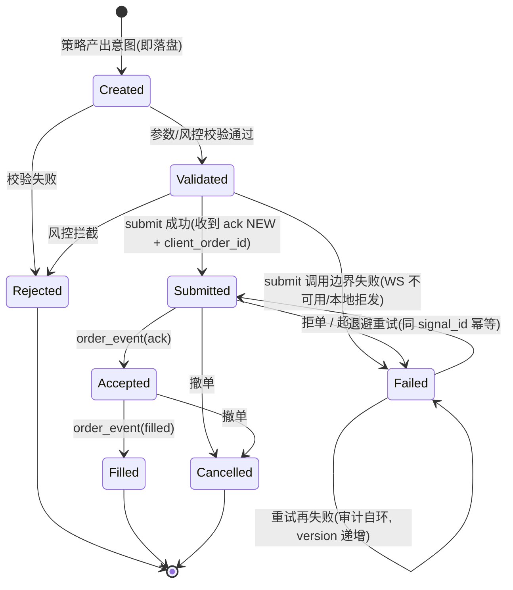
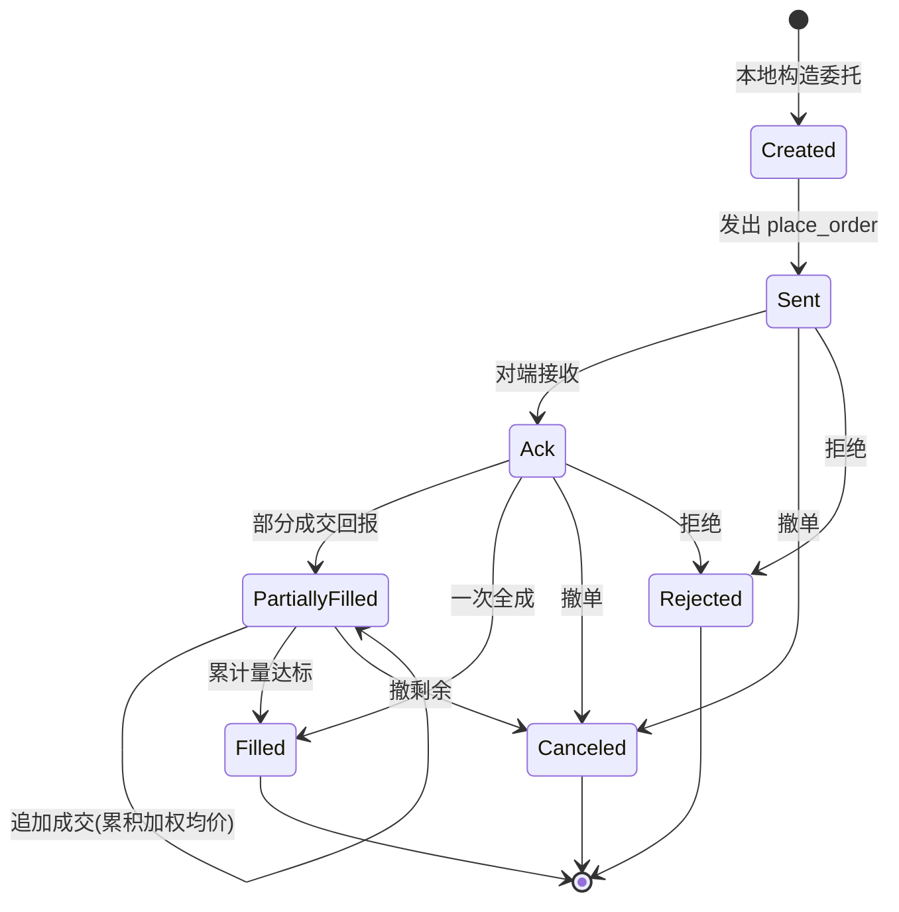
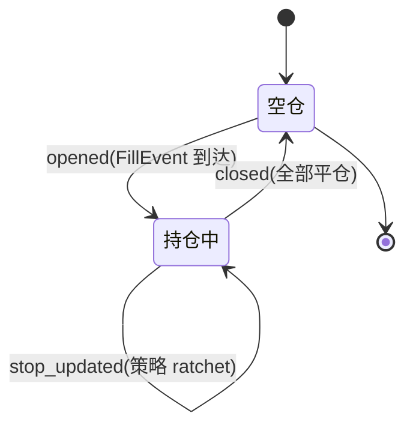
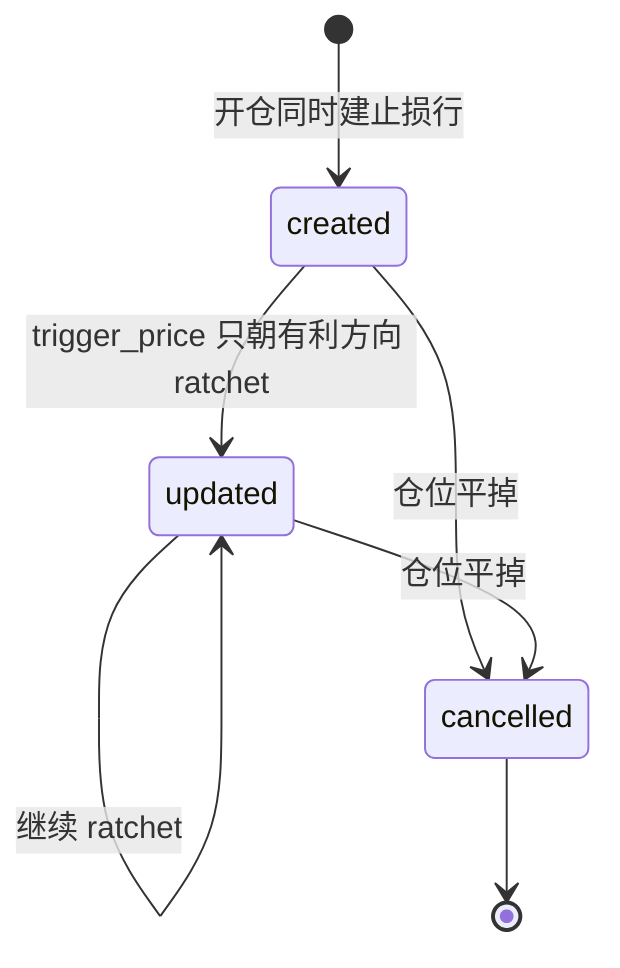
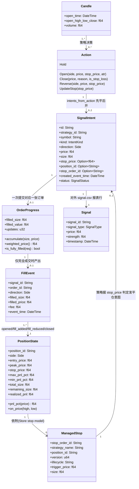
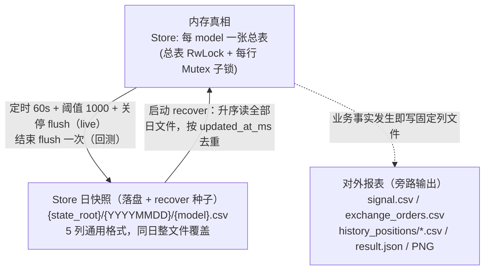
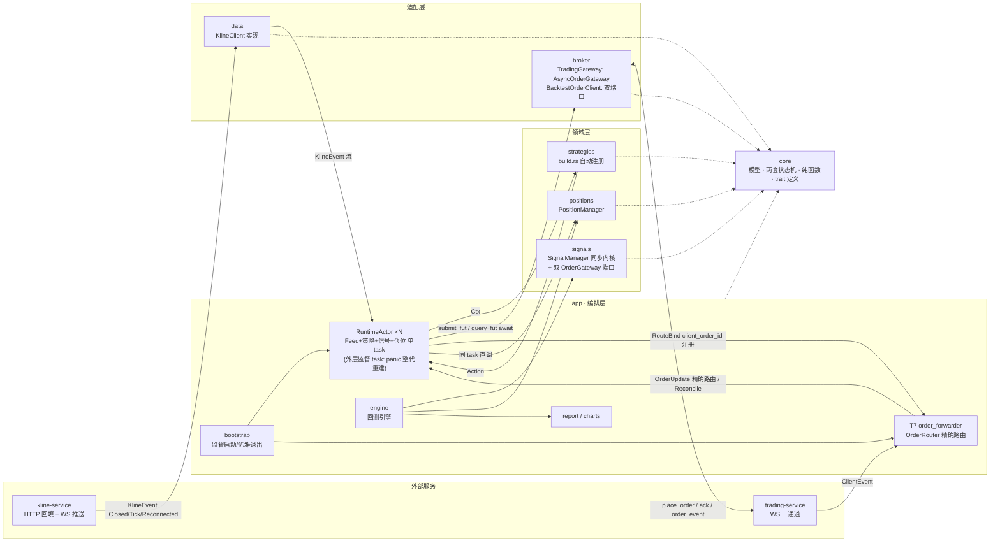
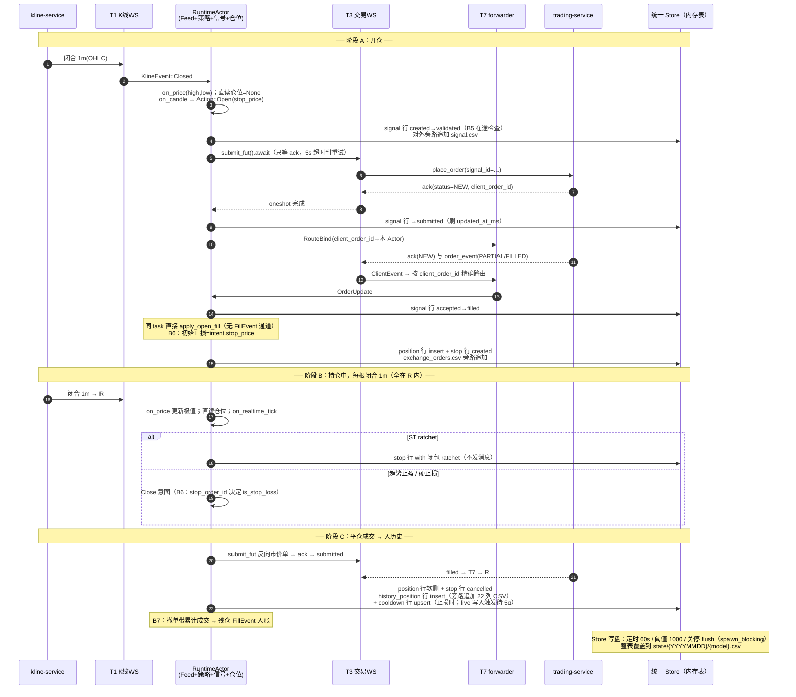

# strategy-rs 开发设计文档

> 依据《怎么样做设计.md》模板产出：**状态机 → 模型 → 模块接口 → 流程图**，
> 每节配一张验收表格。内容全部对齐当前代码，
> 引用处标注 `文件:行` 便于核对。
>
> **2026-09-16 更新（统一 Store 重构 S1–S8）**：信号/仓位/止损/冷却/历史仓/
> 成交/净值 7 类 model 的内存与持久化统一到新 crate `strategy-store`
> （Store + ModelTable：总表 RwLock + 每行子锁，日快照
> `{state_root}/{YYYYMMDD}/{model}.csv`，墓碑 + 跨日 recover）。旧的
> append-only 事件日志（signal_events/position_events/stop_events）、
> tmp+rename 快照（snapshots/）、position.json/cooldown.json、回测三报表
> （backtest_trades.csv / backtest_equity.csv / {tf}_equity.csv）已全部删除；
> 本文 §2.3 数据字典、§3.2 crate 边界、§4 时序中的落盘步骤已按 Store 改写。
> 状态机（§1 信号 8 态 / 订单 7 态）语义未变。
>
> 相关文档：`docs/live-signal-position-flow.md`（实盘链路细节）、
> `contracts/*.md`（外部服务消息契约）。

---

## 目录

0. [系统定位与红线](#0-系统定位与红线)
1. [状态机设计（State Diagram）](#1-状态机设计state-diagram)
2. [模型设计（Class / ER Diagram）](#2-模型设计class--er-diagram)
3. [模块与接口设计（Component Diagram）](#3-模块与接口设计component-diagram)
4. [流程图设计（Sequence Diagram）](#4-流程图设计sequence-diagram)
5. [设计一览与验收清单](#5-设计一览与验收清单)

---

## 0. 系统定位与红线

Rust 版 CTA 策略框架。流水线：

```
kline-service → 策略 → 信号管理（生命周期/统一 Store/重试/对账）
              → 订单网关 → 仓位管理（统一 Store） → trading-service
```

回测与实盘**共用同一套** Strategy trait、信号状态机、信号/仓位同步内核；
差异在适配器（`BacktestOrderClient` vs `TradingServiceClient`）与 Store 时钟
（回测 CandleClock=K 线 open_time；live EpochClock）。

| 红线 | 约束 | 代码落点 |
|------|------|----------|
| 确定性 ID | `signal_id = sig_ + sha256({策略类型}_{币种}_{1m时间戳ms}_{信号类型})[..16]` | `core/src/signal.rs:127` |
| 禁 now() | signal_id/信号时间/回测产物只取 K 线时间；`Ctx` 不暴露时钟（live Store 元数据时间走 EpochClock，不进 ID/报表） | `core/src/strategy.rs:6`、`store/src/lib.rs:25` |
| 禁未来函数 | 策略只能读 `Ctx::closed_data()`（已闭合序列） | `core/src/strategy.rs:16-21` |
| 信号是客观事实 | Created 即入 Store（随定时/关停 flush 落盘），Rejected/Failed 同样可审计 | `signals/src/manager.rs`（Store `signal` model） |
| 默认不发真单 | `submit_enabled=false`；paper_trading 强制 false | 配置 `services.trading` |
| 单写者 | 信号、仓位由同一个 RuntimeActor 串行写（Step2 后含策略决策） | `app/src/runtime_actor.rs` |

---

## 1. 状态机设计（State Diagram）

> **口诀：框里写名词（状态），箭头上写动词（事件）。**
>
> 本项目有 **4 个独立状态机**：信号（8 态）、订单（7 态）、仓位聚合、止损单。
> 信号与订单**刻意分离**——信号是"策略意图的档案"，订单是"交易所侧执行"，
> 一条信号可能因重试对应多次提交。

### 1.1 信号生命周期（8 态）

`crates/core/src/lifecycle.rs`



**状态流转表（验收 Checklist）** — 对应测试 `lifecycle.rs:115-186`

| 当前状态 | 触发事件 | 目标状态 | 是否允许 | 备注 |
|----------|----------|----------|----------|------|
| Created | 校验通过 | Validated | ✅ | — |
| Created | 校验失败 | Rejected | ✅ | 终态，不下单 |
| Created | 直接提交 | Submitted | ❌ | 不可跳级 |
| Validated | ack NEW（拿到 client_order_id） | Submitted | ✅ | **ack 返回后才落 submitted** |
| Validated | submit 抛错 | Failed | ✅ | 无 order_id 的边界失败 |
| Submitted | order_event(ack) | Accepted | ✅ | 推送可省略，filled 时自动补边（`signals/src/manager.rs:292-305`） |
| Submitted | 超时/断连 | Failed | ✅ | `FailureKind::Retryable` |
| Submitted | REJECTED 拒单 | Failed | ✅ | `FailureKind::Rejected`，不重试 |
| Submitted | 直接成交 | Filled | ❌ | 必须先 Accepted |
| Accepted | order_event(filled) | Filled | ✅ | 产出 FillEvent |
| Accepted | 撤单 | Cancelled | ✅ | 终态 |
| Accepted | 回退提交 | Submitted | ❌ | 不可回退 |
| Failed | 退避到期 | Submitted | ✅ | 仅 Retryable |
| Failed | 重试再失败 | Failed | ✅ | 自环，version 递增留痕 |
| Failed | 直接接受 | Accepted | ❌ | 重试必须重新提交 |
| Rejected/Filled/Cancelled | 任意 | 任意 | ❌ | 终态不可出 |

**恢复语义**：`is_pending()` = {Created, Validated, Submitted, Accepted}，
重启时 Created/Validated 以 signal_id 幂等重提；Submitted/Accepted
`query_fut` 恒返回 Retryable（trading-service 无订单查询协议），保留状态等
`order_event` 推送；Failed 走重发。

### 1.2 订单状态机（7 态）

`crates/core/src/order.rs`；与 `contracts/trading-service.md:68-73` 的 state 字段一一对应。



| 当前状态 | 触发事件 | 目标状态 | 是否允许 | 备注 |
|----------|----------|----------|----------|------|
| Created | 发送 | Sent | ✅ | — |
| Created | 收到 ack | Ack | ❌ | 不可跳过 Sent |
| Ack | 部分成交 | PartiallyFilled | ✅ | 累积进 `OrderProgress`，**不发 FillEvent** |
| PartiallyFilled | 再次部分成交 | PartiallyFilled | ✅ | 自环，`is_fully_filled` 容差 1e-9 |
| PartiallyFilled | 完全成交 | Filled | ✅ | **仅此刻产出 FillEvent** |
| PartiallyFilled | 拒绝 | Rejected | ❌ | 已有成交只能撤不能拒 |
| Ack | 回退 | Sent | ❌ | 不可回退 |

### 1.3 仓位聚合与止损单

仓位本身无枚举状态，用生命周期动作表达状态推进；当前态常驻统一 Store 的
`position` model（平仓软删除，`positions/src/manager.rs`）。



止损单当前态是 Store `stop` model（`ManagedStop`，id=`stop_{position_id}_sl`），
`lifecycle` 字符串三态，终态留审计（不再有独立 Triggered 态——触价平仓由策略
在 `on_realtime_tick` 内判定，成交后止损单随仓位平掉而 cancelled）：



| model（Store） | 生命周期动作 | 当前态写入 | 副作用 |
|------|------|-----------|--------|
| `position` | opened | insert（id=position_id） | 同时 insert `stop`(created) |
| `position` | fill_added / fill_reduced | with 闭包更新，`remaining_size` 增减 | — |
| `position` | price_updated | with 闭包更新 peak / max_pnl / min_pnl | — |
| `position` | closed | 软删除（deleted=1） | insert `history_position`（只增）+ 旁路追加历史固定列 CSV + `stop` cancelled →（止损平仓）upsert `cooldown` 冷却日 |
| `stop` | created / updated / cancelled | upsert 同一 stop_order_id | trigger_price ratchet；终态不删 |

> 平仓三件事（`positions/src/manager.rs` `apply_close_fill`）：①写
> `history_position` 行并旁路追加 22 列历史 CSV（写失败只告警不阻断）
> ②软删 `position` 行、`stop` 置 cancelled ③`is_stop_loss=true` 时写
> `cooldown` 冷却日，策略当日不再开仓。
>
> 已知遗留（待 Phase 5α）：live 止损平仓的冷却**写入触发**尚缺
> `is_stop_loss` 角色透传（存储/读取/Ctx 注入管道已通），回测路径已生效。

---

## 2. 模型设计（Class / ER Diagram）

### 2.1 三层建模在本项目的对应

| 层 | 本项目载体 |
|----|-----------|
| 概念模型 | 下方类图：Candle / Action / SignalIntent / FillEvent / PositionState / ManagedStop |
| 逻辑模型 | Rust 类型 + serde 契约（枚举 snake_case 字符串名**稳定**，直接进 payload_json） |
| 物理模型 | 统一 Store：进程内总表（RwLock 索引 + 每行子锁）+ 日快照 `{state_root}/{YYYYMMDD}/{model}.csv`（5 列通用格式）；无数据库、无 append 事件日志 |

### 2.2 核心类图



**三个容易混淆的模型必须记住**：

1. `Signal` ≠ `SignalIntent`。前者是**对外报表行**（signal.csv，列序契约锁定），
   后者是**管道内的意图 + 生命周期状态**（`core/src/signal.rs:146-193`）。
2. `position_id` = **开仓信号的 signal_id**，身份贯通全链路（也是 Store
   `position` / `history_position` model 的行 id）；止损单 ID =
   `stop_{position_id}_sl`（Store `stop` model 的行 id）。
3. `Action::Reverse` 在 `intents_from_action` 产出 **2 条意图，平仓永远在前**
   （`core/src/signal.rs:258`）。

### 2.3 数据字典（物理落盘）

#### 2.3.0 两层持久化关系（先看清谁读谁）

进程内唯一真相是 `strategy-store::Store`：每个 model 一张总表
（`RwLock<HashMap<id, Arc<Mutex<行>>>>`：总表锁只护索引，拿到行句柄即释放，
每行一把独立子锁）。CRUD 只动内存；**日快照 CSV 是 Store 的落盘形态兼
恢复种子**，对外固定列报表是旁路输出，二者链路完全不同。



| 维度 | Store 日快照 | 对外报表 |
|------|------|---------|
| 读者 | **程序自己**（启动 `Store::recover` 的种子） | **人 / 下游工具**，决策路径不读回 |
| 写法 | 同日整文件**覆盖**（tmp+rename）；跨日新文件 | **追加**一行，永不重写 |
| 保留内容 | 每个 id 一行最新状态（deleted=1 墓碑同行携带） | 每条事实一行，只增不改 |
| 内容形态 | 通用 5 列 + `payload_json`（model 完整 JSON） | 展开的业务字段，**列序锁定** |
| 写入时机 | live：定时（默认 60s）/每 1000 事件/关停；回测：结束一次 | 事实发生即写，立即 `flush()` |
| 删掉的后果 | 恢复丢失最近一个快照周期的状态（当日既有快照 + 墓碑兜底） | 数据永久丢失，代码无从重建 |
| 回测下 | Store 照常 flush 到 `state/{YYYYMMDD}/`（K 线时钟，确定性） | 照常产出，逐字节复现基线 |

#### 2.3.A 统一 Store — 7 个已注册 model

`Store::table::<T>()` 按 `Model::NAME` 在同一 Store 内永远返回同一张表
（live 全进程共享一个 `Arc<Store>`，base=`output_dir/state`；回测引擎
独占一个 Store）。

| model `NAME` | Rust 类型 | 行 id 键 | 生命周期 |
|------|------|------|------|
| `signal` | `signals::manager::ManagedSignal` | `intent.id`（signal_id） | 8 态全留，含 Rejected/Failed/Cancelled 终态 |
| `position` | `positions::manager::ManagedPosition` | `state.position_id` | 开仓 insert；平仓软删除（deleted=1） |
| `stop` | `positions::manager::ManagedStop` | `stop_order_id`（`stop_{position_id}_sl`） | created/updated/cancelled，终态留审计 |
| `cooldown` | `positions::manager::Cooldown` | `strategy_name` | 止损平仓 upsert 当日冷却日 |
| `history_position` | `positions::history::HistoryPosition` | `position_id` | 平仓 insert，只增 |
| `trade` | `app::report::TradeRow` | `trade_{signal_id}` | 每笔成交一行（开仓 pnl=0），只增；回测注册 |
| `equity` | `app::report::EquityPoint` | `eqd_/eqt_` 前缀桶 id | daily/tf 两 kind 同表确定性 upsert；回测注册 |

> 多实例去重约束：`signal_id = sha(策略类型_SYMBOL_K线时间戳_信号类型)`，
> 含策略**类型名**不含实例名。同类型+同 symbol+同周期+同 K 线+同信号类型的
> 两个实例（仅参数不同）在共享 `signal` 表会被全局去重；当前命名拓扑
> `{type}_{TF}_3_{SYMBOL}_{MODE}` 不触发该情形。

#### 2.3.B 日快照 CSV — 物理格式、墓碑与恢复

所有 model 同一套 5 列（`store/src/persist.rs`）：

```
id,deleted,created_at_ms,updated_at_ms,payload_json
```

- `deleted`：0/1。软删行当日仍落盘（1）；跨日 flush 时物理清出内存、转入
  墓碑区，**墓碑持续进入后续每个日快照**，保证跨日恢复不复活。同 id 重新
  insert 时旧墓碑失效。
- `created_at_ms` / `updated_at_ms`：毫秒时间戳。upsert 保留 created、刷新
  updated；`with()` 读写算闭包结束也刷新 updated。时钟注入：live
  `EpochClock`（UTC 墙钟），回测 `CandleClock`（当前 K 线 open_time）。
- `payload_json`：model 完整 serde JSON（snake_case 契约）。
- 恢复：`Store::recover::<T>()` 升序读 base 下全部 8 位数字日目录中的
  `{NAME}.csv`，同 id 取 `updated_at_ms` 最大者；最终 deleted=1 的进墓碑、
  不回活行；坏行 fail-open（跳过该记录并继续，待 Phase 5 收紧）。
- 写入：同一日文件整文件覆盖（非 append）；旧日文件保留，历史可查。
- 锁纪律：行子锁只在同步闭包期间持有，`with(id, |row| …)` 闭包内
  **禁止 await、禁止调用网关**；flush 走 `spawn_blocking`，不持行锁跨线程
  等待（多实例共享同一 Store 重复 flush 仅重复覆盖同一文件）。

#### 2.3.C 对外报表 — 列序锁定（与改造前逐字节一致）

| 文件 | 表头字段 | 定义处 |
|------|---------|--------|
| `signals/{name}/signal.csv` | `strategy_name,signal_id,timestamp,user_id,signal_action,symbol,pos_type,cash,leverage,side,exchange,trigger_price,order_type,quantity`（14） | `signals/src/writer.rs:10` |
| `{name}/exchange_orders.csv` | `signal_id,symbol,exchange,leverage,pos_type,price,side,exchange_order_id,exchange_order_status,exchange_order_price,exchange_order_quantity,exchange_update_time`（12） | `broker/src/order_log.rs:74` |
| `state/history_positions/{name}/{YYYYMMDD}.csv` | `position_id,strategy_name,symbol,position_type,entry_price,exit_price,entry_time,exit_time,entry_timestamp,exit_timestamp,peak_price,stop_price,max_pnl_pct,min_pnl_pct,exit_reason,is_stop_loss,price_diff,pnl_pct,duration_seconds,atr_at_entry,trail_activated,trading_mode`（22） | `positions/src/history.rs:23` |

三张表均为 header-on-create（文件不存在时才写表头）+ append。

#### 2.3.D 回测成交与净值（Store model）

旧回测三报表（`backtest_trades.csv` / `backtest_equity.csv` /
`{tf}_equity.csv`）已删除。成交与净值改为回测 Store 的两个 model，随回测结束
唯一一次 flush 落到 Store 通用 5 列日快照，业务字段全部在 `payload_json`：

| 文件 | model | 行 id | payload_json 关键字段 | 定义处 |
|------|------|-------|------|--------|
| `state/{YYYYMMDD}/trade.csv` | `trade`（TradeRow） | `trade_{signal_id}` | trade_id(T%08 序号)、strategy_name、strategy_id、symbol、side、quantity、price、commission、slippage、pnl（开仓=0）、timestamp（K 线时间）、comment | `app/src/report.rs:101` |
| `state/{YYYYMMDD}/equity.csv` | `equity`（EquityPoint） | `eqd_{strategy_name}_{date}` / `eqt_{strategy_name}_{bucket_secs}`（防跨 kind 碰撞） | strategy_name、kind=daily/tf、label、bucket_secs、equity、cash | `app/src/report.rs:128` |

equity 同桶（daily=UTC 日；tf=信号周期对齐桶）每根 1m 同 id upsert，落盘行
保留桶内最后一根 1m 的值（旧日末语义）；回测报表（result.json/PNG）改从
`trade_rows()` / `daily_equity()` / `tf_equity()` 读 Store 表生成。

#### 2.3.E 行情数据

| 文件 | 表头字段 | 定义处 |
|------|---------|--------|
| `data/klines/{tf}/{SYMBOL}_{tf}.csv` | `timestamp,open,high,low,close,volume` | `data/src/csv_store.rs:1-5` |

桶时间语义 = `open_time`（左闭区间起点）；读取时容忍 `open_time` 列名别名与
ISO8601 时间。

#### 2.3.F 非通用快照的伴生产物

| 产物 | 内容 | 写时机 |
|------|------|--------|
| Store `position` / `stop` / `cooldown` model（日快照内的行，非独立文件） | `ManagedPosition`（PositionState 全字段）/ `ManagedStop` / `Cooldown{date}` | 开仓即 insert；价格·止损更新走行锁 `with()`；平仓软删 position、cancelled stop；止损平仓 upsert 冷却日，策略 Ctx 当日据此拒绝开仓 |
| `backtest_result.json` / 回测 config 快照 / `backtest_report.txt` / `backtest_analysis_report.md` / `charts/*.png`（3 张） | 回测报告与图表 | 回测结束（数据读自 Store trade/equity 表） |

#### 2.3.G 时间格式约定（项目内共 4 种，勿混用）

| 场景 | 格式 | 示例 |
|------|------|------|
| Store 快照 `created_at_ms`/`updated_at_ms` | epoch 毫秒整数（UTC） | `1757548800000` |
| K 线 CSV 的 `timestamp` | pandas 风格 `%Y-%m-%d %H:%M:%S%:z` | `2026-09-11 00:00:00+00:00` |
| 快照目录 / 历史仓位**文件名** | `YYYYMMDD` | `20260911/`、`20260610.csv` |
| 止损冷却日 | `YYYY-MM-DD` | `2026-09-07` |

> trade 行 payload 内另有 ISO 风格 `%Y-%m-%dT%H:%M:%S`（K 线时间，无尾缀时区），
> 与 K 线 CSV 的 pandas 风格不要混用。

---

## 3. 模块与接口设计（Component Diagram）

### 3.1 组件图

箭头 = 依赖/调用方向；`core` 只被依赖、不依赖任何业务 crate。

> **2026-09-15 终态更新（Phase 0–4 + Step2）**：live 每实例的策略 task、
> Signal Actor、Position Actor、Fill 桥接已合并为单个 **RuntimeActor**
> （同 task 内 Feed→策略→SignalManager→PositionManager，成交直入仓位、
> 无 FillEvent 通道、无跨 task 查仓），外层由监督 task 在 panic 时整代重建；
> live 下单走 `AsyncOrderGateway`（await，非 block_on）；T7 持
> order_id→Actor 路由表精确投递。下图已按终态更新；§4 时序细节以
> `live-signal-position-flow.md`（2026-09-15 重写版）为准。



### 3.2 crate 职责与边界

| crate | 职责 | 不允许做 |
|-------|------|---------|
| `core` | Candle/Timeframe、信号 8 态 + 订单 7 态、FillEvent、加减仓纯函数、Strategy trait、风控、确定性 ID | 任何 IO、任何 now() |
| `store` | 统一 model 门面：Store/ModelTable（总表 RwLock + 每行子锁）、Clock 注入、日快照 CSV、墓碑、跨日 recover | 理解 payload_json 业务语义、做决策 |
| `signals` | 信号全生命周期：入 Store→验证→提交→失败分类/重试→回调 Filled；Store `signal` model + 对外 signal.csv | 感知 WS / 重连 / 协议 |
| `positions` | 仓位唯一写者：开/加/减/平、峰值跟踪、止损价/回落止盈、止损冷却；Store position/stop/cooldown/history_position 四 model + 历史固定列 CSV | 直接下单 |
| `broker` | `BacktestOrderClient`、`TradingServiceClient`（WS 三通道+重连）、脚本化 mock（测试/联调，常规编译）、exchange_orders.csv | 决策 |
| `data` | KlineClient 端口与远程实现（单 `KlineEvent` 流）、Feed 1m 增量聚合、CSV、归档下载 | 决策 |
| `strategies` | 策略插件（example_dual_ma / example_mtf_trend），build.rs 自动发现注册 | 直接 IO / 直接下单 |
| `indicators` | SuperTrend / SAR / 效率比 / talib 封装（通用指标库） | 持有跨调用状态 |
| `app` | 回测引擎（独立 Store + CandleClock）、**RuntimeActor（live 单写者内核）+ order_router + 监督重启**、bootstrap 进程装配、配置、CLI、报告 | 承载业务规则 |

### 3.3 接口清单

**内部端口（trait，回测/实盘双实现）**

| 定义方 | 接口 | 签名 | 输入 | 输出 | 说明 |
|--------|------|------|------|------|------|
| `core`（提供） | `Strategy::on_candle` | `&mut self, &Ctx` → `Vec<Action>` | 已闭合 1m + PositionView | 动作列表 | 引擎保证**空仓时**调用 |
| `core`（提供） | `Strategy::on_realtime_tick` | 同上 | 同上 | 动作列表 | 引擎保证**有仓时**调用；默认空实现 |
| `core`（提供） | `ClosedSource::closed` | `Timeframe` → `Option<&[Candle]>` | 时间框架 | 升序已闭合序列 | 类型层面隔离未来函数 |
| `signals`（依赖） | `OrderGateway::submit` | `&SignalIntent` → `Result<String, SubmitError>` | 意图 | order_id | **同步端口，仅回测**；失败分 `Rejected`/`Retryable` |
| `signals`（依赖） | `AsyncOrderGateway::submit_fut/query_fut` | boxed future → `Result<String/OrderSnapshot, _>` | 意图/order_id | 同上 | **live 端口**（RuntimeActor await；runtime 内禁止 block_on） |
| `signals`（依赖） | `drain_ready_fills` | → `Vec<ReadyFill>` | — | 就绪成交 | 回测即时成交；TradingGateway live 恒空 |
| `data`（提供） | `KlineClient::backfill` | `(symbol, tf, bars)` → `Vec<Candle>` | 回填根数 | 升序已闭合 | async boxed future |
| `data`（提供） | `KlineClient::attach` | `(symbol, tf)` → `KlineStream` | — | 注册式接收端（进程级一条 WS 多 symbol 扇出；落后→`Lagged`） | 重连/Lagged 后由调用方 backfill 补缺 |

**RuntimeActor 消息接口（终态：跨 task 入口只剩三类）**

| 命令 | 载荷 | 来源 | 说明 |
|------|------|------|------|
| `OrderUpdate` | order_id, state, filled_size, avg_price, event_time | T7（按 order_id 精确路由，未知才广播） | 内部字段名；order_id 即服务端 client_order_id；filled_size/avg_price 对应协议 filled_quantity/filled_price；成交同 task 直入仓位 |
| `Reconcile` | — | T7 在交易 WS Reconnected 时 | 先查后发对账 |
| `Shutdown` | — | bootstrap Ctrl-C | 排空→快照 flush→退出 |

K 线（Closed/Tick/Reconnected）、策略决策、价格更新、止损修改全部在
RuntimeActor 内部完成（同 task 直调，无命令）。旧 Intent/PriceTick/
UpdateStop/Query/ApplyFill 命令均已删除。

**外部服务契约**（详见 `contracts/`）

| 服务 | 通道 | 消息 | 关键字段 | 说明 |
|------|------|------|---------|------|
| kline-service（依赖） | HTTP | 历史回填 | symbol, timeframe, bars | 返回升序已闭合 |
| kline-service（依赖） | WS | 订阅 / 推送 | closed / tick | 断线指数退避重连，上限 `reconnect_backoff_max_secs` |
| trading-service（依赖） | WS | `place_order` | option="place_order"、strategy_name、exchange、account、instrument、side(long/short)、order_type=market、price=0、quantity、**signal_id**（前向扩展字段，mock 幂等） | 按策略类型名各一条认证 WS 的懒连接池（HMAC 握手：URL query 带 strategy_name+nonce+HMAC-SHA256 签名）；开仓与平仓同一帧，方向相反 |
| trading-service（依赖） | WS | `ack` | status=NEW, client_order_id（服务端生成 0x+32hex） | 请求-应答；REJECTED 为永久拒绝；UNKNOWN 判 Retryable |
| trading-service（依赖） | WS | `order_event` | status, filled_quantity, filled_price | 事后状态流推送（NEW/PARTIAL/FILLED/CANCELED/REJECTED/UNKNOWN） |
| trading-service（依赖） | WS | `get_position` / `positions` | — | 仅持仓查询，**无订单查询协议**，重连对账靠重发未 ack 信号 + 等 order_event 推送 |

**配置契约**（`run` 必需，缺失 fail-fast）

```yaml
services:
  kline:   { backfill_url, ws_url, reconnect_backoff_max_secs }
  trading: { ws_url, request_timeout_ms, submit_enabled, reconnect_backoff_max_secs }
```

---

## 4. 流程图设计（Sequence Diagram）

### 4.1 主场景：实盘开仓 → 持仓跟踪 → 平仓入历史（2026-09-15 终态）

**事实**：
① `submit_fut().await` 只等 `ack(NEW)`，**成交异步**，filled 经 T7 精确路由回来，
通常落在后续多根 bar；② K 线 close 不出 Actor，策略判定用的 close 来自同 task Ctx；
③ 成交回报在**同一 task**直接入仓位内核，无 FillEvent 通道、无跨 task 查仓。



> 上图 Store 交互均为内存表写入（行锁闭包，不跨 await）；磁盘日快照按
> 定时/阈值/关停节奏 flush，启动经跨日去重 recover。完整注解版（含 ack/update
> 关系、残仓、监督重启、对账）见 `live-signal-position-flow.md`。

### 4.2 每根闭合 1m 的固定处理顺序（Step2 后全在 RuntimeActor 内）

`app/src/runtime_actor.rs::drive_bar`：

1. Feed 聚合出闭合 1m（无新闭合直接返回）；
2. `positions.on_price(high, low)` 在 Store position 行上更新峰值（close 不参与）；
3. **直读** `positions.position()` 得 `PositionView`（同 task，零消息）；
4. 有仓 → `on_realtime_tick`；无仓 → `on_candle`；
5. Action 分流：`UpdateStop` 同 task 直调 `update_stop`；
   `Open/Close/Reverse` 转 `SignalIntent` → 信号内核 prepare（B5 在途去重）
   → `submit_fut().await` → 就绪成交同 task 入账。

### 4.3 三种离场

以 `example_dual_ma.rs` 为参照（初始止损 + 信号离场）：

| 离场 | 判定用价 | 触发条件 | 产物 | is_stop_loss |
|------|---------|---------|------|-------------|
| 信号离场 | close | 快慢线反向交叉（无仓侧允许反向开仓） | `Action::Close` / `Reverse` | false |
| 硬止损 | close 或 high/low | `ExitPriceSource=Close` 用收盘价；`HighLow` 用影线 | `Action::Close` | true |
| 移动止损 | —（仅改价） | 策略经 `Action::UpdateStop` 只改止损价，不触发成交 | `Action::UpdateStop` | — |

### 4.4 场景覆盖表（验收依据）

| 步骤 | 正常路径 | 异常路径 | 补偿 / 重试 |
|------|---------|---------|-----------|
| 订阅 K 线 | `KlineEvent::Closed` 持续推送 | WS 断线 | 指数退避重连；`Reconnected` 触发历史补缺 |
| 策略决策 | 产出 Action | 策略 panic | **监督 task 整代重建**（B11）：重新订阅+事件重放，不拖垮其他实例 |
| 信号落盘 | created → validated | 校验失败/在途冲突 | Rejected 终态落盘可审计；B5 拦截在途重复 Open/Close |
| 提交下单 | ack(NEW) → submitted | REJECTED 永久拒绝 | Failed，不重试 |
| 提交下单 | — | 超时 5s / 断连 / UNKNOWN | Failed → 退避重发，同 signal_id 幂等 |
| 状态推送 | ack → filled | 跳过 ack 直接 filled | `handle_order_update` 自动补 accepted 边 |
| 成交入仓 | **同 task 直调 apply_*fill（无通道）** | — | 启动交叉对账补丢失成交（B4 根治） |
| 部分成交 | 累积，不发 FillEvent | 撤单时 filled_size>0 | B7：Canceled 分支产出残仓 FillEvent |
| 平仓 | position 软删 + stop cancelled + history_position（旁路 22 列 CSV）；止损时 upsert 冷却日 | 历史 CSV 写失败 | 只告警，不阻断 Store 平仓流程 |
| 止损冷却 | 回测读/写均生效；**live 读路径已通（每 bar 注入 Ctx），写入触发待 Phase 5α 透传 is_stop_loss** | — | 不得在 live 宣称已生效 |
| 进程重启 | Store recover（升序读全部日快照，updated_at_ms 去重，墓碑不复活） | 快照坏行 | fail-open 跳过（待 Phase 5 收紧）；recover 后幂等重提/先查后发（B3） |
| 回测 | 同参数重跑逐字节复现 | — | 关闭周期 flush，仅结束落一次当日快照（K 线时钟，墙钟不入产物） |

### 4.5 回测与实盘的路径差异（终态）

| 维度 | 回测 | 实盘 |
|------|------|------|
| 驱动 | 引擎单线程顺序驱动 | RuntimeActor：K 线事件驱动，3N+2 task |
| 成交时机 | `submit()` 内 inline 成交（同步 OrderGateway） | 异步 `order_update`（AsyncOrderGateway await），可能隔多根 bar；在途约束保护 |
| 仓位写入 | 引擎同步直调 `PositionManager` | RuntimeActor 同 task 直调（内核同一份代码） |
| Store 落盘 | 关闭周期 flush，结束 flush 一次 | 60s 定时 + 每 1000 事件阈值 + 关停各一次，整表覆盖写 spawn_blocking |
| Store 时钟 | CandleClock：元数据时间锚定 K 线 open_time | EpochClock（UTC 墙钟，仅 Store 元数据）；signal_id/信号时间仍只取 K 线时间 |

---

## 5. 设计一览与验收清单

| 章节 | 图示类型 | 核心功能 | 验收产出 | 本项目对应 |
|------|---------|---------|---------|-----------|
| 1 状态机 | 状态图 ×4 | 信号/订单/仓位/止损单的合法转移 | 状态流转表 | `can_transit` 单测穷举非法边 |
| 2 模型设计 | 类图 | 实体、字段、关联 | 数据字典 | 统一 Store（7 model 注册表）+ 日快照 5 列 + 对外固定列 CSV 列序 |
| 3 模块接口 | 组件图 | crate 边界与耦合方向 | 接口清单 | 3 个 trait 端口 + Actor 命令 + `contracts/` |
| 4 流程图 | 时序图 | 实盘全链路时间顺序 | 场景覆盖表 | mock 服务集成测试为可执行规格 |

### 5.1 测试门禁

```bash
cargo test --workspace
cargo clippy --workspace --all-targets -- -D warnings
```

229 测试覆盖：状态机、Store CRUD/墓碑/跨日 recover、信号重试/对账、仓位加减/
部分减仓、WS 三通道 mock 集成、Actor panic 整代重启、回测端到端确定性复现
与产物断言。

### 5.2 设计缺口收敛记录（2026-09-15 全部修复）

| # | 原缺口 | 修复 | 验证 |
|---|--------|------|------|
| 1 | FillEvent 无止损字段，PA 硬编码 false/"live_close"，冷却日 live 失效 | **B6**：FillEvent 加 `is_stop_loss/exit_reason/initial_stop`（serde default，CSV 零新列），Filled 时从意图填充 | signals 单测×2 |
| 2 | 开仓初始止损被替换为 0.98 占位 | **B6**：initial_stop 透传 intent.stop_price，0.98 仅兜底 | 集成测试断言 stop=98 |
| 3 | 无在途信号约束，可能重复开/平仓 | **B5**：prepare 内在 Created..Accepted 去重（Open 全局、Close 按 position_id），拒绝落审计；回测 inline 终态不受影响 | 状态表单测×2 |
| 4 | WS 重连对账未接线 | **B3**：启动对账 + T7 在 Reconnected 时下发 Reconcile（先查后发，幂等重提）；交叉对账补丢失成交 | e2e 3 例 |
| — | 其他 | B1 tick 陪葬、B2 block_on panic、B4 fill 通道丢失、B7 残仓、B8 广播噪音、B9 跨 task 查仓、B10 阻塞 IO、B11 无监督、B12 死代码 | 已核销（历史实施计划见 git 历史） |

> 仍待**联调验证**（非代码缺口）：trading-service 对 signal_id 的服务端回显
> 与幂等去重契约、真实重连乱序、按 symbol 共享 K 线 WS（KlineDispatcher 已删除，
> 需要时按真实需求重建）。

> 2026-09-16（统一 Store 重构）：回测成交/净值并入 Store `trade`/`equity`
> model，旧回测三张固定列 CSV（trades/daily equity/tf equity）删除，报告改读
> Store 表生成；signal.csv 无调用方的 `existing_signal_ids()` 死函数早已删除
> （回测路径每信号确定性写一行，无重复可能，不需要读回去重）。

### 5.3 通用填写规则（沿用模板）

1. 框里写名词（状态 / 实体 / 模块），箭头上写动词（事件 / 动作）。
2. 每张图必须配一张表格，作为开发与测试的共同验收依据。
3. 先画图再写代码；改代码若动了**状态转移**或 **CSV 列序**，必须同步改本文档。
