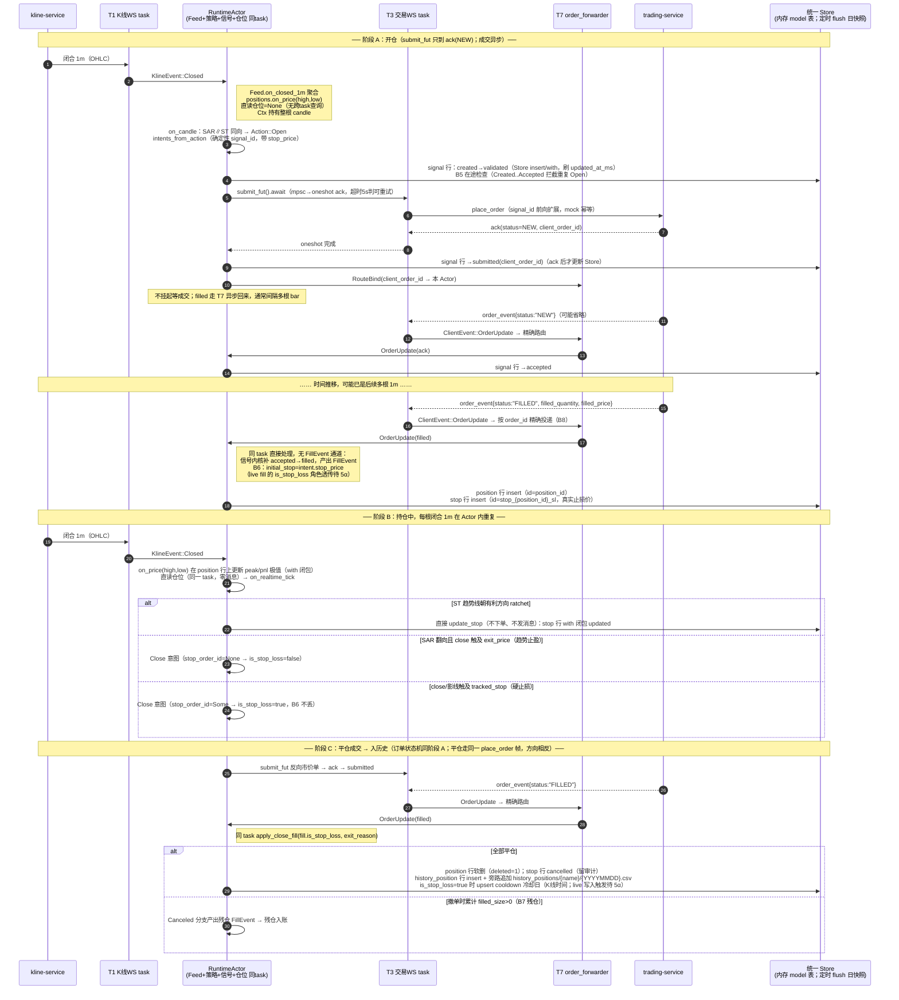

# 实盘链路：K 线 → RuntimeActor（策略/信号/仓位单 task）→ 交易所，及止盈止损时序

> **2026-09-15 终态（Phase 0–4 + Step2 全部落地后）**。实盘里**没有独立的止盈
> 止损单挂在交易所**——止盈止损由策略在每根**已闭合 1m K 线**上本地判断，
> 触及时发反向市价单，与手动平仓走同一条信号路径。
>
> 关键事实：
> - **单写者合并**：每 (策略 × symbol) 的 K 线消费、Feed 聚合、策略决策、
>   信号状态机、仓位内核全部在**同一个 RuntimeActor task** 内顺序执行；
>   成交在同 task 直接入账，**不再有 FillEvent 通道、没有跨 task 查仓**。
> - **K 线 close 只在 Actor 内部流转**：`positions.on_price` 只用 high/low
>   更新峰值；策略判定用的 close/high/low 来自同 task Ctx 里的闭合 1m。
> - **成交异步但同 task 顺序化**：`submit_fut().await` 只等 ack(NEW)；
>   filled 由 trading-service 事后推送，经 T7 精确路由回本 Actor，
>   落在后续事件循环——期间在途约束（B5）拦截重复开/平仓。
>
> **2026-09-16 更新（统一 Store，S1–S8）**：信号/仓位/止损/冷却/历史仓当前态
> 不再写事件 CSV/json，全部在进程级 `Arc<Store>` 共享表（7 个 model：
> signal/position/stop/cooldown/history_position/trade/equity；live 注册前 5 个，
> trade/equity 仅回测注册）。下图中"磁盘"步骤改为 Store 内存行写入；落盘节奏：
> live 定时 60s（`state_flush_interval_secs` 可配，0 回退 60）+ 每 1000 事件阈值
> + 关停各一次 `spawn_blocking` 整表 flush 到 `state/{YYYYMMDD}/{model}.csv`
> （5 列 + payload_json，跨日墓碑、启动跨日去重 recover）。旁路固定列文件只剩
> `history_positions/{name}/{YYYYMMDD}.csv` 即时追加（signal.csv /
> exchange_orders.csv 仅回测产出）。
>
> **已知遗留（待 Phase 5α，勿当已修）**：止损冷却的 live **写入触发**尚未通——
> live order_update 合成的 FillEvent 恒为 `is_stop_loss=false`（读路径已通：
> 每 bar 从 cooldown 表读冷却日注入 Ctx；存储管道已通）。

## 1. 参与方（终态 task 拓扑 3N+2）

| 角色 | 数量 | 职责 |
|---|---|---|
| **T1 K 线 WS task** | N | data crate 的 kline-service 连接（断线退避重连），单 `KlineEvent` 流（Closed/Tick/Reconnected）驱动 RuntimeActor |
| **RuntimeActor** | N | 单 task 独占：Feed + 策略对象 + SignalManager + PositionManager + async 网关调用；panic 由外层**监督 task** 整代重建（重新订阅+启动对账） |
| **T3 交易 WS task** | 按策略类型共享（懒连接池） | 与 trading-service 按策略类型各一条认证 WS（HMAC 握手）：submit 命令 + oneshot ack、order_event/Reconnected 外推；query_fut 恒返 Retryable（无订单查询协议） |
| **T7 order_forwarder** | 1（进程级） | `OrderRouter`：order_id→Actor 精确路由（B8），未知订单全量广播兜底；WS 重连时下发 Reconcile |

已删除的旧角色：独立策略 task T2、Signal Actor T4、Position Actor T5、
FillEvent 桥接 T6、panic watcher T8（策略 panic 归监督层，无需额外观察 task）。

## 2. 时序图：开仓 → 持仓止损跟踪 → 平仓入历史

### 2.1 ack 与 order_event（容易混淆点）

- **ack** 是下单请求的同步应答（服务端生成 `client_order_id=0x+32hex`；
  按 signal_id 精确或 FIFO 关联）：`status=NEW` 使 `submit_fut` 完成，
  随后落 submitted；`REJECTED`/`EXPIRED` 永久拒绝（Failed 不重试）；
  `UNKNOWN`/超时/断连可重试（Failed→退避重发，同一 signal_id 幂等）。
- **order_event** 是服务端状态流（NEW/PARTIAL/FILLED/CANCELED/REJECTED/
  UNKNOWN），经 T7 异步到达；可从 submitted 直跳 filled，内核自动补 accepted。
- filled 回报由 Actor 同 task 入账；**在下一个 filled/OrderUpdate 之前，
  Actor 内直读仓位即与信号状态一致**（无跨 task 异步窗口）。订单未成交期间
  策略由 B5 在途约束保护。

## 3. 关键机制（终态）

### 3.1 每根闭合 1m 的固定处理顺序（全部在 RuntimeActor 内）

`runtime_actor::drive_bar`（`crates/app/src/runtime_actor.rs`）：

1. `Feed.on_closed_1m` 聚合出闭合 1m（无新闭合直接返回）；
2. `positions.on_price(high, low)` 更新峰值/盈亏极值（close 不参与）；
3. **直读** `positions.position()`（同 task，零消息，B9 消解）；
4. 有仓走 `on_realtime_tick`，无仓走 `on_candle`；close/high/low 取自 Ctx；
5. Action 分流：`UpdateStop` → 同 task 直调 `positions.update_stop`；
   `Open/Close/Reverse` → `intents_from_action` → 信号内核 prepare
   （B5 在途去重）→ `submit_fut().await` → 就绪成交（回测型网关）同 task 入账。

### 3.2 三种离场（语义不变）

以下为**框架通用离场语义**（由 PositionManager 与 `Action` 变体支持），
不代表某个具体策略。教学 example 中：
- `example_dual_ma` / `example_mtf_trend` 只使用**硬止损** + **信号反转离场**
  （两者均发 `Action::Close`，不发 `Action::UpdateStop`）；
- **趋势止盈**（`exit_active` / `Action::UpdateExit`）与**移动止损**
  （`Action::UpdateStop` ratchet）由具备 SAR/Supertrend 类逻辑的策略使用，
  脚手架示例未包含。

| 离场 | 判定用价 | 触发 | 产物 | is_stop_loss |
|---|---|---|---|---|
| 趋势止盈 | **close** | SAR 翻向后 exit_active，close 触及 exit_price | `Action::Close` | false（exit_reason=live_close） |
| 移动止损 | —（仅改价） | ST 趋势线只朝有利方向 ratchet | `Action::UpdateStop` | — |
| 硬止损 | **close 或 high/low** | ExitPriceSource=Close 用收盘价；HighLow 用影线 | `Action::Close` | true（exit_reason=stop_loss） |

策略代重建/进程重启后，Store recover（position/stop 表跨日去重）重新播种
当前仓位与 stop_price，策略对象从 Ctx 读到跟踪止损价。

### 3.3 平仓三件事（PositionManager，同 task 调用）

1. **历史落盘**：`history_position` 表 insert（只增）+ 旁路追加
   `history_positions/{name}/{YYYYMMDD}.csv` 22 列（峰值、最大/最小盈亏、
   exit_reason、atr 等）；CSV 写失败只告警不阻断；
2. **软删当前态**：position 行 `deleted=1`（跨日清出内存并进墓碑）、
   stop 行置 cancelled（留审计）；
3. **止损冷却日**：`is_stop_loss=true` 时 upsert `cooldown` 行（K 线日期），
   策略入场前 Ctx 读 `stop_loss_cooldown()` 拦截当日新开仓。
   **回测读/写均生效；live 读路径已通（每 bar 注入 Ctx），但写入触发尚缺
   order_update 合成 FillEvent 时的 is_stop_loss 角色透传——待 Phase 5α，
   不得在 live 宣称已生效。**

### 3.4 身份贯通

- `position_id` = 开仓信号确定性 `signal_id`
  （sha256(`{策略}_{币种}_{1m时间戳ms}_{buy/sell}`) 前 16 hex）。
- 平仓意图携带 `position_id`；B5 在途约束按 position_id 对 Close 去重。
- 止损单 ID = `stop_{position_id}_sl`，即 Store `stop` model 的行 id
  （lifecycle：created/updated/cancelled）。

### 3.5 持久化：统一 Store + 旁路固定列 CSV

- **内部真相**：进程级 `Arc<Store>`（base=`output_dir/state`，EpochClock）。
  signal/position/stop/cooldown/history_position 五个 model 各自一张总表，
  行写入是同步内存操作（Created 立即入表，Rejected/Failed 同样留审计）；
  落盘统一为日快照 `state/{YYYYMMDD}/{model}.csv`
  （id,deleted,created_at_ms,updated_at_ms,payload_json，tmp+rename 覆盖；
  跨日墓碑 + 启动升序跨日去重 recover）。
- **flush 节奏（live）**：每 `state_flush_interval_secs`（默认 60s，配 0 回退
  60）一次 + 内核每 1000 事件置阈值标志一次 + 优雅关停无条件一次；三处最终都
  经 `spawn_blocking(store.flush)`（定时与阈值同轮去重只落一次）。
- **旁路固定列 CSV（下游契约，不经 Store 格式）**：live 仅平仓时追加
  `history_positions/{name}/{YYYYMMDD}.csv`（22 列）；signal.csv 与
  exchange_orders.csv 只在回测产出。

## 4. 故障恢复（已接线）

- **启动对账**（Actor 每代启动）：`positions.restore()`（Store recover
  position/stop/cooldown/history_position 四表）→ 信号 `recover()`（Store
  recover signal 表，仅首代执行；Created/Validated 以 signal_id **幂等重提**；
  Submitted/Accepted **先 query**）→ 交叉对账（信号 Filled 但仓位缺失 →
  query 合成 fill 补开仓）。坏快照行 fail-open 跳过（待 Phase 5 收紧）。
- **WS 重连**：交易 WS Reconnected 经 T7 下发 `Reconcile`，先查后发；
  K 线 WS Reconnected 触发历史补缺 backfill。
- **panic 监督**（B11）：策略/网关/Store 写 panic → 外层监督 task 线性退避后
  整代重建（新策略对象、新网关、Store 跨日去重恢复 + 事件重放），外层句柄不变；
  Ctrl-C：Shutdown 排空箱内命令 → 全 Store flush（spawn_blocking + join 等待）
  → 8s 超时退出。
- **在途约束**（B5）：Created..Accepted 的 Open 拦截重复 Open；
  同 position_id 的 Close 在途去重；Filled/Cancelled/Failed 释放。
- **残仓**（B7）：撤单时累计 filled_size>0 → 残仓 FillEvent 入账，
  信号仍终结于 Cancelled。

### 仍需联调验证（mock 覆盖不到）

- trading-service 对 `signal_id` 的服务端回显与幂等去重（对账重提依赖此契约；当前 mock 已支持，真实服务前向扩展）；
- 真实 WS 重连时序、order_event 乱序/重复投递；
- 止盈止损为**闭合 1m 粒度**，从触发到成交有"一根 bar + 异步成交"滑点；
- trading-service 无服务端条件单。
